# BIMcred Core Features

| Field | Value |
| --- | --- |
| Document | Product specification, core features |
| Owner | Product / orchestration |
| Status | Approved for local MVP build |
| Version | 1.0 |
| Last updated | 2026-11-17 |
| Scope | Candidate, Employer and Admin portals, LOC assessment, MVP cut-line |
| Out of scope | Real payments, production SMS, native mobile apps, international candidates |

This document is the behavioral contract for the BIMcred prototype. Where it conflicts with a mockup, this document wins. Where it conflicts with the frozen stack (Next.js 15 App Router, TypeScript strict, Tailwind v3, Prisma with PostgreSQL, server actions, cookie sessions, bcryptjs), the stack wins.

---

## 1. Problem and positioning

### 1.1 The US BIM labor market

BIM and VDC hiring in the United States runs on claims that are expensive to test. A candidate resume says "Revit", "Navisworks", "ISO 19650" and "coordination"; an employer has no reliable way to distinguish a production technician from someone who has watched a coordination meeting. The result is predictable:

- Screening is referral-heavy and network-bound. Firms hire people they already know, which limits geographic and firm-type mobility.
- Job boards optimize for application volume, not signal. A posting for a BIM coordinator can attract hundreds of applicants with near-identical keyword profiles.
- Software certifications prove tool familiarity, not delivery judgment. Knowing where a command lives does not prove that someone can scope a clash test, defend an LOD table, or allocate model reliance risk.
- Recruiters and staffing agencies sit in the middle with opaque pricing, variable screening quality and no portable evidence of competence.
- Candidates, especially students and career changers, cannot benchmark themselves against the market. They get feedback only after a rejection.

The market is also structurally fragmented. Owners, architecture and engineering firms, contractors, trade contractors and facility operators each describe BIM competence differently. A shared vocabulary exists (ISO 19650, NBIMS-US, LOD/LOIN, COBie, IFC) but it has not been turned into a comparable, verified candidate signal.

### 1.2 The wedge: verification plus a comparable LOC

BIMcred is a talent-first B2B platform. The wedge is not "another AEC job board"; it is a verified unit of competence:

1. A candidate creates a free profile and verifies a US mobile number.
2. The candidate completes a timed, 15-question BIM assessment.
3. The platform publishes a LOC (Level of Competence) score from 100 to 500, a band, and a competency breakdown.
4. Employers pay to search and filter verified, scored candidates, and spend credits to unlock contact details.

Verification matters because it raises the cost of fake and duplicate profiles. The LOC matters because it gives both sides a shared unit to discuss, in the same way a credit score gives a lender and borrower a shared starting point. Neither is sufficient on its own:

- Verification without assessment produces clean but undifferentiated profiles.
- Assessment without verification produces scores that anyone can generate repeatedly under fake identities.

### 1.3 Why incumbents fail at this

| Incumbent type | Strength | Structural failure BIMcred exploits |
| --- | --- | --- |
| General job boards | Distribution and SEO | No domain screening, no verified skill signal, application spam, no LOC-like comparison |
| AEC niche job boards | Audience relevance | Still resume-keyword based; no assessment, no standardized score, no employer-side filtering on competence |
| Software certification programs | Brand recognition | Tool-centric, not delivery-centric; tests command knowledge; expensive and slow to update; not a hiring filter |
| Staffing agencies and recruiters | Human judgment, placement relationship | Opaque margin, inconsistent screening, no portable candidate asset, candidate pays with leverage |
| University and association credentials | Legitimacy | Lag market practice; not comparable across programs; not a live signal for a specific hire |
| Portfolio and project galleries | Evidence of work | Easy to misattribute work; no structured competency data; no verification |

None of these combine identity verification, a defensible assessment, a portable score and a paid employer search surface. That combination is the product.

### 1.4 Positioning statement

> For US BIM professionals who are tired of being reduced to a keyword list, BIMcred is a free, verified profile with a scored, portable measure of competence. For employers who need to hire BIM talent without relying on referrals, BIMcred is the only searchable pool of verified, scored candidates with competency-level filters and credit-based contact.

### 1.5 Non-goals for MVP

- Not a freelance marketplace. No bidding, contracts, timesheets or payments to candidates.
- Not a training provider. The assessment measures current competence and does not award a course credential.
- Not a background check. BIMcred does not verify employment history, criminal records or education in MVP.
- Not an ATS replacement. The employer pipeline is a lightweight tracker for BIMcred-sourced applicants.
- Not an international product. MVP requires a US mobile number and US work eligibility signal.

---

## 2. Personas

| Persona | Context | Goals | Pains | Primary success metric |
| --- | --- | --- | --- | --- |
| Student / recent graduate | Community college, university or trade program; limited project experience | Prove potential, get a first BIM role, benchmark against peers | Resume has coursework but no project evidence; no professional network; application black holes | Completes assessment and receives at least one employer view within 30 days |
| Active job seeker | 1-5 years in AEC, looking for a better role or firm | Be discovered without applying to hundreds of postings; control who sees contact details | Keyword screening; recruiter spam; cannot prove coordination ability in an interview | Profile visible, 3+ unlocks, interview within 45 days |
| Working professional (passive) | Employed BIM technician, coordinator or manager; not actively looking | Maintain a private, verified credential; evaluate market options discreetly | Visibility risk with current employer; no time for long assessments | Claims LOC once, keeps profile hidden, responds to a small number of high-fit unlocks |
| Hiring manager | Architecture, engineering or construction firm; owns a BIM team | Fill a role quickly with someone who can actually coordinate models | Screening takes weeks; referrals dry up; candidates overstate software skill | Time-to-shortlist under 7 days; 50%+ of unlocks reach a conversation |
| BIM director / VDC lead | Owns standards, technology and delivery quality across projects | Raise team competence, compare candidates on delivery judgment, reduce bad hires | No common competency framework; interviews are inconsistent; certification noise | Hires who pass 90-day review; team LOC distribution improves |
| Recruiter / talent partner | Agency or internal talent acquisition | Source qualified BIM candidates quickly; justify shortlists to clients | No structured evidence; duplicate candidates; manual screening | Shortlist acceptance rate; speed to present 3 candidates |
| Admin / operations | Runs verification, trust and support | Keep the pool clean, fair and credible; resolve disputes | Fraud, duplicate identities, ambiguous verification evidence, legal exposure | Verification SLA, fraud catch rate, audit completeness |

Persona priority for MVP: active job seeker and hiring manager first, student and BIM director second, recruiter and passive professional third, admin continuously.

---

## 3. Feature map

Release tags follow MoSCoW in substance: **MVP (Must)**, **V1 (Should)**, **V2 (Could)**. Acceptance criteria are written so a reviewer can pass or fail the behavior by hand.

### 3.1 Feature map diagram

```mermaid
flowchart TD
    subgraph Candidate["Candidate portal"]
        C1["Free signup and US mobile verification"]
        C2["Profile builder with completeness score"]
        C3["Timed 15-question assessment"]
        C4["LOC score, band and competency radar"]
        C5["Visibility, privacy and retake controls"]
        C6["Job feed, apply and application tracker"]
    end

    subgraph Employer["Employer portal"]
        E1["Company verification"]
        E2["Plan-gated talent search and filters"]
        E3["Shortlist and comparison view"]
        E4["Credit-based contact unlock"]
        E5["Job posting and applicant pipeline"]
        E6["LOC explainer and invoices"]
    end

    subgraph Admin["Admin portal"]
        A1["KPI dashboard"]
        A2["Verification queue"]
        A3["Question bank and LOC calibration"]
        A4["Credits, plans and feature flags"]
        A5["Fraud signals and audit log"]
        A6["Support inbox"]
    end

    subgraph Shared["Shared services"]
        S1["Cookie session auth and RBAC"]
        S2["LOC scoring engine and bank versioning"]
        S3["Credit ledger"]
        S4["Audit events and analytics"]
        S5["Rate limits and abuse controls"]
    end

    C1 --> S1
    C3 --> S2
    C4 --> S2
    C5 --> S4
    E1 --> A2
    E2 --> S5
    E4 --> S3
    E4 --> S4
    E5 --> S4
    A3 --> S2
    A4 --> S3
    A5 --> S4
```

### 3.2 Candidate portal

| ID | Feature | Release | Behavior | Acceptance criteria |
| --- | --- | --- | --- | --- |
| C-01 | Free signup | MVP | Email, password, name, country fixed to US. No card, no trial, no candidate paywall. | A new user can sign up with a unique email; password min 10 chars; duplicate email returns a field error; session cookie is httpOnly; no employer or admin route is reachable with a candidate session. |
| C-02 | US mobile verification | MVP | Collect phone, normalize to E.164, validate NANP, send a 6-digit OTP, verify within 10 minutes. Dev mode uses fixed OTP `000000` and labels the screen "development mode". | `+1` is enforced; `(415) 555-0142` normalizes to `+14155550142` in dev mode; invalid area codes and N11 area codes are rejected; production mode also rejects the reserved `555-0100`-`555-0199` test range, with a named dev-mode exception for the demo number; 5 wrong OTP attempts locks the code; resend blocked for 60 seconds; a third send in an hour is blocked; one phone number can verify at most one active account; success sets `phoneVerifiedAt`. |
| C-03 | Profile builder | MVP | Headline, current title, city and state, years of experience, software, project types, sectors, work authorization, availability, work mode, desired salary band, bio, portfolio URLs, resume URL. Live completeness score. | Completeness is a 0-100 integer with fixed weights: headline 15, location 15, current title 10, at least one year 10, at least one discipline 15, three or more tools 15, bio of 60+ characters 20. Saving any field recomputes it without a reload; the assessment CTA enables only at 100 in the prototype; the checklist shows exactly which fields remain; whitespace does not count as complete. |
| C-04 | Timed assessment | MVP | 15 questions, 900 seconds, one page with progress, answer autosave, review before submit, server-enforced elapsed time. | Starting the attempt records `startedAt` and creates an attempt row; timer displays remaining time; submission more than 120 seconds after the timer ends is rejected and recorded as expired; refreshing the page does not reset the timer; one candidate can have only one in-progress attempt. |
| C-05 | LOC result | MVP | Show LOC 100-500, band, weighted accuracy, correct count, per-competency radar and strengths/gaps. Explanations are available after submission. | Submitting all-correct answers returns 500 and Expert; an empty submission returns 100 and Emerging; the 10 competency rows sum to the bank item count; the score is identical on reload; no answer key is present in the assessment payload before submission. |
| C-06 | Retake policy | V1 | First attempt immediately after profile completion. Retake after a 14-day cooldown. Maximum 3 attempts per rolling 180 days. Displayed LOC is the best score in the window, with the latest attempt date and attempt count. The prototype ships one immutable attempt and disables retake. | V1 build: a second attempt before 14 days is blocked with the exact eligible date; a fourth attempt inside 180 days is blocked; all attempts are listed to the candidate; the employer card shows the best score, band and age; score history is immutable. |
| C-07 | Verified badge | MVP | Badge shown when the US mobile number is verified and at least one attempt is complete. Badge state is derived from data, not stored as a free-floating flag. | A candidate with an unverified phone has no badge even after scoring; a candidate with a verified phone but no completed attempt has no badge; the badge tooltip names the two conditions; removing verification is impossible without admin action, so the badge cannot be lost accidentally. |
| C-08 | Visibility controls | MVP | Three states: hidden, visible to verified employers (default), public profile. Public is explicit opt-in. | Default after signup is employers-only; hidden candidates return zero search results and cannot be unlocked; switching to public requires a confirmation checkbox; switching back to hidden removes the public page within one render and from the sitemap. |
| C-09 | Job feed | V1 | List of published employer jobs filtered by candidate work mode, location, years and software. MVP shows a simple published-jobs list after assessment. | Only published, non-expired jobs appear; a hidden candidate still sees the feed; filters are URL-addressable; empty state explains how to widen filters. |
| C-10 | Apply and tracker | V1 | One-click apply using the BIMcred profile, optional note, tracker states Applied, Screening, Interview, Offer, Hired, Rejected, Withdrawn. | Applying twice to the same job is idempotent; the employer pipeline receives the application in the same transaction; candidate can withdraw until Hired; status changes show a timestamp and are visible to the candidate. |
| C-11 | Privacy controls | MVP | Download my data (V1), delete my account (MVP request), hide phone from employers until unlock, consent record for SMS. | Delete request sets status pending-deletion, immediately removes the profile from search, and purges PII within 30 days; consent timestamp and policy version are stored; candidate can revoke SMS consent. |
| C-12 | Public profile and SEO | V2 | Opt-in public profile at `/p/[slug]` with LOC band, competencies and headline. No contact details, no exact employer history. | Public page is `noindex` unless the candidate opted in; opt-in adds it to the sitemap; opting out returns 404 and removes it from search engines on next crawl; page contains Person and occupation structured data. |
| C-13 | Skill-gap guidance | V2 | Link low-scoring competencies to learning resources and suggested project exercises. | Recommendations are deterministic from the lowest two competency scores; BIMcred does not sell placements in MVP; resource links are labelled external. |
| C-14 | Notifications | V1 | In-app notifications for unlock, application status, retake eligibility and verification outcome. Email is stubbed in the prototype. | Unread count matches unread rows; marking read is idempotent; no notification contains another candidate's PII. |
| C-15 | Resume handling | V1 | MVP accepts a resume URL and a plain-text summary. V1 adds PDF upload with size and type validation. | URL must be https; upload rejects files over 5 MB and non-PDF types; extracted text is never used to change the LOC. |

### 3.3 Employer portal

| ID | Feature | Release | Behavior | Acceptance criteria |
| --- | --- | --- | --- | --- |
| E-01 | Company signup and verification | MVP | Company name, domain, size, HQ, contact, role. Employer can search in a limited trial state before verification but cannot unlock. Manual admin verification. | Unverified employer sees a banner and a capped result set; unlock is blocked with reason "verification pending"; admin approval sets `verifiedAt` and unlocks search; rejecting requires a reason visible to the employer. |
| E-02 | Plan-gated talent search | MVP | Search verified, scored, visible candidates only. Plan controls result cap, filters and credits. | Hidden or unscored candidates never appear, even with a direct URL; search requires an employer session; expired plan shows an upgrade state instead of results; result cap is enforced server-side, not only in the UI. |
| E-03 | Talent filters | MVP | LOC band and range, competency minimums, years, state/metro, work mode, availability, software, project type, verified-only, freshness. | Filters combine with AND; competency filters require `byCompetency.pct >= n`; clearing all filters restores the default list; unknown filter values are ignored, not fatal; filter state survives pagination. |
| E-04 | Shortlist | MVP | Add and remove candidates, private notes, private tags, shareable within the company. | Shortlist is per company, not per user; duplicate add is idempotent; removing does not consume or refund a credit; notes are visible only to company members; shortlisting does not reveal contact data. |
| E-05 | Credit-based unlock | MVP | Spend 1 credit to reveal verified contact details and full LOC breakdown. Unlock is recorded and candidate is notified. | Balance cannot go negative; the same candidate is not charged twice by the same company; concurrent unlock requests result in one charge; unlock returns 402-style state with balance when credits are insufficient; candidate sees who unlocked and can report abuse. |
| E-06 | Job posting | MVP | Title, description, location, work mode, seniority, software, salary band, visibility, expiry. | Draft to published requires title, description, location and one role family; published jobs appear in the candidate feed within one request; expiry defaults to 60 days; employer can close early; closed jobs accept no new applications. |
| E-07 | Applicant pipeline | MVP | Kanban with Applied, Screening, Shortlisted, Interview, Offer, Hired; Rejected and Withdrawn as terminal states. | Drag or button change persists immediately; terminal states require no reason but store the actor; candidate sees the same status; moving backward is allowed and audited; concurrency conflict shows the latest state rather than silently overwriting. |
| E-08 | Saved searches | V1 | Save filter sets with a name and optional alert preference. | Saving requires at least one filter; names are unique per company; loading a saved search reproduces the same result count at the same data snapshot; deleting is soft and audited. |
| E-09 | Comparison view | V1 | Compare up to 4 candidates on LOC, band, competency pcts, years, software and availability. | Comparing more than 4 is blocked; candidates without a score cannot be compared; missing data renders as "Not provided", not zero; print view fits one page. |
| E-10 | LOC explainer card | MVP | Plain-language explanation of the score, band, weighted accuracy, recency and what the assessment does not measure. | Card is reachable from every candidate card; it states LOC is a signal, not a sole hiring criterion; it shows bank version and attempt date; it never exposes item answers. |
| E-11 | Invoices and receipts | V2 | Plan invoices, credit pack receipts, credit ledger. MVP uses admin-granted credits and a read-only ledger. | Every credit movement has a ledger row and a reason; totals reconcile; only company admins can view invoices; no card data is stored by BIMcred. |
| E-12 | Team seats and roles | V1 | Company admin, recruiter, viewer. Seat count plan-gated. | Viewer cannot unlock or change pipeline; removing a seat revokes sessions on next request; the last company admin cannot be removed. |
| E-13 | Messaging | V2 | In-app threaded messaging after unlock. MVP reveals email and phone instead. | Messaging requires a prior unlock; candidates can block a company; messages are retained for 24 months for disputes. |
| E-14 | Hiring analytics | V2 | Funnel by job, time to shortlist, unlock-to-reply rate, source mix. | Metrics reconcile with raw event counts; no candidate-level protected attributes appear; exports exclude contact data. |

### 3.4 Admin portal

| ID | Feature | Release | Behavior | Acceptance criteria |
| --- | --- | --- | --- | --- |
| A-01 | KPI dashboard | MVP | Candidates, verified candidates, scored candidates, weekly unlocks, credits consumed, jobs, applications, verification backlog and report queue. | Every KPI has a definition tooltip; numbers are computed from the same queries used by the portals; date range defaults to last 30 days; empty database renders zeros rather than errors. |
| A-02 | Verification queue | MVP | Candidate phone exceptions, employer company verification, reported profiles. Approve, reject, request more information. | Queue is oldest-first with SLA age; decisions require a reason code; approval and rejection are audited; employer approval immediately changes search and unlock permissions. |
| A-03 | Question bank analytics | V1 | Per item: exposure, p-value (proportion correct), point-biserial discrimination, distractor distribution, median time, flag state. MVP shows counts and correct rate. | p-value and discrimination recompute from stored attempts; an item with p-value below 0.20 or discrimination below 0.15 can be flagged; flagged items stay live until an admin publishes a new bank version; no item edit mutates historical scores. |
| A-04 | LOC distribution and calibration | V1 | LOC histogram by band, median, attempt distribution, score-change on retake, freshness. Recalibration tooling versions the bank. | Changing any item answer, difficulty or active state requires a new `bankVersion`; existing attempts retain their original version and score; a recalibration preview shows affected candidates before publish; admins cannot edit a candidate's score directly. |
| A-05 | Credit and plan overrides | MVP | Grant or deduct credits, change plan, extend trial, waive verification. Every action is ledgered. | Manual adjustment requires a reason and cannot create a negative balance; overrides are visible to the employer in the ledger; admin cannot delete ledger rows, only append compensating entries. |
| A-06 | Fraud and abuse signals | V1 | Duplicate phone, duplicate device fingerprint (if collected), test-time anomalies, unlock velocity, IP velocity, multiple accounts per number, candidate reports, employer unlock-to-reject patterns. | Signals are advisory and never auto-ban; each signal links to evidence; resolving a case requires a disposition code; false-positive dismissal is audited. |
| A-07 | Audit log | MVP | Append-only record of authentication, verification, credit, score-policy, visibility, admin and unlock events. | Each row has actor, action, entity type, entity id, timestamp, request id and a redacted metadata blob; logs are not editable in the UI; a candidate can see their own unlock and visibility history. |
| A-08 | Feature flags | MVP | Flags for assessment enabled, public profiles, employer self-serve signup, retake changes, new search filters, dev OTP visibility. | Flag changes take effect without a deploy; each change is audited with before and after; flags have a description and owner; dev OTP visibility cannot be enabled in production mode. |
| A-09 | Support inbox | V1 | Threads from candidates and employers, macros, linked account context. | Reply is stored with author and timestamp; linking a thread shows account status but not passwords or OTPs; closing requires a resolution category. |
| A-10 | Content moderation | V1 | Review job posts, employer names, candidate bios and portfolio links for spam and prohibited content. | Reported content is hidden pending review; admin can restore with a reason; repeat-offender companies can be suspended without deleting history. |
| A-11 | Compliance tooling | V2 | Export, deletion verification, retention job status, adverse-impact dashboard. | Deletion job produces a verifiable completion record; exports exclude secrets; adverse-impact views aggregate and suppress small cells. |

---

## 4. The LOC model as a product feature

### 4.1 What LOC means

LOC stands for Level of Competence. It is a 100-500 integer built from a fixed, difficulty-weighted 15-item assessment. The naming is deliberate: it borrows the LOD idea of progressive definition and applies it to people. A higher LOC means a candidate answered more of the harder items correctly under a 15-minute time box, not that they have a certain number of years of experience.

- **100-199, Emerging.** Recognizes vocabulary and concepts; limited applied judgment.
- **200-299, Developing.** Handles routine tasks; needs review on coordination, standards and exchanges.
- **300-399, Competent.** Independent on common workflows; can own a defined workstream with normal QA.
- **400-449, Proficient.** Leads coordination and information-management decisions; can defend trade-offs.
- **450-500, Expert.** Cross-discipline command under time pressure; suitable for program-level leadership.

Scoring is specified in `src/lib/loc.ts` and must not be reimplemented in UI code:

- Item weights: difficulty 1 = 1, difficulty 2 = 2, difficulty 3 = 3.
- Weighted accuracy = earned weight / 28 available weight.
- LOC = clamp(round(100 + weighted accuracy x 400), 100, 500).
- Unanswered and unknown items score zero. Duplicate answers use the last submission.
- The band is always derived from LOC, so the two cannot disagree.

The competency weights in `COMPETENCIES` do not change the headline LOC. They rank strengths and gaps and drive the radar chart. This separation is intentional: one number for the market, ten numbers for the conversation.

`strengths` is the top two competencies with pct at least 70, ranked by competency weight times pct. `gaps` is the bottom two competencies with pct below 60, ranked ascending by the same product. Ties break on pct, then competency key, so results are deterministic. Both arrays contain human-readable labels.

### 4.2 How employers should read it

| Employer question | Correct reading | Incorrect reading |
| --- | --- | --- |
| Is this candidate technically credible? | The score is one verified data point among profile, projects and interview. | The score replaces the interview. |
| Can they do the specific job? | Check the competency pcts and band against the role's actual demands. | A 400 means they can do every BIM role. |
| Are they current? | Check attempt date and bank version. | An old score describes current ability with certainty. |
| Should we reject a 280? | A 20-minute assessment has error; use it to prioritize, not to filter out. | A 280 is unhireable. |
| Is the score comparable? | Comparable across candidates on the same bank version and rules. | Comparable to certifications, degrees or years of experience. |

The employer card must always show: LOC, band, attempt date, bank version, top three competency pcts, and one sentence stating that LOC is a skills signal and not a sole hiring criterion.

### 4.3 Anti-gaming

- **Time box.** 900 seconds enforced on the server; late submissions are recorded as expired. The item set is not published.
- **Difficulty weighting.** Three difficulty-3 items carry 9 of 28 weight. The correct options are balanced across a, b, c and d; in bank version 1 no single fixed letter exceeds 8 of 28 weight, so uniform guessing lands in the Developing band at best.
- **No answer key before submit.** The assessment payload contains prompts and options only.
- **Attempt limits (V1).** One attempt per 14 days, three per 180 days; the best score is displayed, so retaking until lucky has diminishing returns and is visible as an attempt count. The MVP records one immutable attempt to keep the prototype scorable and auditable.
- **Identity binding.** One verified phone per account; duplicate-phone checks and unlock/attempt velocity monitoring.
- **Bank rotation (V1).** Anchor items remain common for comparability; rotated items reduce memorization. Any rotation creates a new bank version.
- **No self-reported inputs in the score.** Years of experience, software lists and education do not affect LOC.

LOC is still an imperfect proxy. It measures a sample of knowledge under time pressure, not collaboration, judgment under ambiguity or site experience. The product must say so wherever the score appears.

### 4.4 Calibration and quality control

| Activity | Cadence | Rule |
| --- | --- | --- |
| Item review by two BIM subject-matter experts | Before bank publish and annually | Both must agree on answer and explanation; disagreement blocks publish. |
| p-value review | Monthly once n >= 30 per item | Flag below 0.20 (too hard or miskeyed) or above 0.95 (too easy, low information). |
| Discrimination review | Monthly once n >= 30 per item | Flag point-biserial below 0.15; review distractor pull for miskeyed items. |
| Timing review | Monthly | Flag items with median time over 90 seconds or skipped by more than 30 percent of attempts. |
| Bank versioning | Every content or key change | New `bankVersion`; historical attempts keep their version and score. |
| Distribution monitoring | Weekly | Track band mix and median LOC; investigate sudden shifts before changing anything. |
| Recalibration | Only with evidence | Preview impact, publish with notice, never retroactively rewrite a candidate's score. |

### 4.5 Legal and fairness guardrails

- LOC is a **signal**, not a decision. Every employer-facing surface must state that it must not be the sole hiring criterion.
- BIMcred does not collect protected attributes for scoring. Optional self-identification for adverse-impact monitoring is separate, aggregate-only and never shown to employers.
- No scoring input is a proxy for a protected class. Location is used for employer filtering, not scoring. Names and schools are not scored.
- Automated rejection is prohibited. Employers can filter and prioritize, but a human must make the hiring decision.
- Adverse-impact monitoring uses the four-fifths rule as a screening heuristic, not as a legal conclusion, and triggers human review of items and marketing channels.
- Candidates can see their breakdown, request human review of a disputed score and request deletion.
- Counsel review is required before paid launch. The MVP is a product prototype, not legal advice.
- SMS verification requires explicit consent with a stored timestamp and policy version; opt-out is honored.
- No claim of "certification" or "accreditation" is made for LOC in MVP.

---

## 5. Non-functional requirements

| Area | Requirement | Verification |
| --- | --- | --- |
| Performance | p95 server render under 800 ms for candidate dashboard and employer search at 10,000 seeded candidates. | Load script with 50 concurrent users; p95 recorded in the release checklist. |
| Assessment latency | Autosave server action under 300 ms p95; submit under 600 ms p95. | Instrumented timing in staging; failure shows a retryable inline error, never loses the selected answer. |
| Availability | 99.5 percent monthly target for V1. Local prototype has no uptime commitment. | Uptime monitor on `/api/health` in V1. |
| Accessibility | WCAG 2.1 AA: keyboard-complete assessment, visible focus, 4.5:1 text contrast, labelled form errors, no color-only band meaning. | Manual keyboard pass plus axe scan on candidate, employer and admin critical paths. |
| Mobile-first | Candidate flows usable at 360 px width; assessment one question per viewport section with sticky timer; employer search usable but optimized for desktop. | Device checks at 360, 768, 1280 px. |
| Browser support | Latest two versions of Chrome, Edge, Firefox and Safari. | Smoke test matrix per release. |
| Security | bcrypt cost 12, httpOnly SameSite=Lax session cookie, secure cookie in production, session rotation on login, server-side authorization on every action, CSRF protection via SameSite plus origin check, rate limits on auth and OTP. | Action-level authorization tests; negative tests for cross-company access. |
| Privacy | OTP hashed at rest, no PII in application logs, contact details encrypted at rest in production, least-privilege admin views. | Log audit and schema review. |
| SEO | Public profiles opt-in only; default `noindex`; sitemap generated from opted-in profiles; removal on opt-out. | Fetch page before and after opt-in; check meta robots and sitemap. |
| Data retention | OTP 10 minutes; sessions 30 days; raw attempts 24 months; audit log 24 months; deleted accounts purged within 30 days; backups 7 days. | Retention job dry-run report. |
| Auditability | Every credit, score-policy, verification, visibility and admin action is append-only with actor and request id. | Attempt to mutate an audit row through the UI; verify no path exists. |
| Observability | Structured logs with request id, error boundary with user-safe message, analytics events listed in section 7. | Trigger a forced error and confirm no stack trace reaches the browser. |
| Internationalization | English only, US date and currency formatting. | Not applicable beyond formatting checks. |

---

## 6. Pricing and packaging logic

All prices below are the current prototype plan catalogue. They must be validated with design partners before paid launch and are not market facts.

| Plan | Audience | Price | Included | Key limits |
| --- | --- | --- | --- | --- |
| Trial | New employer evaluating the pool | USD 0 | 10 credits, 3 active job posts, 1 seat, candidate previews | No advanced filters, no pipeline, no analytics, no export |
| Starter | Small firm or occasional hiring manager | USD 149/month, or USD 119/month billed annually | 25 credits, 3 seats, 10 active jobs, LOC and competency filters, CSV export of unlocked candidates | No pipeline, no analytics, email support next business day |
| Growth | AEC team hiring several BIM/VDC roles | USD 399/month, or USD 319/month billed annually | 75 credits, 10 seats, unlimited jobs, pipeline with stage analytics, shared notes | Fair-use search cap |
| Enterprise | National firm with procurement and security review | USD 1,200/month, or USD 960/month billed annually | 250 credits, unlimited seats, SSO, audit log, public API and webhooks, custom DPA | Contractual, 99.9 percent uptime SLA |
| Credit pack | Any paid plan | USD 199 per 10 credits (V2) | One-time top-up | Not in the prototype; expires 12 months after purchase |

### 6.1 Why credits, not per-seat-only

- **Value aligns with action.** Employers pay when they choose to contact a specific candidate, not for browsing. That keeps search broad and lowers the perceived risk of trying the product.
- **Candidate privacy is enforceable.** Unlimited contact access would turn the pool into a scrapeable database. A credit price creates friction against mass unlocking and makes abuse detectable.
- **Seat pricing punishes collaboration.** Hiring involves a manager, a director and sometimes a recruiter. Charging per seat discourages sharing shortlists. Credits let a company distribute access without metering every viewer.
- **Predictable unit economics.** Each unlock has a measurable cost of acquisition and support. Credits make contribution margin per employer computable from day one.
- **Expansion is natural.** A firm that hires more spends more credits without renegotiating seats.

### 6.2 Rules

- Candidates never pay, and paid placement is not sold in MVP.
- A credit is consumed on unlock, not on view, shortlist or compare.
- Re-unlocking the same candidate by the same company is free for 90 days.
- Credits are refunded automatically if the candidate is deleted, hidden or otherwise not unlockable at the moment of unlock.
- No refund for candidate non-response; that is a quality signal, not a billing event.
- Admin-granted credits in the prototype follow the same ledger rules as paid credits.
- Pricing changes require 30 days notice to active paid employers.

---

## 7. Metrics and instrumentation

### 7.1 North star

**Weekly verified, scored candidates who are unlocked by a paying employer and respond within 14 days.** This is the only metric that simultaneously proves supply quality, demand willingness to pay and marketplace liquidity. Placements are the long-term outcome but are too slow and too noisy for weekly operation.

Supporting definitions:

- Verified and scored: phone verified, at least one completed attempt, profile completeness at least 70.
- Unlocked: a credit-consuming contact reveal by a verified employer.
- Responded: candidate reply, application stage advance or explicit contact acknowledgement recorded in-product.

Initial operating targets below are hypotheses for the prototype, not market statistics. They must be replaced with observed baselines after the first 100 employers.

| Funnel step | Event | Target (hypothesis) |
| --- | --- | --- |
| Signup to phone verified | `candidate.phone.verified` / `candidate.signup.completed` | 70 percent |
| Phone verified to assessment completed | `candidate.assessment.completed` / `candidate.phone.verified` | 55 percent |
| Assessment completed to visible profile | visibility state = employers | 80 percent |
| Employer search to shortlist | `employer.candidate.shortlisted` / `employer.search.executed` | 8 percent |
| Shortlist to unlock | `employer.contact.unlocked` / `employer.candidate.shortlisted` | 25 percent |
| Unlock to candidate response in 14 days | response event / `employer.contact.unlocked` | 35 percent |
| Trial to paid | `employer.plan.upgraded` / trial start | 15 percent |

### 7.2 Guardrail metrics

- Assessment completion time and abandonment rate; abandon above 25 percent triggers a UX review.
- Retake score change distribution; a large average gain suggests item leakage.
- Unlock-to-reply rate by employer; below 15 percent triggers a quality review and possible credit policy change.
- Candidate report rate per 100 unlocks; any report is reviewed within one business day.
- Duplicate-phone and multi-account detections; false-positive rate tracked.
- OTP delivery success and cost per verified candidate.
- Search zero-result rate; above 20 percent means filter defaults or supply gaps.
- Adverse-impact ratio on aggregate outcomes, reviewed quarterly.
- Refund rate and support contacts per 100 unlocks.

### 7.3 Instrumentation events

Event names are exact and dotted. Every event carries `occurredAt`, `actorId`, `actorRole`, `requestId`, `sessionId` and `appVersion`.

| Event | Trigger | Required properties |
| --- | --- | --- |
| `candidate.signup.started` | Signup form first interaction | `source` |
| `candidate.signup.completed` | Account created | `userId`, `referrer` |
| `candidate.phone.otp_requested` | OTP send accepted | `channel`, `attemptNumber`, `devMode` |
| `candidate.phone.verified` | OTP accepted | `userId`, `normalizedPhoneHash` |
| `candidate.phone.failed` | OTP rejected or locked | `reason`, `attemptNumber` |
| `candidate.profile.updated` | Profile save | `completeness`, `changedFields` (names only) |
| `candidate.assessment.started` | Attempt row created | `attemptId`, `attemptNumber`, `bankVersion` |
| `candidate.assessment.question_answered` | Answer saved | `attemptId`, `questionId`, `elapsedSeconds` |
| `candidate.assessment.submitted` | Submit action | `attemptId`, `answeredCount`, `elapsedSeconds` |
| `candidate.assessment.completed` | Score persisted | `attemptId`, `locScore`, `band`, `rawScore`, `bankVersion` |
| `candidate.assessment.expired` | Server rejects late submit | `attemptId`, `elapsedSeconds` |
| `candidate.loc.generated` | LOC result rendered for candidate | `attemptId`, `locScore`, `band` |
| `candidate.retake.requested` | Retake CTA | `eligible`, `daysRemaining` |
| `candidate.visibility.changed` | Visibility toggle | `from`, `to` |
| `candidate.job.viewed` | Job detail opened | `jobId`, `source` |
| `candidate.application.submitted` | Application created | `jobId`, `applicationId` |
| `candidate.application.withdrawn` | Candidate withdraws | `applicationId` |
| `employer.verification.submitted` | Company details submitted | `companyId`, `domainType` |
| `employer.search.executed` | Search results rendered | `filterHash`, `filterKeys`, `resultCount`, `plan` |
| `employer.candidate.viewed` | Candidate card opened | `candidateId`, `locBand`, `unlocked` |
| `employer.candidate.shortlisted` | Shortlist add | `candidateId`, `locBand` |
| `employer.compare.opened` | Comparison opened | `candidateCount` |
| `employer.contact.unlocked` | Credit spend succeeds | `candidateId`, `creditsSpent`, `balanceAfter`, `locBand` |
| `employer.unlock.blocked` | Unlock rejected | `candidateId`, `reason` (`no_credits`, `unverified`, `hidden`) |
| `employer.job.published` | Job goes live | `jobId`, `roleFamily`, `workMode` |
| `employer.pipeline.stage_changed` | Application stage move | `applicationId`, `from`, `to`, `actorId` |
| `employer.saved_search.created` | Saved search created | `savedSearchId`, `filterKeys` |
| `employer.plan.upgraded` | Trial or plan change | `fromPlan`, `toPlan`, `creditsAdded` |
| `employer.invoice.viewed` | Invoice opened | `invoiceId` |
| `admin.employer.verified` | Admin approves company | `companyId`, `reasonCode` |
| `admin.candidate.flagged` | Fraud signal raised | `candidateId`, `signal`, `severity` |
| `admin.credit.adjusted` | Manual ledger entry | `companyId`, `delta`, `reason` |
| `admin.loc.recalibrated` | New bank version published | `fromVersion`, `toVersion`, `affectedAttempts` |
| `admin.feature_flag.changed` | Flag toggled | `flagKey`, `from`, `to` |
| `admin.flag.reviewed` | Fraud case disposition | `flagId`, `disposition`, `reasonCode` |
| `support.ticket.created` | Support thread opened | `channel`, `category`, `requesterRole` |
| `support.ticket.closed` | Thread resolved | `ticketId`, `resolutionCategory` |

Analytics must never include raw phone numbers, email addresses, OTPs, passwords or full resumes. Use hashes or ids.

---

## 8. MVP cut-line

### 8.1 What ships in the local prototype

| Area | Ships | Notes |
| --- | --- | --- |
| Auth | Candidate and employer email/password signup, login, logout, cookie sessions, bcrypt hashing, role checks | Admin is seeded or promoted by script |
| Phone | E.164 normalization, NANP validation, rate limits, dev OTP `000000` | No SMS provider call |
| Profile | Full candidate profile, completeness score, visibility states | Resume is a URL, not an upload |
| Assessment | 15-question bank, 900-second timer, autosave, server-side elapsed check, one active attempt, one completed attempt per candidate | Retakes are disabled in the prototype |
| LOC | Full scoring engine, bands, competency breakdown, strengths/gaps, immutable attempt record | Bank version fixed at 1; retake policy is V1 |
| Employer | Verification request, search with core filters, shortlist, credit unlock, job post, pipeline kanban, LOC explainer | No saved searches, no comparison |
| Credits | Ledger, plan field on company, admin grants, insufficient-credit state | No payment provider |
| Admin | KPI dashboard, verification queue, credit override, audit log, feature flags, fraud signal list | Question analytics read-only counts |
| Jobs | Publish, list, apply, withdraw, stage changes | Email notifications stubbed |
| Data | PostgreSQL via Prisma (Neon free tier), seed script with demo candidates, employers and jobs | No migration history yet; schema pushed with `db push` |
| Analytics | Events persisted to a local table and emitted to server logs | No external analytics vendor |
| Docs | This spec and inline code documentation | No marketing site |

### 8.2 What is stubbed or deferred

| Deferred item | Stub behavior | Target release |
| --- | --- | --- |
| Real SMS delivery | Dev OTP `000000`; UI shows a development banner | V1 |
| Payments and invoicing | Admin grants credits; ledger is read-only for employer | V2 |
| Email notifications | In-app notification rows only | V1 |
| Resume upload and parsing | URL field and plain-text summary | V1 |
| Background jobs | Cooldowns and expiry computed on read | V1 |
| Public SEO profiles | Route exists behind a flag, default off | V2 |
| Messaging | Contact reveal only | V2 |
| Saved searches and compare | Hidden behind flags or absent | V1 |
| Retake policy | One immutable attempt; retake UI is disabled and the cooldown/limit policy is documentation only | V1 |
| Managed Postgres scaling | Free tier already live; migrations, replica and PITR are not configured | V1 |
| Question rotation and equating | Fixed 15-item bank, version 1 | V1 |
| Adverse-impact dashboard | Manual query only | V2 |

### 8.3 Manual acceptance test for a reviewer

Run in order on a clean database. Expected results are exact.

1. Open the app as an anonymous visitor. Confirm `/candidate`, `/employer` and `/admin` redirect to login.
2. Sign up as a candidate with a fresh email. Confirm you land on phone verification, not the dashboard.
3. Enter `(415) 555-0142`. Confirm the normalized value is `+14155550142` and the OTP screen appears. Enter `000000`. Confirm verification succeeds and `phoneVerifiedAt` is set.
4. Enter an invalid number such as `(115) 555-0142`. Confirm a field error explains the US area-code rule.
5. Complete every profile field: headline, city and state, current title, at least one year, a discipline, three tools, and a 60-character bio. Confirm completeness reaches 100, each checklist item is marked, and only then does the assessment CTA enable.
6. Start the assessment. Confirm the timer starts at 15:00, answer three questions, refresh the page, and confirm the answers and remaining time persist.
7. Submit with some wrong answers. Confirm a LOC between 100 and 500, the band matches the score, the radar shows the named competencies, and strengths/gaps match the documented thresholds.
8. Confirm the attempt record shows one attempt with a submitted timestamp, and the retake control is disabled with an explanation that retakes are a V1 policy.
9. Sign out, sign in as a seeded verified employer. Search with a LOC band filter. Confirm only visible, verified, scored candidates appear and hidden candidates do not.
10. Shortlist a candidate. Confirm no credit is spent. Unlock the same candidate. Confirm exactly one credit is deducted, contact details appear, and a second unlock is free.
11. Attempt to unlock with zero credits. Confirm the action is blocked with an insufficient-credit reason and no ledger row is written.
12. Publish a job as the employer. Sign in as the candidate, confirm the job appears, apply, then confirm the application appears in the employer pipeline.
13. Sign in as admin. Confirm the KPI dashboard shows non-zero counts, the verification queue lists pending companies, and the audit log contains signup, verification, assessment, unlock and job events.
14. Set the candidate's visibility to hidden as the candidate or admin. Confirm the candidate disappears from employer search and cannot be unlocked by direct id.
15. As admin, grant 5 credits to the employer. Confirm the employer balance increases by exactly 5, the credit ledger records the actor and reason, and the audit log contains the grant. Confirm no UI path edits or deletes a ledger row.

A reviewer should be able to complete this in under 20 minutes. Any step that requires reading source code to explain the result is a spec violation.

---

## 9. Risks and mitigations

| Risk | Likelihood | Impact | Mitigation | Early warning |
| --- | --- | --- | --- | --- |
| Cold start: employers see too few candidates to pay | High | Critical | Launch metro-by-metro with a single BIM discipline focus; seed supply through schools and associations; give employers a free trial with real credits; measure zero-result searches and fill gaps before selling | Search zero-result rate above 20 percent |
| Cold start: candidates see no jobs and churn | High | High | Free candidate product with standalone value (LOC benchmark, profile, skill gaps); do not require an application to get value; show job feed even when sparse | Assessment completion below 40 percent |
| Test fraud: proxy test-taking or answer sharing | Medium | High | Server time box, one active attempt, phone binding, attempt limits, bank rotation in V1, timing anomaly detection, manual review of top-band outliers | Unusual timing clusters or sudden 450+ rate increase |
| LOC credibility: employers dismiss the score | Medium | Critical | Publish scoring method, item sources and band meanings; SME-reviewed bank; calibration metrics; never overclaim; trial outcomes reviewed with design partners | Employers ignore LOC filters or explicitly ask for raw resumes only |
| LOC credibility: candidates game or overfit | Medium | High | Difficulty weighting, no pre-submit key, retake limits, best-score display with attempt count, rotation and equating, item analytics | Repeated identical high scores across new accounts |
| Phone verification cost and deliverability | Medium | Medium | US-only NANP validation, rate limits, per-number and per-IP caps, vendor fallback in V1, monitor cost per verified candidate | OTP failure rate above 5 percent or cost per verify rising month over month |
| TCPA and privacy compliance | Medium | High | Explicit SMS consent with timestamp, opt-out, no marketing SMS without separate consent, counsel review, state privacy request workflow | Complaint or opt-out spike |
| EEOC and adverse impact | Medium | Critical | LOC as one signal, no protected attributes in scoring, human decision required, aggregate adverse-impact monitoring, annual counsel review, item bias review | Aggregate selection-rate ratio below 0.8 |
| Data breach or insider misuse | Low | Critical | Least privilege, admin audit log, no PII in logs, encryption at rest in production, rate limits, session revocation, incident runbook | Unusual admin export or unlock volume |
| Question leakage | Medium | High | No answer key client-side, bank versioning, rotation and anchor items, monitoring of public posts, rapid item replacement | Item p-values jump toward 1.0 |
| Employer misuse: mass unlocking, harassment, discrimination | Medium | High | Credit friction, candidate report flow, company suspension, contact audit, no protected attributes exposed, terms of use | Report rate per 100 unlocks above 2 |
| Model drift: pool changes and bands lose meaning | Medium | Medium | Quarterly distribution review with SME panel, versioned banks, no retroactive score edits, recency display | Median LOC drift beyond agreed tolerance |
| Single-vendor dependency for SMS | Medium | Medium | Abstract SMS provider interface, second provider configured in V1, dev fallback, alerting on delivery failure | Provider outage or deliverability drop |
| Legal characterization as consumer report or background check | Low | High | Do not verify criminal, credit or employment history; describe as candidate-provided skills assessment; counsel review before paid launch; no automated adverse action | Customer contract requests FCRA compliance language |

---

## Appendix A. Assessment blueprint

Bank version 1. 15 items, 28 total difficulty weight. Five difficulty-1, seven difficulty-2, three difficulty-3 items.

| Item | Competency | Difficulty | Weight | Correct option | Source |
| --- | --- | --- | --- | --- | --- |
| q01 | ISO 19650 information management | 1 | 1 | c | ISO 19650-2 |
| q02 | LOD, LOI and model progression | 1 | 1 | a | BIMForum LOD Specification |
| q03 | Coordination and clash detection | 1 | 1 | a | NBIMS-US coordination practice |
| q04 | US standards and contracts | 1 | 1 | b | NIBS / NBIMS-US |
| q05 | Delivery methods and BIM execution | 1 | 1 | d | ISO 19650-2 / NBIMS-US |
| q06 | ISO 19650 information management | 2 | 2 | b | ISO 19650-1 |
| q07 | 5D quantities and estimating | 2 | 2 | d | ASPE / CSI estimating practice |
| q08 | 4D sequencing | 2 | 2 | c | 4D sequencing practice |
| q09 | IFC and openBIM interoperability | 2 | 2 | a | IFC 4.3 |
| q10 | Digital twin and handover | 2 | 2 | d | buildingSMART / NIBS COBie |
| q11 | Automation and computational design | 2 | 2 | c | Revit API |
| q12 | Coordination and clash detection | 2 | 2 | a | ISO 19650-2 coordination practice |
| q13 | LOD, LOI and model progression | 3 | 3 | b | ISO 19650-1 / EN 17412-1 |
| q14 | US standards and contracts | 3 | 3 | d | AIA E202 |
| q15 | Delivery methods and BIM execution | 3 | 3 | c | AIA E202 / ConsensusDocs BIM addendum |

Competency weights are relative multipliers in the 0.5-1.5 band: ISO 19650 1.4, LOD 1.2, clash 1.1, quantity 1.0, schedules 0.9, interop 1.0, standards 0.9, delivery 1.0, digital twin 0.8, automation 0.7. They total 10.0 and normalize to a 1.0 share by dividing by 10. They rank strengths and gaps only; the headline LOC uses item difficulty weights.

## Appendix B. Glossary

| Term | Definition |
| --- | --- |
| BEP | BIM Execution Plan: the delivery team's response to information requirements. |
| CDE | Common data environment: the single source of project information with defined states. |
| COBie | Construction Operations Building Information Exchange: an open handover data schema. |
| EIR | Exchange Information Requirements: the appointing party's information requirements. |
| IFC | Industry Foundation Classes: an open, schema-based building data exchange format. |
| LOC | Level of Competence: BIMcred's 100-500 verified assessment score. |
| LOD | Level of Development: the BIMForum progression of an element's geometry and information. |
| LOIN | Level of Information Need: information defined by purpose and use case. |
| NANP | North American Numbering Plan, the +1 numbering plan used for US numbers. |
| NBIMS-US | The US national BIM standard published by NIBS. |
| p-value (item) | Proportion of candidates answering an item correctly; a difficulty indicator. |
| Point-biserial | Correlation between item correctness and total score; a discrimination indicator. |

## Appendix C. Requirement traceability

| Requirement group | Source section | Implementation owner |
| --- | --- | --- |
| Question bank and competencies | Appendix A, section 4 | `src/lib/questions.ts` |
| LOC scoring, bands, breakdown | Section 4 | `src/lib/loc.ts` |
| Candidate features | Section 3.2 | Candidate portal |
| Employer features | Section 3.3 | Employer portal |
| Admin features | Section 3.4 | Admin portal |
| Non-functional requirements | Section 5 | Platform |
| Metrics and events | Section 7 | Platform and product |
| MVP acceptance test | Section 8.3 | QA and reviewer |
