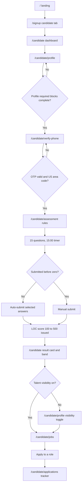
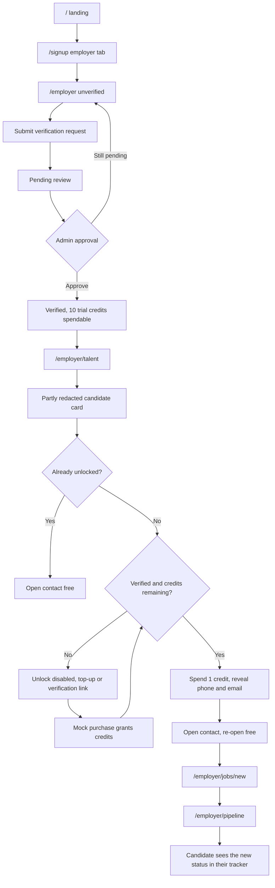
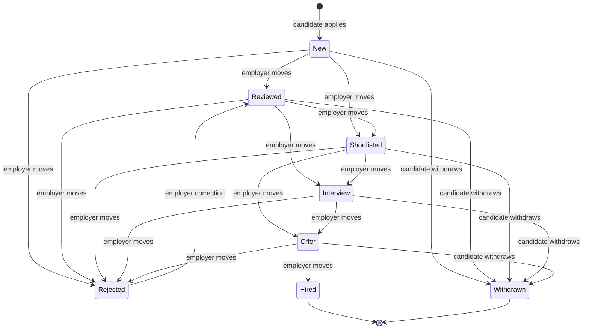

# BIMcred User Journeys and UX Specification

Status: prototype specification for the local Next.js build.
Audience: product, design, engineering and the human reviewer who signs off the prototype.
Companion code: `src/lib/journeys.ts` is the single source of truth for step ids, routes, CTAs and resume-card ordering. This document explains why those steps exist and how each one behaves.

Assumptions are labelled `[ASSUMPTION]`. Anything not labelled is either implemented in the prototype or fixed by the route inventory in section 9.

---

## 1. Journey principles

### 1.1 Talent first

The candidate never pays, never sees a paywall and never has to talk to a salesperson. Signup, phone verification, the assessment, the LOC score, visibility control and applying are all free. The only paid action in the product is an employer revealing candidate contact details, and that cost is always shown before the click. Consequences: the candidate dashboard leads with progress and the next action, never an upsell; candidate data is private by default and no scored card is visible until the candidate opts in at `/candidate/profile`; and visibility can be turned off at any time without losing the score or applications.

### 1.2 Prove then browse

Employers browse verified, scored cards with partly redacted names for free. Identity and contact details are hidden behind a credit. This keeps the marketplace honest in both directions: candidates know that only serious employers spend a credit, and employers know that every visible card passed phone verification and a timed assessment. Filtering at `/employer/talent` costs nothing and never reveals identity; one credit unlocks one candidate's phone and email, priced on the button and charged immediately on click; and admin approval happens before any credit becomes spendable at `/employer/billing`.

### 1.3 Three minutes to first value

A new candidate should reach a meaningful artifact quickly: minute 0 to 1 is account creation at `/signup` plus the profile builder at `/candidate/profile` with seven weighted completeness blocks; minute 1 to 3 is US mobile verification at `/candidate/verify-phone` using the dev OTP plus the rules screen at `/candidate/assessment`; minute 3 onward is the timed assessment, with the LOC score revealed immediately at `/candidate/assessment` and mirrored on `/candidate`. The dashboard resume card enforces this: `candidateNextAction` in `src/lib/journeys.ts` always returns exactly one CTA. Its contract order is profile, phone, assessment, visibility, then the terminal `all-set` state; profile completion and phone verification may be done in either order, while the assessment hard-gates on both.

### 1.4 No dead ends

Every screen has a way forward and a way back: every form has a cancel or back link to its portal home; every error names the fix and keeps the input; every terminal state offers a next step (a hired application points to the candidate job feed, an unverified employer points to the verification banner at `/employer`); and unknown URLs render the not-found page with links to `/`, `/candidate`, `/employer` and `/admin`.

### 1.5 One action per empty state

An empty state is a product surface, not a placeholder. Each one contains a single primary action, the reason the list is empty, and no more than one secondary link. Section 2.11 and section 3.13 hold the exact copy.

### 1.6 Prototype non-goals

These are deliberately absent and out of scope during review: no real email or SMS delivery and no notification system at all (status changes are visible only when the affected page is reloaded); no real payments (billing at `/employer/billing` is a local mock that updates the subscription balance and writes an audit event); no document upload or KYC (employer verification is manual and text-based); no assessment retakes after a completed attempt; and no native apps (the web app is responsive to 360 px).

---

## 2. End-to-end candidate journey

### 2.1 Candidate flow

### 2.2 Step table

The table follows the dashboard resume-card order, which prioritises profile completion. Sections 2.3 to 2.5 describe the same steps in trust-first order (email and mobile before the profile); either order is valid because the assessment is the hard gate on both. `candidateNextAction` in `src/lib/journeys.ts` is the authoritative resume order.

| Step | Screen (route) | User action | System response | Data written | Failure modes |
| --- | --- | --- | --- | --- | --- |
| 1. Account | `/signup` | Submits name, email and password, plus company name for an employer | Creates account, starts cookie session, redirects to the role home | User row, profile stub, trial subscription for employers, session cookie | Duplicate email redirects to `/login` with "That email is already registered. Sign in instead."; weak password rejected before the request |
| 2. Profile | `/candidate/profile` | Fills headline, city and state, current title, at least one year of experience, one discipline, at least three tools and a 60-character bio; saves | Saves the whole profile, updates the weighted completeness meter, returns to `/candidate/profile?saved=1` | Profile fields, completeness percentage, updated timestamp | Validation error keeps input; the meter stays below 100 until every required block is filled |
| 3. Phone | `/candidate/verify-phone` | Enters 10-digit US mobile, requests OTP, submits 6-digit code | Normalises to E.164, checks area code, enforces a 60-second resend cooldown, verifies OTP, sets Verified | Normalised phone, verification timestamp, consumed OTP | Invalid format or area code; wrong OTP; resend too early; expired code. The prototype has no wrong-guess lockout and no cross-account phone uniqueness |
| 4. Assessment | `/candidate/assessment` | Starts attempt, answers 15 questions, submits or lets the timer expire | Starts a 15:00 server-timed attempt, scores on submit, auto-submits from the open tab at zero | Attempt row, 15 answer rows, start/end timestamps, duration | Already completed; phone not verified; profile incomplete; refresh clears unsubmitted selections; late submit rejected |
| 5. LOC | `/candidate` | Reads score and breakdown | Renders the score ring, band and competency breakdown from the stored attempt | LOC score, band, section scores, issued timestamp | A failed submit keeps the attempt open or asks for a new one; no candidate-visible stack trace |
| 6. Visibility | `/candidate/profile` | Checks or unchecks talent-pool visibility and saves | Persists the flag, confirms with a flash, includes or excludes the card in employer search | Visibility flag, updated timestamp | Save failure keeps the form values; visibility change is not optimistic |
| 7. Job feed | `/candidate/jobs` | Filters by keyword, work mode and LOC window; applies from the card | Returns matching open jobs, blocks duplicate applications, attaches scored profile | Application row, status New, job relation | Empty filter result; job closed between view and apply; duplicate application |
| 8. Tracker | `/candidate/applications` | Opens a card, withdraws | Shows current status and applied date; withdraw is terminal unless already hired | Status change, audit event | Withdraw after hire blocked; terminal applications hide the withdraw action |

### 2.3 Account and email handling

Email is collected at `/signup` and validated for syntax and uniqueness. `[ASSUMPTION]` The prototype has no separate email-confirmation screen because none is listed in the shipped route inventory. Instead:

- Duplicate email redirects to `/login` with the flash "That email is already registered. Sign in instead."
- Signup writes an `auth.signup` audit event; it does not create an in-app welcome notification.
- In development the server logs the account creation; no confirmation link is sent or required.

The real verification gate is the US mobile number. Candidate accounts without a verified mobile can build a profile and browse jobs, but the assessment start button at `/candidate/assessment` is replaced by a "Finish these first" gate naming the missing verification.

### 2.4 US mobile verification

Screen: `/candidate/verify-phone`. One input, one primary button, one resend control, one status card.

Normalisation rules, applied in order:

1. Strip spaces, parentheses, hyphens and dots.
2. Strip a leading `+1`, `1`, `001` or `+001`.
3. Reject anything that is not exactly 10 digits after stripping.
4. Reject an area code whose first digit is `0` or `1`; NANP area codes cannot start with those digits.
5. Reject N11 service codes (`211`, `311`, `411`, `511`, `611`, `711`, `811`, `911`). The prototype accepts the documentation range `555-0100` to `555-0199` so reviewers can use `4155550123`; `[ASSUMPTION]` production would treat it as non-routable.
6. Store as E.164 (`+14155550123`) and display as `(415) 555-0123`.

`[ASSUMPTION]` No carrier or line-type lookup is performed locally, so a valid landline in a valid area code would pass. The product says "US mobile" and relies on the honesty of the candidate and on employer feedback for stale numbers.

OTP lifecycle in the prototype:

- A six-digit code is generated server-side per request and bound to the signed-in account. Codes are stored in plain text in the database; production would hash them.
- Validity is 10 minutes. Requesting a new code consumes the previous one.
- Resend cooldown is 60 seconds, enforced per user in the action. The button is disabled and the page reports the wait.
- A correct code consumes the row and sets `phoneVerified = true`.
- Dev mode: each request generates a fresh random six-digit code; when `DEV_SHOW_OTP=true` the verification screen shows that code in a development banner. `[ASSUMPTION]` The banner is gated to non-production and is the only place the code is exposed.
- Not shipped: a five-attempt lockout and cross-account phone uniqueness. A candidate can guess repeatedly, and two accounts can verify the same number. Both are target-product controls called out in README › Prototype limitations.

Data written on success: normalised number, `phoneVerified = true`, the OTP row's consumed timestamp, and an audit event.

Exact error copy:

- Invalid format or area code: "Enter a valid 10-digit US mobile number, for example (415) 555-0134."
- Wrong code: "That code is not correct. Check the SMS and try again."
- Resend too early: "Please wait 60 seconds before requesting another code."
- Expired code: "That code expired. Request a new one."
- No active code: "No active code. Request a new one."
- Account already verified: "This account already has a verified mobile number."

### 2.5 Profile builder

Screen: `/candidate/profile`. The builder is one form with grouped sections and a single Save profile action, so a candidate can leave and return without losing saved work.

Required blocks for a 100 percent completeness score:

1. Headline, at least 8 characters (15 points).
2. US city and state, at least 3 characters (15 points).
3. Current job title, at least 2 characters (10 points).
4. At least one year of experience (10 points).
5. One or more disciplines (15 points).
6. At least three BIM tools (15 points; one or two tools earns 7).
7. A bio of at least 60 characters (20 points).

The four-block work-history item in earlier drafts is not part of the shipped schema; the prototype measures the seven signals above. `[ASSUMPTION]` A production profile would add structured work history as an optional ranking signal.

Optional signals that do not block completion: availability status, work authorization and remote preference. `[ASSUMPTION]` A production profile would add portfolio URL, certifications and structured work history.

The completeness meter is the weighted sum of those seven checks, capped at 100. It is visible at the top of `/candidate/profile` and on the `/candidate` resume card. Because the assessment gate requires exactly 100, a candidate who stops at 80 percent sees precisely which blocks are missing rather than a vague nudge.

Privacy defaults: visibility is off at signup and stays off until the candidate enables it. Headline and disciplines are never enough to identify a candidate in the employer pool because the pool shows only an initials avatar and a partly redacted name until unlock.

### 2.6 Timed assessment

Screen: `/candidate/assessment`. Rules are shown before the attempt starts, not after.

Hard gates to start:

- Session is a candidate.
- US mobile is verified.
- `profileComplete` is true.
- No prior submitted attempt exists.

Attempt rules:

- 15 single-choice questions drawn from the shared BIM question bank, with options and scoring defined in `src/lib/questions.ts`.
- 15 minutes total. The timer is server-anchored: the end time is written when the attempt starts, so closing the tab does not pause it.
- One completed attempt per account. An attempt that expires before submission is marked expired and the candidate may start again.
- Answers are held in React state and posted once with the form. There is no autosave request: the answer you select stays in the open tab, and leaving the page discards unsubmitted selections.
- The candidate can scroll and change answers until submission.
- Submitting with unanswered questions is allowed without a confirmation step; unanswered items score zero.
- At zero, the open tab auto-submits whatever is selected in the browser. If the tab is closed past the window, the next visit marks the attempt expired and offers a fresh start.
- The server rejects a submit that arrives more than two minutes after the 15-minute window; the assessment page marks an attempt expired after one minute past the window.

Abandon behaviour:

- Navigating away keeps the attempt open and the timer running. Returning before expiry starts a fresh form with no selected answers because the prototype does not autosave.
- Closing the browser loses unsubmitted selections for the same reason.
- If the timer expires while the candidate is away, the next request that touches the attempt marks it expired and offers a new attempt rather than scoring an empty form.
- A submitted attempt cannot be reopened. `/candidate/assessment` then shows the result summary and a link to `/candidate`.

Scoring: each item carries a difficulty weight of 1 to 3. The score is `round(100 + weightedAccuracy × 400)`, where weighted accuracy is earned weight divided by total bank weight, giving a total between 100 and 500. The canonical formula and band table live in `src/lib/loc.ts`; if that file differs, that file wins and this paragraph is updated.

### 2.7 LOC result

The result is revealed on `/candidate/assessment` immediately after submission; the same card is the top card of `/candidate`.

Reveal sequence:

1. The score out of 500, rendered as a ring plus a numeral.
2. The band label, its description, the weighted-accuracy badge and the employer signal line.
3. Section breakdown by competency area, with a radar chart on wide screens and correct/total bars.
4. Strengths and growth areas derived from the item pattern.
5. No count-up animation and no share button in the prototype; the candidate can read or screenshot the card.

Band table used by this specification:

| Score | Band | Candidate-facing meaning |
| --- | --- | --- |
| 100 to 199 | Emerging | Recognizes BIM concepts and vocabulary; suited to supervised production or internship roles |
| 200 to 299 | Developing | Handles routine modeling and documentation with support on coordination and standards |
| 300 to 399 | Competent | Works independently across common BIM workflows and can own a defined workstream |
| 400 to 449 | Proficient | Leads coordination and information-management decisions on a project |
| 450 to 500 | Expert | Program-level BIM/VDC leadership, standards ownership and high-risk advisory |

The score is never hidden behind a paywall and never expires. Employers see the exact score and band on the talent card before spending a credit; contact details remain hidden until unlock.

### 2.8 Visibility opt-in

Screen: `/candidate/profile`, visibility section. The copy is explicit about consequences: "When visibility is on, verified employers can find your scored profile. Unlocking your phone and email costs them one credit. You can turn this off at any time."

Rules:

- The toggle is always available, but employer search only includes candidates with a LOC score, so switching it on before the assessment has no public effect until the score exists.
- The default for a new account is off.
- Turning it off removes the candidate from future search results at `/employer/talent` immediately.
- Turning it off does not revoke contact details already unlocked by an employer. Section 7.5 covers the fairness reasoning and the support path.

### 2.9 Job feed and application

Screen: `/candidate/jobs`.

Filters: keyword over title, company, location and description; work mode; and an "Inside my LOC window" checkbox that is on by default. The LOC filter only applies once the candidate has a score. Filtering is combinable and reflected in the URL (`q`, `mode`, `fit`) so a filtered feed can be shared or reloaded. Filtering never changes application state.

Job card shows title, a verified-employer badge, company, location, work mode, employment type, a two-line description, LOC window, salary range, applicant count and an "Inside window" badge when the candidate's score sits inside the posted range. The employer name is public; the hiring manager is not. There is no separate job detail page in the prototype; the card is the full posting.

Apply flow:

1. The candidate reads the card in the feed; there is no role detail screen.
2. "Apply" submits directly from the job card with the candidate's BIMcred profile. The prototype has no confirmation sheet; the success flash reads "Application sent. Track its status from the Applications tab."
3. What travels with the application: the candidate profile and its LOC score. Phone and email are never sent. The employer sees contact only if they spend a credit to unlock the candidate at `/employer/talent/[id]`.
4. A role the candidate already applied to renders "Applied ✓" instead of an apply button, and the server action also rejects a duplicate with "You have already applied to that role."
5. The card also shows a heuristic fit score, with a footnote that employers rank applicants on their own pipeline rather than this number.

### 2.10 Application tracker

Screen: `/candidate/applications`. One row per application, newest first, with status chip, job title, employer, applied date and last update.

Statuses shown to candidates: New, Reviewed, Shortlisted, Interview, Offer, Hired, Rejected, Withdrawn.

Allowed candidate actions:

- Withdraw while the application is active (not hired, rejected or already withdrawn).
- Open the job description from the tracker row even after the role closes.

Withdrawal is terminal and writes an audit event. A hired application cannot be withdrawn; the action returns an error. The prototype has no candidate-employer message thread.

### 2.11 Candidate empty states, exact copy

1. `/candidate`, no applications. Heading: "No applications yet". Body: "Your scored profile travels with every application, so employers see LOC and competency fit before the first call." Button: "Browse the job feed" going to `/candidate/jobs`.
2. `/candidate/applications`, no applications. Heading: "Nothing in the tracker yet". Body: "Apply to a role from the job feed. You will see each stage here, from new to hired, with the date it changed." Button: "Find a role" going to `/candidate/jobs`.
3. `/candidate/jobs`, filters return nothing. Heading: "No roles match that filter". Body: "Try widening the work mode or clearing the LOC window filter. New roles appear here as soon as employers publish them." Button: "Clear filters" clearing the query string on `/candidate/jobs`.
4. `/candidate`, assessment not taken. The score card uses a dashed panel rather than the shared Empty component. Heading: "No score yet". Body: "The assessment unlocks once your profile is 100% complete and your mobile is verified. You will see a 100–500 LOC score plus a per-competency breakdown." Button: "Check eligibility" going to `/candidate/assessment`.

### 2.12 Candidate error states, exact copy

1. Assessment without mobile verification. There is no dedicated error screen. `/candidate/assessment` lists "US mobile verified" under "Finish these first" with a Fix link, and a direct start attempt redirects back with the flash "Verify your US mobile number before starting the assessment."
2. Assessment with an incomplete profile. Same pattern: the gate list shows "Profile complete (100%)" with a Fix link, and a direct start redirects with "Finish your profile first (N% complete) so the score can be published against it."
3. Assessment already completed. `/candidate/assessment` renders the result card instead of a start button, and a direct start redirects with "You have already completed the assessment." No retake control is shown.
4. Application to a closed job. There is no closed-job screen. A stale card or direct submit redirects to `/candidate/jobs` with the flash "That role is no longer open." and the role is gone from the feed on reload.

---

## 3. End-to-end employer journey

### 3.1 Employer flow

### 3.2 Step table

| Step | Screen (route) | User action | System response | Data written | Failure modes |
| --- | --- | --- | --- | --- | --- |
| 1. Account | `/signup` | Chooses Employer, submits company name, work email, password | Creates unverified employer with a Trial subscription, starts session, redirects to `/employer` | User, company, employer profile, subscription, session | Duplicate email; weak password; company name too short |
| 2. Verify | `/employer` | Clicks Submit verification | Writes a request audit event and keeps the pending banner; approval is a separate admin action | Audit event only; no status change | Already verified; not signed in |
| 3. Credits | `/employer/billing` | Opens billing after approval | Shows the 10-credit trial balance already on the subscription | Balance 10, plan Trial, spendable only after approval | Duplicate grant prevented by company id; account unverified |
| 4. Search | `/employer/talent` | Sets keyword, LOC band or floor, discipline, software, location, years, availability or remote | Returns partly redacted cards and updates the count, with no credit spend; Trial cannot filter | Filter state in the URL, no identity data | Zero results; unverified employer sees a disabled unlock with a verification helper |
| 5. Unlock | `/employer/talent/[id]` | Clicks "Unlock contact · 1 credit" | Deducts 1 credit, reloads with phone and email revealed, writes an audit event | Unlock row, subscription decrement, audit event | Zero credits disables the button and shows the top-up helper; already unlocked opens free |
| 6. Shortlist | `/employer/talent?view=shortlist` | Opens "My shortlist" and compares unlocked candidates | Lists unlocked candidates and renders a compare table for two or more | No extra row; derived from unlock records | Empty list before the first unlock |
| 7. Post job | `/employer/jobs/new` | Submits title, description, location, work mode, employment type, optional salary, LOC window and competencies | Publishes an Open role that appears in the candidate feed | Job row, status Open, created timestamp | Unverified account; plan post limit; invalid LOC window; salary min above max |
| 8. Pipeline | `/employer/pipeline` | Moves an applicant through allowed statuses, saves an internal note | Applies the transition, writes an audit event; the candidate sees the new status on next load | Status update, optional note, audit event | Illegal transition; candidate withdrew; closed job still stops new applications |
| 9. Billing | `/employer/billing` | Adds a mock credit pack | Grants credits immediately and writes an audit event | Subscription credit increment, audit entry | Zero-credit state handled by the disabled unlock and top-up copy |

### 3.3 Company verification

Screen: `/employer`, verification banner. The account starts unverified and cannot spend credits, unlock contact details or publish jobs. It can browse and filter the scored pool and open candidate previews with a partly redacted name.

Evidence collected: the company profile fields (company name, website, industry, company size, HQ) plus a one-click Submit verification action that writes an audit event. There is no document upload, registration-number field or structured evidence form in the prototype.

Manual review: everything is manual in the prototype. `[ASSUMPTION]` No automated domain or registry lookup runs locally. The admin reads the company record at `/admin/employers` and clicks Approve company or Revoke verification; each action flips `verified` and is audited. There is no reject-with-reason flow, no stored review reason and no rejection note on the employer side.

While unverified the employer sees "Company verification pending" with an explanation that browsing works but unlocking and publishing wait for admin approval. The banner also points reviewers at `/admin/employers` so the local demo can be approved. Revoking verification returns the account to the same pending banner.

### 3.4 Trial credits and billing

`/employer/billing` shows the balance, the plan and a mock top-up panel. The trial subscription starts with 10 credits at signup and becomes spendable only after an admin verifies the company. `[ASSUMPTION]` Top-up packs are local fixtures: 10, 25, 50 and 100 credits at a flat simulated $12 per credit, plus a custom amount from 1 to 500. There is no payment processor and no invoice; the success flash is the receipt.

Balance rules:

- The subscription stores `creditsRemaining` and `creditsUsed`; every changed balance also writes an audit event with actor, delta and reason.
- Reasons include trial grant, top-up, admin adjustment and unlock.
- The balance can never go below zero; the unlock action decrements conditionally inside one transaction and fails closed.
- The prototype has no separate purchase table, invoice number, refund row or editable ledger. A production build would make the ledger append-only and derive the balance from it.

### 3.5 Talent search

Screen: `/employer/talent`. Search is free and anonymous.

Filters: keyword over headline/title/bio, LOC band, minimum LOC, discipline, software, location, minimum years, availability and remote-only. Filters are a Starter feature; the Trial plan browses the unfiltered pool.

Behaviour:

- "Apply filters" submits a GET form, so the URL carries the filter state and a search can be reloaded or shared.
- The result count and the number of scored candidates in the pool are shown beside the form.
- Sorting is LOC high to low by default; there are no alternate sort controls in the prototype.
- An unverified employer sees the same cards, but the unlock button on a candidate detail is disabled with "Your company must be verified by an admin before unlocking contacts." and a Verification link to `/employer`.

### 3.6 Candidate result card anatomy

Each card at `/employer/talent` shows an initials avatar, a partly redacted name such as "Maya C.", a phone-verification badge, the headline, the LOC score and band with a meter, location and years, up to two discipline chips, up to two software chips, a remote-ok chip and a footer reading "Contact hidden · 1 credit" with a "View & unlock" button, or "Contact unlocked · free to reopen" with "Open profile". The detail header at `/employer/talent/[id]` shows the full name once unlocked (redacted otherwise) and adds the assessment evidence and competency breakdown. Before unlock neither view includes an email, phone, full name, current employer or precise location. There is no per-card Shortlist button; "My shortlist" is built from candidates already unlocked.

### 3.7 Credit unlock

Screen: `/employer/talent/[id]`, unlock button in the contact card. There is no confirmation dialog: the button states the cost and charges on click.

What is revealed: full name, phone in friendly format, email, city and state, and the full profile that was already partly visible. The LOC score and breakdown were already visible before the spend.

What is logged: employer id, candidate id, credit cost, balance after, timestamp and actor in an audit event. The candidate is not notified of an unlock and never sees which employer unlocked them. `[ASSUMPTION]` This is a deliberate privacy and anti-spam decision.

Rules:

- First unlock of a candidate by a company costs 1 credit.
- Any later view of the same candidate by any user in the same company is free. The unlock is company-scoped, not user-scoped.
- A double click or retried request is idempotent: the second request returns the already-unlocked contact and charges nothing.
- Zero credits disables the unlock button and replaces the helper text with "You have no credits left. Top up on the billing page." A Buy credits link sits beside it; no dialog opens and no contact is revealed.
- Self-view, stale-contact refunds and a full purchase ledger are target-product policies marked `[ASSUMPTION]` and are not exercised by the prototype.

### 3.8 Shortlist and compare

Shortlisting in the prototype is modelled through unlock state: any candidate the company has unlocked appears under "My shortlist" at `/employer/talent?view=shortlist`, and the page renders a side-by-side compare table when two or more candidates are listed. There is no separate free shortlist, private note field or job-scoped shortlist entry; those are target-product additions.

Compare view shows up to five unlocked candidates across name, LOC, band, years of experience, disciplines, up to three tools and location. Because only unlocked candidates enter the list, contact details are already available from each detail page.

A shortlist entry is never shown to the candidate: they learn about interest only when the employer moves their application in the pipeline, and there is no message thread.

### 3.9 Job posting

Screen: `/employer/jobs/new`, with the list at `/employer/jobs`.

Fields: job title (required, 4–120 characters), description, location, work mode, employment type, optional annual salary range, LOC floor and ceiling, and a set of competency checkboxes used to describe the role. There is no separate discipline or software field on the job form. The server re-validates the title, the LOC window (inside 100–500 with the floor not above the ceiling) and salary ordering.

On publish:

- The create form publishes directly with status Open; there is no draft step at creation.
- The role appears at `/candidate/jobs` to candidates whose score is at least the floor minus 100, and the fit score uses the posted window.
- The employer sees the role at `/employer/jobs` with applicant counts, and can close, reopen or move it to draft.
- There is no edit form for a published job in the prototype.
- Closing a job sets status Closed. It stops accepting applications immediately and keeps all existing applications and their states.

Publishing is blocked for an unverified company or when the plan's active-post limit is reached. The server returns "Your company must be verified before you can publish a role." or names the plan's post allowance, and the publish button is disabled with a "Verification required" or "Active post limit reached" helper.

### 3.10 Applicant pipeline

Screen: `/employer/pipeline`. Six active columns (New, Reviewed, Shortlisted, Interview, Offer, Hired); Rejected and Withdrawn applications sit in a "Closed" section below the board. Each card shows the candidate name, job title, LOC pill, fit score, applied time, an optional private note and buttons for the allowed next moves. A job filter sits above the board, and each card has an "Add note" control that saves an internal note.

Employer-driven states: New, Reviewed, Shortlisted, Interview, Offer, Hired, Rejected.
Candidate-driven state: Withdrawn.
The prototype has no "Job closed" flag on applications; a closed role simply stops accepting new applications while existing ones stay on the board.

Allowed employer transitions: New to Reviewed, Shortlisted or Rejected; Reviewed to Shortlisted, Interview or Rejected; Shortlisted to Interview, Offer or Rejected; Interview to Offer or Rejected; Offer to Hired or Rejected; Rejected back to Reviewed. Hired and Withdrawn are terminal.

Every move writes an audit event; the candidate sees the new status the next time they open `/candidate/applications`. The prototype does not capture a rejection reason, does not send an in-app or email notification, and does not block a backward correction from Rejected to Reviewed.

### 3.11 Billing

Screen: `/employer/billing`. Sections: top stats for credits available, lifetime spend, plan and renewal; the current period with plan features and a credit progress bar; the simulated top-up panel; the unlock ledger; and a plan comparison with immediate switching. There is no invoice table, payment-method form or billing-contact section.

The paywall is an inline state rather than a dialog: when the balance is zero, the unlock button on `/employer/talent/[id]` is disabled and the helper text points to `/employer/billing`. The talent search header also shows the remaining balance. `[ASSUMPTION]` Job posting does not consume credits; it is limited by the plan's active-post count and by employer verification.

### 3.12 Credit and paywall edge cases

| Case | Expected behaviour | Route |
| --- | --- | --- |
| Zero credits, unlock clicked | Button is disabled with top-up copy and a Buy credits link; no contact revealed | `/employer/talent/[id]` to `/employer/billing` |
| Duplicate unlock, same company | Contact opens, balance unchanged, no second audit entry or debit | `/employer/talent/[id]` |
| Double click on unlock | One debit only; the second request short-circuits before the transaction | `/employer/talent/[id]` |
| Self-view `[ASSUMPTION]` | Target-product preview mode; not reachable in the prototype because an account has one role | `/employer/talent/[id]` |
| Stale contact refund `[ASSUMPTION]` | Target-product admin refund; the prototype has no refund control | `/admin/employers` |
| Concurrent unlocks of two candidates with one credit | Exactly one succeeds, the other gets the paywall; no negative balance | `/employer/talent/[id]` |
| Unverified employer | Card and detail are visible; the unlock button is disabled with a verification helper and link; no credit spend possible | `/employer/talent` |
| Candidate turns visibility off after unlock | Existing contact stays with the employer; card leaves future search; no auto-refund | `/candidate/profile` |

### 3.13 Employer empty and error copy

1. `/employer/talent`, zero results. Heading: "No candidates match those filters". Body: "Try lowering the LOC floor, widening the discipline, or clearing the keyword. The pool grows as candidates finish their assessments." Button: "Clear filters" going to `/employer/talent`.
2. `/employer/talent?view=shortlist`, nothing unlocked. Heading: "Your shortlist is empty". Body: "Unlock a candidate to add them here. Unlocks persist, so this list is your permanent shortlist and re-opening is free." Button: "Back to search" going to `/employer/talent`.
3. `/employer/jobs`, no jobs. Heading: "No job posts yet". Body: "Publish your first BIM role with a LOC window, work mode and pay range. Candidates see where they sit before they apply." Button: "Post your first job" going to `/employer/jobs/new`. With jobs but none open, the Open section shows "No open roles. Publish a draft or create a new post."
4. `/employer/pipeline`, no applicants. Heading: "No applications in the pipeline", or "No applicants for this role yet" when a job filter is active. Body: "Publish a role with a clear LOC window and matching candidates can apply from their job feed. Applications appear here instantly." Button: "Post a job" going to `/employer/jobs/new`.
5. `/employer`, no unlocks. Heading: "No unlocks yet". Body: "Filtering is free and unlimited. A credit is spent only when you unlock a candidate's phone and email." Button: "Search the pool" going to `/employer/talent`.
6. Zero credits. There is no error page or dialog. The unlock button on `/employer/talent/[id]` is disabled and the helper text reads "You have no credits left. Top up on the billing page." with a "Buy credits" link to `/employer/billing`.
7. Unverified employer. The unlock button is disabled and the helper text reads "Your company must be verified by an admin before unlocking contacts." with a "Verification" link to `/employer`.

---

## 4. Admin journey

### 4.1 Daily operations loop

Screen: `/admin`. The board is a queue-of-queues. The recommended order is oldest and highest-risk first:

1. Employer verification requests at `/admin/employers`. Clear before any other queue because employers cannot spend until approved.
2. Abuse review at `/admin/users`. The prototype shows role, phone verification, LOC and visibility; it has no automated duplicate-phone flags or LOC-jump deltas.
3. Question health at `/admin/assessments`. The prototype shows per-item attempts and correct rate and highlights items below 60 percent. Timing analytics and a retire control are target-product features.
4. Credit and unlock anomalies at `/admin/audit`. Look for repeated unlocks by one employer and unlocks with an immediate moderation report.
5. Support notes on `/admin`. Resolve moderation reports with a written outcome. `[ASSUMPTION]` Refund and phone-lockout tooling is target-product; the prototype has neither.

Each queue row shows a status and a next action. Nothing is deleted; resolved items leave the open queue but stay in the audit log.

### 4.2 Runbook A: approve or revoke an employer

1. Open `/admin/employers`; the Pending tab filters unverified companies.
2. Read the company name, contact, industry, company size, HQ, website and current credit balance.
3. Check the signup email domain against the website where possible. `[ASSUMPTION]` The prototype runs no registry or domain lookup.
4. If proof is sufficient, click Approve company. The employer becomes Verified, the existing 10-credit trial balance becomes spendable, and the audit log records actor and company.
5. To undo an approval, click Revoke verification. The account returns to the pending state, credits and publishing are blocked again, and the change is audited.
6. Use the Grant control beside the company to add credits for support; the grant is audited.
7. There is no reject-with-reason, review note or evidence attachment in the prototype, so a company that should not be approved simply stays pending.

### 4.3 Runbook B: investigate a suspicious LOC jump (target product)

`[ASSUMPTION]` The prototype shows current score, attempt duration and item answers at `/admin/assessments` and `/admin/users`, but it has no attempt-history delta, device metadata or fingerprinting. This runbook is the intended production process.

1. Open `/admin/users` and search by name, email or phone.
2. Compare the current score with the history entry. A jump is suspicious when the delta is 150 or more between attempts, or when the score is 450 or more with a completion time under 6 minutes.
3. Open the attempt at `/admin/assessments` and inspect duration, per-question time, answer changes and device metadata.
4. Check for duplicate accounts sharing the phone, a re-used device fingerprint, or an OTP verified minutes before the attempt.
5. Check `/admin/audit` for concurrent sessions or admin actions on the same account.
6. Classify: legitimate fast expert, technical anomaly or confirmed abuse.
7. For a legitimate fast expert, add a note and leave the score.
8. For an anomaly, leave the score, flag the attempt for question-health review and note the finding.
9. For confirmed abuse, set visibility off at `/admin/users` and record the evidence in the audit log. The prototype has no suspend control and no score-edit control; visibility and phone-verification state are the only levers.

### 4.4 Runbook C: retire a bad question (target product)

`[ASSUMPTION]` This is the intended production runbook. The prototype exposes per-item accuracy at `/admin/assessments` but has no retire, edit or reserve-pool control.

1. Open `/admin/assessments` and sort by lowest correct rate.
2. Open the question and read the stem, options, intended answer and explanation.
3. Confirm the signal with at least 20 attempts; below that, mark "watch" instead of retiring.
4. Check whether the question is ambiguous, has two defensible answers, relies on obsolete software or leaks the answer in the stem.
5. If it must be retired, set status Retired with a reason. Retired questions stop appearing in new attempts immediately.
6. Existing attempts keep their original score; no retroactive rescoring in the prototype.
7. If retiring the question would leave fewer than 15 active questions, add a replacement from the reserve pool before saving.
8. Record the change in `/admin/audit` with the question id, previous status and reason.
9. Announce the change in the ops note on `/admin` so support can answer candidate questions.

---

## 5. Cross-portal state machine

### 5.1 Application lifecycle

A closed job is not an application state. The job's status flips to Closed, leaves the candidate feed and every existing application keeps its current state. The prototype does not add a separate "Job closed" label. New applications are blocked at the job level.

### 5.2 Transition table

| From | To | Trigger | Actor | Side effects | Notification |
| --- | --- | --- | --- | --- | --- |
| none | New | Application submitted from `/candidate/jobs` | Candidate | Application row, match score, audit event | None in prototype |
| New | Reviewed | Employer moves the applicant at `/employer/pipeline` | Employer | Status update, audit event | None in prototype |
| New, Reviewed, Shortlisted, Interview, Offer | Withdrawn | Candidate withdraws at `/candidate/applications` | Candidate | Terminal status, audit event | None in prototype |
| New, Reviewed, Shortlisted, Interview, Offer | Rejected | Employer moves the applicant | Employer | Status update, audit event | None in prototype |
| Reviewed | Shortlisted | Employer moves the applicant | Employer | Status update, audit event | None in prototype |
| Shortlisted | Interview | Employer moves the applicant | Employer | Status update, audit event | None in prototype |
| Shortlisted, Interview | Offer | Employer moves the applicant | Employer | Status update, audit event | None in prototype |
| Offer | Hired | Employer marks the applicant hired | Employer | Terminal status, audit event | None in prototype |
| Rejected | Reviewed | Employer corrects a rejection | Employer | Status update, audit event | None in prototype |
| any open | Job closed | Employer closes the job at `/employer/jobs` | Employer | Job status Closed; applications keep state; feed listing removed | None in prototype |

Invariants:

- Only the actor named in the table can trigger the transition; ownership is re-checked in the action.
- Hired and Withdrawn are terminal for the candidate. An employer can move Rejected back to Reviewed; that correction is audited.
- Every transition updates `Application.status` and writes one audit event.
- A candidate cannot apply twice to the same job, even after withdrawal.
- Notifications are target-product only; section 6 lists the intended matrix.

---

## 6. Notification matrix

`[ASSUMPTION]` **The prototype ships no user-facing notification system.** It has no in-app feed and no SMS. The only outbound email is an operator notification when a Candidate or Employer signs up. Status changes and moderation decisions are visible to the affected user when they next load the relevant page, and every write lands in `/admin/audit`. The matrix below is the target-product design and is included so the intent is reviewable alongside the shipped audit trail.

| Event | In-app | Email | SMS | Timing |
| --- | --- | --- | --- | --- |
| Candidate signup | Yes | Logged only | No | Immediate |
| Candidate phone verified | Yes | No | No | Immediate |
| Assessment submitted and LOC issued | Yes | Logged only | No | Immediate |
| Candidate visibility turned on | Yes, confirmation | No | No | Immediate |
| Application submitted, candidate receipt | Yes | Logged only | No | Immediate |
| Application submitted, employer alert | Yes | Logged only | No | Immediate |
| Application status change, candidate | Yes | Logged only | Opt-in only for Interview and Offer | Immediate |
| Interview scheduled | Yes | Logged only | Opt-in only | Immediate |
| Offer recorded | Yes | Logged only | Opt-in only | Immediate |
| Offer accepted, employer alert | Yes | Logged only | No | Immediate |
| Application withdrawn, employer alert | Yes | Logged only | No | Immediate |
| Job closed with pending applicants | Yes | Logged only | No | Immediate |
| Employer verification approved or rejected | Yes | Logged only | No | Immediate |
| Credits purchased | Yes | Logged only | No | Immediate |
| Candidate unlock, employer receipt | Yes | No | No | Immediate |
| Stale-contact refund issued | Yes | Logged only | No | On admin action |
| Support ticket resolved | Yes | Logged only | No | On admin action |

Deliberately not sent even in the target design, and none are sent in the prototype:

- No notification to a candidate when an employer unlocks or views their profile. This protects candidates from pressure and keeps the paid action low-noise.
- No marketing, re-engagement, digest or newsletter messages.
- No SMS OTP delivery; with `DEV_SHOW_OTP=true` the generated code appears in the on-screen banner.
- No notification to a candidate when a company marks them as shortlisted; the candidate sees it as a status change the next time they load the tracker.
- No password-reset email delivery. The reset flow is out of scope for the prototype.
- No employer notification when a candidate toggles visibility off, because it would reveal candidate behaviour.

---

## 7. Edge cases and recovery

### 7.1 Abandoned assessment

Symptom: the candidate closes the tab mid-attempt. Behaviour: the server-anchored end time keeps running, but selections were never sent, so unsubmitted answers are lost. Recovery: returning to `/candidate/assessment` before expiry shows a fresh form with the remaining time; the candidate re-answers and submits. If the window has passed, the attempt is marked expired on the next visit and a new attempt can be started, because only a completed attempt consumes the one-attempt rule. An expired attempt is not scored as LOC 100.

### 7.2 Expired OTP

Symptom: the candidate enters a code after 10 minutes. Behaviour: the expired code is rejected with "That code expired. Request a new one." and is not consumed. Recovery: request a new code after the 60-second cooldown; the new code invalidates the old one. There is no attempt lockout in the prototype, so support has nothing to clear.

### 7.3 Duplicate accounts or same phone on two emails

Symptom: a candidate creates a second account and verifies a number already used elsewhere. Behaviour: the prototype permits it, because phone uniqueness is not enforced across accounts. The second account gets its own independent LOC score. `[ASSUMPTION]` Production would reject the duplicate and require an admin-assisted merge; neither the rejection nor the merge tool is shipped.

### 7.4 LOC 100 candidate

Symptom: a candidate scores the floor of 100. Behaviour: the score is valid, visible and never hidden; the band is Emerging; the candidate can opt into visibility and still sees roles in the feed because the feed keeps postings whose floor is at most 100 above the candidate's score. The result screen frames the score as a starting point with concrete growth areas from the weakest sections, not as a failure. Recovery: no retake exists in the prototype, so the next action is applying to suitable roles and improving the profile. `[ASSUMPTION]` A future release may allow one retake after 30 days.

### 7.5 Candidate toggles visibility off after an unlock

Symptom: an employer already paid for contact, then the candidate turns visibility off. Behaviour: the employer keeps the details they paid for, the candidate leaves future searches at `/employer/talent`, no automatic refund is issued, and the unlocked profile stays reachable by direct link for that company only because the detail page permits an unlocked candidate even when hidden. Recovery: the prototype has no admin control to revoke an unlock or refund the credit; that is a target-product policy.

### 7.6 Employer with zero search results

Symptom: filters return an empty list. Behaviour: no credit is spent, filter state stays visible, and the empty state suggests lowering the LOC floor, widening the discipline or clearing the keyword, with a Clear filters action. Recovery: clear filters and search again. The employer's next action is still available from the nav and the jobs page.

### 7.7 Closed or deleted job with pending applications

Symptom: the employer closes a job while applications are open. Behaviour: the prototype soft-closes with no hard delete; the job stops accepting applications, leaves `/candidate/jobs`, and every application keeps its current state. There is no "Job closed" badge and no messaging thread. Recovery: reopening a closed role restores the feed listing and is reflected in the audit log.

### 7.8 Additional guardrails

Credits are integers only. Moderation resolutions, verification flips and credit grants are audited against the acting admin, though the prototype does not require a written reason for every admin toggle. Every list has a stable empty state, and no screen renders a bare table with zero rows. Session expiry redirects to `/login`, and a failed form save keeps the submitted values where the browser still holds them.

---

## 8. Accessibility, mobile and reviewer script

### 8.1 Accessibility notes

- All interactive controls are reachable by keyboard in DOM order; focus rings are never removed without a visible replacement.
- The score ring carries an accessible label such as "LOC 348 out of 500" and the numeral is always present as text.
- The assessment timer uses `aria-live="polite"` for the remaining time, and answer selection uses native radio semantics.
- The prototype has no count-up or card transition animation, so reduced-motion users see the final state immediately.
- Contrast targets WCAG AA (4.5:1 body, 3:1 large text) and the palette is chosen for it, but no formal audit has been run.
- Primary actions use large or full-width targets; compact controls in tables and the pipeline board are smaller than 44 px, which is a known mobile accessibility gap.

### 8.2 Mobile journey notes

- The candidate journey is designed for a 360 px viewport first. The dashboard resume card is the only above-the-fold CTA.
- The assessment shows the question list on one long page with a sticky timer and jump chips. Options are full-width tap targets, and submit actions sit at the top and bottom so a short viewport is not a trap.
- The profile builder stacks its sections on small screens; the completeness meter stays visible near the top.
- The job feed uses full-width cards and inline filters rather than a bottom sheet.
- Employer tables become horizontally scrollable cards below 768 px.
- The unlock button sits inside the contact card, with the cost and remaining balance directly beneath it.
- Pipeline columns become a horizontally scrollable board with a job filter above it.

### 8.3 Reviewer test script

Run the app locally with the team's dev command, then execute these steps in order. Each step names the expected result. Use a fresh database or unique emails if the fixtures already exist.

> **Prototype note.** This script describes the shipped local prototype and the target product. The prototype implements the core candidate, employer and admin paths; design-only affordances described elsewhere in this document (unlock confirmation dialogs, self-view previews, stale-contact refunds, free shortlists with notes, question retirement, invoices, mid-attempt autosave, duplicate-number blocking, OTP attempt lockout) are not shipped. README › Prototype limitations is the authoritative list of what is present and absent.

Phase A: candidate

1. Open `/`. Expected: landing page with separate candidate and employer entry points.
2. Click the candidate signup action and land on `/signup`. Expected: candidate tab selected, no payment field.
3. Submit name "Review Candidate", email `reviewer.candidate@example.com`, password `Bimcred123!`. Expected: redirect to `/candidate`, signed in, resume card says "Complete your profile".
4. Click "Finish profile" and land on `/candidate/profile`. Expected: completeness meter below 100 percent and the required blocks marked.
5. Fill headline "Review Candidate BIM Coordinator", current title, a US city and state, one year of experience, one discipline, three software tools and a bio of at least 60 characters; save. Expected: meter reaches 100 percent and the dashboard resume card changes to "Verify your US mobile".
6. Open `/candidate/assessment` directly. Expected: the start button is replaced by a "Finish these first" gate listing "US mobile verified" with a link to `/candidate/verify-phone`.
7. Open `/candidate/verify-phone`, enter `4155550123`, request the code. Expected: the stored number displays as `(415) 555-0123`, the dev banner shows the generated six-digit code, resend is disabled for 60 seconds.
8. Submit `000000`. Expected: inline error "That code is not correct. Check the SMS and try again."; no verification.
9. Submit more wrong codes if desired. Expected: the same inline error; the prototype has no wrong-guess lockout.
10. Submit the code shown in the dev banner. Expected: Verified state, dashboard status changes, resume card changes to "Take the BIM skill test" with a Start assessment action.
11. Open `/candidate/assessment` and start. Expected: rules shown, timer starts at 15:00, the 15 questions and a jump strip visible.
12. Answer several questions, refresh the page. Expected: the timer continues from the server-anchored end time, but the refreshed form has no selected answers because the prototype does not autosave. Re-answer at least the questions you want scored.
13. Answer the rest and submit. Expected: submission happens immediately with no unanswered-questions confirmation; unanswered items score zero. The result is a LOC score between 100 and 500 with band and section breakdown on `/candidate/assessment`, and the same score becomes the top card on `/candidate`.
14. Reload `/candidate/assessment`. Expected: the completed result card with attempt record and no retake button.
15. Open `/candidate/profile`, check "Appear in employer talent search" in the visibility card and click Save profile. Expected: the flash confirms visibility applied, and `/candidate` shows "Visible to verified employers" with the toggle On.
16. Open `/candidate/jobs`. Expected: job cards with filters; applying a work-mode filter updates the URL and the count.
17. Apply to an open role. Expected: the application is submitted directly with a confirmation flash, and the tracker shows it as New. Phone and email are not sent with the application.
18. Open `/candidate/applications`. Expected: the application appears with status New, job title and timestamp.

Phase B: employer and admin

19. Sign out, open `/signup`, choose Employer, submit company "BIMcred Review Co", email `reviewer@bimcred-demo.com`, password `Bimcred123!`. Expected: redirect to `/employer` with an Unverified badge and the "Company verification pending" banner.
20. Click Submit verification. Expected: success flash "Verification requested. An admin reviews company accounts in the operations console."; unlock and post-job actions remain blocked.
21. Sign out and sign in as admin, open `/admin/employers`. Expected: the new company appears in the list, or in the Pending tab, with company, contact, website and credit balance.
22. Click Approve company. Expected: the badge changes to Verified, the pending count drops, and the audit log records the decision.
23. Sign back in as the employer and open `/employer/billing`. Expected: Verified badge, balance 10 credits, plan Trial.
24. Open `/employer/talent`. The Trial plan does not include filters, so browse the unfiltered pool. Expected: the reviewer candidate's card is recognisable by the headline "Review Candidate BIM Coordinator"; the header still shows 10 credits.
25. Open that card. Expected: partly redacted name and initials, phone and email hidden, "Unlock contact · 1 credit" with the balance helper text.
26. Click Unlock. Expected: no dialog; the page reloads with phone and email revealed, a success flash, balance becomes 9, and `/admin/audit` records the unlock. Re-opening is free.
27. Reload the same candidate. Expected: contact still visible, balance still 9, no second unlock event.
28. Set the balance to zero with Prisma Studio (run `npx prisma studio`, open `Subscription`, set the "BIMcred Review Co" row's `creditsRemaining` to 0) or with SQL: `UPDATE Subscription SET creditsRemaining = 0 WHERE employerId = (SELECT id FROM EmployerProfile WHERE companyName = 'BIMcred Review Co');`. Then open another locked candidate. Expected: the unlock button is disabled, helper text says "You have no credits left. Top up on the billing page.", and a Buy credits link points to `/employer/billing`. No contact is revealed.
29. On `/employer/billing`, add a mock credit pack. Expected: balance increases immediately with the flash "Credits added to your balance." There is no invoice or receipt row.
30. Open `/employer/billing` and inspect the unlock history. Expected: one row for the reviewer candidate showing -1 credit and the unlock time; understood as the mock ledger.
31. Open `/employer/jobs/new` and publish a role with a title, description, location, work mode, a LOC window around the reviewer candidate's score and an optional pay range. Expected: redirect with a created flash; the role is listed as Open at `/employer/jobs`.
32. Return to the candidate account and open `/candidate/jobs`. Expected: the new role appears when the candidate's score is at least the floor minus 100.
33. Apply to the new role, then return to the employer and open `/employer/pipeline`. Expected: the applicant appears in New.
34. Move the applicant to Shortlisted. Expected: status updates, candidate tracker shows Shortlisted, audit records the transition.
35. Close the job at `/employer/jobs`. Expected: the role leaves `/candidate/jobs`; the application stays in the tracker with its current status. The prototype does not add a separate "Job closed" badge.
36. Open `/admin/assessments` and inspect question health. Expected: bank size, items attempted, mean correct rate, per-item attempts and correct rate, competency coverage and LOC spread. The prototype shows no average-time column.
37. Open `/admin` and find the open moderation report (seeded as AEC Build Group reporting James Park). Add a resolution note and click Resolve. Expected: the report leaves the queue and the audit log records the resolution.
38. Open `/admin/audit`. Expected: the employer verification decision, candidate unlock, job publish and status changes, pipeline transition and report resolution all appear with actor and timestamp.
39. Open `/admin/users` and confirm the reviewer candidate shows verified phone, LOC score and visibility on.

Phase C: negative checks

40. While signed in as the reviewer candidate, open `/employer/talent` directly. Expected: the server-side role gate redirects to `/candidate`; no employer data is rendered.
41. Attempt a 9-digit number such as `415550123`. Expected: format error naming a valid example, no OTP sent.
42. Attempt an invalid area code such as `0155550123`. Expected: area-code error, no OTP sent.
43. Sign up a second employer and, before approval, attempt to unlock. Expected: the unlock button is disabled with "Your company must be verified by an admin before unlocking contacts." and no credit charge.
44. Return to the candidate account, turn visibility off at `/candidate/profile`, then browse `/employer/talent` again as the verified employer. Expected: the reviewer candidate's card disappears from the pool, but the direct link from the billing unlock history still opens the already-unlocked contact.

### 8.4 Acceptance checklist

- Every CTA in `src/lib/journeys.ts` resolves to a route in section 9.
- `candidateNextAction` returns exactly one action for every combination of the five candidate flags and never throws.
- `employerNextAction` returns exactly one action for every combination of the four employer flags and never throws.
- Progress reads 0 with all flags false and 100 with all flags true.
- The four candidate empty states and four candidate error states, plus the employer empty states, render the exact copy in this document.
- The unlock path is idempotent, company-scoped, credit-safe and audited.
- The application state machine matches section 5, and every transition is reflected in the candidate tracker on reload.
- No screen ends without a next action.

---

## 9. Route inventory

Public: `/`, `/login`, `/signup`. Candidate: `/candidate`, `/candidate/verify-phone`, `/candidate/assessment`, `/candidate/profile`, `/candidate/jobs`, `/candidate/applications`. Employer: `/employer`, `/employer/talent`, `/employer/talent/[id]`, `/employer/jobs`, `/employer/jobs/new`, `/employer/pipeline`, `/employer/billing`. Admin: `/admin`, `/admin/users`, `/admin/employers`, `/admin/assessments`, `/admin/audit`.

Any route not listed is out of scope. Adding one requires updating this document and `ROUTES` in `src/lib/journeys.ts` in the same change.
