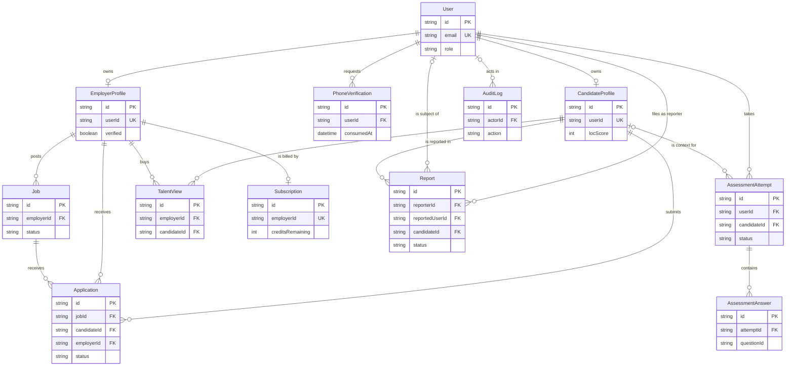

# BIMcred Database Design

Document: 03-database-design
Status: implementation reference; **hosting amendment below supersedes the SQLite-era text**
Scope: Prisma schema, seed data, query strategy, and the Postgres hosting path
Source of truth: `prisma/schema.prisma`, `prisma/seed.ts`

> **Hosting amendment (current build).** The schema now targets PostgreSQL everywhere: the public
> demo runs on Neon's free tier and local development uses the same provider, because Prisma fixes
> the provider per schema and the local and deployed builds must share one generated client. The
> SQLite notes below are kept as the original design rationale; the decisions they justify
> (`String` statuses, comma-separated sets, JSON-string payloads, cuid ids, lowercased emails) are
> unchanged in the current schema. Read `04c-deployment-runbook.md` section 8 for the hosted setup,
> and treat any "path to Postgres" step below as already completed.

This document describes the database as implemented. Capacity and effort
figures are engineering estimates. Privacy and legal notes are policy
proposals and general background, not legal advice or a compliance
certification.

---

## 1. Design goals and constraints

### 1.1 Goals

1. One identity model serving the candidate, employer, and admin portals.
2. A verified, comparable skill signal: LOC 100-500, positioned as "LOD for people".
3. Paid unlocks backed by a credit ledger that cannot go negative or double-charge.
4. A pipeline board that renders from one table and one index.
5. Full local operation on SQLite, seedable in one command, with no external services.
6. A schema that moves to Postgres without rewriting the domain model.

### 1.2 Constraints

- Prisma 6.x, Next.js 15 App Router, TypeScript strict mode.
- IDs are `cuid()` strings: URL-safe, globally unique, generated without a round trip.
- Timestamps are UTC; `createdAt` defaults to `now()` and Prisma maintains `updatedAt`.
- SQLite has no native enums, arrays, or JSON columns. Closed sets are `String` columns with documented allowed values; set-like values are comma-separated strings; structured payloads are JSON strings.
- SQLite comparison is case-sensitive, so the application lowercases email before every write and lookup.
- No `@db.*` attributes, so the model file is provider-portable.

### 1.3 Why `employerId` is denormalised on Application

A normalised pipeline query joins Application to Job to filter by employer, once per status column and again for counts. Copying `Application.employerId` from the job turns the hot path into an index range scan on `(employerId, status)`. The trade-off is possible drift: the product does not transfer jobs, the write path derives the value from the loaded job, and a reviewer query in section 8 detects drift. The database cannot enforce the copy, so section 5 lists it as an application invariant.

### 1.4 Why comma-separated strings and JSON strings now

SQLite has no array or JSON type. Candidate software, disciplines, and job competencies are comma-separated strings; `AuditLog.meta` is a JSON string. The application matches set columns in memory after indexed columns narrow the result. At larger scale these become `text[]` with GIN indexes and `meta` becomes `jsonb` (section 6).

### 1.5 Non-goals

Multi-tenancy, row-level security, payment processing, and database check constraints. Soft-delete columns are omitted; deletion and anonymisation are application flows (section 7).

---

## 2. Entity-relationship diagram

All twelve models are shown. Cardinality is read from the entity nearest the
symbol: `||` exactly one, `|o` zero or one, `o{` zero or many. Full column
detail follows in section 3.



### 2.1 Delete rules and implementation notes

Profiles, phone verifications, attempts, answers, jobs, applications, views,
and subscriptions cascade from their parent. `AuditLog.actorId` and
`Report.reportedUserId` are `SetNull` so history survives account deletion;
reports cascade from both reporter and candidate. Two additive fields support
required reverse navigation: optional `AssessmentAttempt.candidateId` (for
`CandidateProfile.attempts`, without changing the authoritative `userId`
owner) and optional `Report.reportedUserId` (for `User.reportsAgainst`).
Neither renames, removes, or retypes a contract field.

---

## 3. Data dictionary

`String` maps to SQLite `TEXT`, `Int` to `INTEGER`, `Boolean` to `INTEGER` 0/1,
and `DateTime` to ISO-8601 text (SQLite) or `timestamptz` (Postgres).
"Default: app" means application code supplies the value. Enum-like strings
are validated by server actions; the database accepts any string.

### 3.1 User

One login identity per person, exactly one role.

| Column | Type | Null | Default | Allowed values / notes |
| --- | --- | --- | --- | --- |
| id | String | no | cuid() | Primary key |
| email | String | no | - | Unique; stored lowercase by the app |
| passwordHash | String | no | - | bcrypt cost 10+; never serialised |
| name | String | no | - | Display name |
| role | String | no | app | CANDIDATE, EMPLOYER, ADMIN |
| phone | String | yes | - | E.164; indexed for duplicate detection |
| phoneVerified | Boolean | no | false | Set only after code redemption |
| createdAt | DateTime | no | now() | UTC |
| updatedAt | DateTime | no | app | Prisma-maintained |

### 3.2 CandidateProfile

Candidate fields and the latest verified LOC score; one row per candidate.

| Column | Type | Null | Default | Allowed values / notes |
| --- | --- | --- | --- | --- |
| id | String | no | cuid() | Referenced by applications, views, attempts |
| userId | String | no | - | Unique FK to User, cascade |
| headline | String | no | "" | Short marketing line |
| currentTitle | String | no | "" | Free text |
| location | String | no | "" | City, state; free text |
| yearsExperience | Int | no | 0 | 0..60; filter column |
| availability | String | no | OPEN | OPEN, NOT_LOOKING, CONTRACT |
| workAuthorization | String | no | US_CITIZEN | US_CITIZEN, GREEN_CARD, H1B, OTHER |
| remoteOk | Boolean | no | true | Remote preference |
| bio | String | no | "" | Free text; may contain PII |
| software | String | no | "" | Comma-separated: revit, navisworks, archicad, tekla, civil3d, dynamo, ifc, solibri, bim360, recap |
| disciplines | String | no | "" | Comma-separated: architecture, structure, mep, infrastructure, construction, facilities |
| visible | Boolean | no | true | False hides candidate from employer search |
| locScore | Int | yes | - | 100..500; null before first attempt |
| locBand | String | yes | - | Emerging, Developing, Competent, Proficient, Expert |
| locVerifiedAt | DateTime | yes | - | Timestamp of scoring submit |
| createdAt | DateTime | no | now() | UTC |
| updatedAt | DateTime | no | app | Prisma-maintained |

LOC bands: Emerging 100-199, Developing 200-299, Competent 300-399, Proficient 400-449, Expert 450-500.

### 3.3 PhoneVerification

Single-use US mobile verification codes.

| Column | Type | Null | Default | Allowed values / notes |
| --- | --- | --- | --- | --- |
| id | String | no | cuid() | Primary key |
| userId | String | no | - | FK to User, cascade |
| code | String | no | - | Six digits; hash outside local dev |
| expiresAt | DateTime | no | - | Checked at redemption |
| consumedAt | DateTime | yes | - | Set once; consumed rows cannot be reused |
| createdAt | DateTime | no | now() | UTC |

### 3.4 AssessmentAttempt

One 15-question assessment run; immutable after submission.

| Column | Type | Null | Default | Allowed values / notes |
| --- | --- | --- | --- | --- |
| id | String | no | cuid() | Primary key |
| userId | String | no | - | FK to User, cascade; ownership column |
| startedAt | DateTime | no | now() | Used with submittedAt for duration |
| submittedAt | DateTime | yes | - | Null while in progress |
| status | String | no | IN_PROGRESS | IN_PROGRESS, COMPLETED, EXPIRED, ABANDONED |
| rawScore | Int | no | 0 | 0..100 weighted percentage |
| locScore | Int | yes | - | 100..500; set on submit |
| durationSec | Int | no | 0 | Server-measured elapsed seconds |
| ipHash | String | no | "" | SHA-256 of IP plus server salt |
| candidateId | String | yes | - | Optional CandidateProfile FK, SetNull |

### 3.5 AssessmentAnswer

One answered question inside an attempt.

| Column | Type | Null | Default | Allowed values / notes |
| --- | --- | --- | --- | --- |
| id | String | no | cuid() | Primary key |
| attemptId | String | no | - | FK to AssessmentAttempt, cascade |
| questionId | String | no | - | Stable bank ID, e.g. q01 |
| competency | String | no | - | iso19650, lod, clash, quantity, schedules, interop, standards, delivery, digital-twin, automation |
| difficulty | Int | no | 1 | 1 recall, 2 applied, 3 analysis |
| selectedOption | String | no | - | A, B, C, D |
| correct | Boolean | no | false | Frozen at submit for reproducible scoring |
| weight | Int | no | 1 | 1 or 2 points |

### 3.6 EmployerProfile

Company fields; one row per employer user.

| Column | Type | Null | Default | Allowed values / notes |
| --- | --- | --- | --- | --- |
| id | String | no | cuid() | Referenced by jobs, views, applications |
| userId | String | no | - | Unique FK to User, cascade |
| companyName | String | no | "" | Indexed for admin lookup |
| website | String | no | "" | Free text |
| industry | String | no | "" | Free text |
| companySize | String | no | "" | Free-text band, e.g. 11-50 |
| hqLocation | String | no | "" | City, state |
| verified | Boolean | no | false | Admin approval gate; false blocks unlocks |
| createdAt | DateTime | no | now() | UTC |
| updatedAt | DateTime | no | app | Prisma-maintained |

### 3.7 Job

A posted role with a LOC window and competency set.

| Column | Type | Null | Default | Allowed values / notes |
| --- | --- | --- | --- | --- |
| id | String | no | cuid() | Primary key |
| employerId | String | no | - | FK to EmployerProfile, cascade |
| title | String | no | - | Free text |
| description | String | no | "" | Free text |
| location | String | no | "" | City, state |
| workMode | String | no | HYBRID | REMOTE, HYBRID, ONSITE |
| employmentType | String | no | FULL_TIME | FULL_TIME, CONTRACT, PART_TIME, INTERNSHIP |
| minLoc | Int | no | 0 | Inclusive window minimum, 0..500 |
| maxLoc | Int | no | 500 | Inclusive window maximum, 0..500 |
| salaryMin | Int | yes | - | Annual USD |
| salaryMax | Int | yes | - | Annual USD |
| competencies | String | no | "" | Comma-separated competency keys |
| status | String | no | OPEN | DRAFT, OPEN, CLOSED |
| createdAt | DateTime | no | now() | UTC |
| updatedAt | DateTime | no | app | Prisma-maintained |

### 3.8 Application

A candidate application; carries the denormalised employer pointer.

| Column | Type | Null | Default | Allowed values / notes |
| --- | --- | --- | --- | --- |
| id | String | no | cuid() | Primary key |
| jobId | String | no | - | FK to Job, cascade |
| candidateId | String | no | - | CandidateProfile.id, cascade |
| employerId | String | no | - | EmployerProfile.id, derived from Job |
| status | String | no | SUBMITTED | SUBMITTED, REVIEWED, SHORTLISTED, INTERVIEW, OFFER, HIRED, REJECTED, WITHDRAWN |
| note | String | no | "" | Employer-private free text |
| matchScore | Int | no | 0 | 0..100 heuristic, not a hiring decision |
| createdAt | DateTime | no | now() | UTC |
| updatedAt | DateTime | no | app | Prisma-maintained |

### 3.9 TalentView

A paid unlock; repeat views of the same pair are free.

| Column | Type | Null | Default | Allowed values / notes |
| --- | --- | --- | --- | --- |
| id | String | no | cuid() | Primary key |
| employerId | String | no | - | FK to EmployerProfile, cascade |
| candidateId | String | no | - | FK to CandidateProfile, cascade |
| unlockCost | Int | no | 1 | Credits charged at creation |
| note | String | no | "" | Employer-private context |
| createdAt | DateTime | no | now() | UTC |

### 3.10 Subscription

Billing and credit state; one row per employer.

| Column | Type | Null | Default | Allowed values / notes |
| --- | --- | --- | --- | --- |
| id | String | no | cuid() | Primary key |
| employerId | String | no | - | Unique FK to EmployerProfile, cascade |
| plan | String | no | TRIAL | TRIAL, STARTER, GROWTH, ENTERPRISE |
| creditsRemaining | Int | no | 10 | Must never go negative |
| creditsUsed | Int | no | 0 | Monotonic counter |
| currentPeriodEnd | DateTime | no | - | Drives renewal reminders |
| createdAt | DateTime | no | now() | UTC |
| updatedAt | DateTime | no | app | Prisma-maintained |

### 3.11 AuditLog

Append-only operator and security log; `meta` is a JSON string.

| Column | Type | Null | Default | Allowed values / notes |
| --- | --- | --- | --- | --- |
| id | String | no | cuid() | Primary key |
| actorId | String | yes | - | FK to User, SetNull on delete |
| action | String | no | - | Dotted verb, e.g. employer.verified |
| entity | String | no | - | Model name or System |
| entityId | String | yes | - | Affected row ID when known |
| meta | String | no | "{}" | Minimal, PII-free JSON object |
| createdAt | DateTime | no | now() | Indexed for the admin feed |

### 3.12 Report

A moderation report against a candidate.

| Column | Type | Null | Default | Allowed values / notes |
| --- | --- | --- | --- | --- |
| id | String | no | cuid() | Primary key |
| reporterId | String | no | - | FK to User, cascade |
| candidateId | String | no | - | FK to CandidateProfile, cascade |
| reason | String | no | - | Moderation category |
| details | String | no | "" | Reporter narrative; may contain PII |
| status | String | no | OPEN | OPEN, RESOLVED, DISMISSED |
| resolution | String | no | "" | Admin note; may contain PII |
| createdAt | DateTime | no | now() | UTC |
| updatedAt | DateTime | no | app | Prisma-maintained |
| reportedUserId | String | yes | - | Optional User FK, SetNull |

Indexes: `status`; `(status, createdAt)`; `candidateId`; `reporterId`.

---

## 4. Index and query plan rationale

SQLite uses one index per table per query plus the rowid lookup. Composite
indexes put equality columns first and the sort or range column last.

| Table | Indexes | Serves |
| --- | --- | --- |
| User | unique(email) | Login, registration collision |
| User | phone; role; createdAt | Duplicate phone, role counts, recent signups |
| CandidateProfile | unique(userId) | Profile fetch from session |
| CandidateProfile | (visible, locScore); (visible, location); (visible, yearsExperience) | Talent search filters and sort |
| CandidateProfile | (visible, locBand); locBand; locScore | LOC distribution, band facets, statistics |
| PhoneVerification | (userId, consumedAt); expiresAt | Latest code, expiry sweep |
| AssessmentAttempt | (userId, submittedAt); (userId, status); (candidateId, submittedAt); (status, startedAt) | History, resume, expiry sweep |
| AssessmentAnswer | unique(attemptId, questionId); competency; (attemptId, correct) | Idempotent writes, competency breakdown |
| EmployerProfile | unique(userId); verified; companyName | Session, approval queue, lookup |
| Job | (status, workMode); employerId; (status, createdAt); location | Job board, employer list, recency |
| Application | unique(jobId, candidateId); (employerId, status); (candidateId, createdAt); (employerId, createdAt) | Duplicate prevention, pipeline, history |
| TalentView | unique(employerId, candidateId); candidateId; (employerId, createdAt) | Free repeats, unlock audit |
| Subscription | unique(employerId); currentPeriodEnd | Credit balance, renewals |
| AuditLog | createdAt; (entity, entityId); (actorId, createdAt) | Admin feed, entity and actor history |
| Report | status; (status, createdAt); candidateId; reporterId | Moderation queue, subject history |

**Q1 Talent search.** Filter `visible = 1`, `locScore >= ?`,
`yearsExperience >= ?`, order by `locScore DESC`, limit 25. Served by
`(visible, locScore)`: equality then range and reverse ordered scan. Experience
is a residual predicate because two range columns cannot both drive one index.
Location search uses `(visible, location)` for exact city/state matches;
`LIKE '%term%'` cannot use a B-tree and is a documented prototype limitation.

**Q2 LOC distribution.** `SELECT locBand, COUNT(*) WHERE visible = 1 GROUP BY
locBand` is served by `(visible, locBand)` as an index-only scan. The
standalone `locBand` index supports the unfiltered variant.

**Q3 Credit balance.** `SELECT ... FROM Subscription WHERE employerId = ?` is
one B-tree descent on the unique index. The same index supports the conditional
debit in the unlock transaction.

**Q4 Pipeline board.** `WHERE employerId = ? AND status = ?` is served by
`(employerId, status)`. The `updatedAt` sort is a small in-memory sort; add it
to the index only if a column exceeds a few thousand rows.

**Q5 Admin queue.** Unverified employers use `EmployerProfile.verified`; open
reports use `(Report.status, createdAt)`; the recent audit feed uses
`AuditLog.createdAt`.

**Q6 Attempt history.** `WHERE userId = ? ORDER BY submittedAt DESC` uses
`(userId, submittedAt)`. Resuming uses `(userId, status)` to find the single
in-progress row.

**Q7 Duplicate phone detection.** `WHERE phone = ? AND phoneVerified = 1` uses
`User.phone`. The column is nullable and not unique because shared office and
family numbers are allowed; the signup service blocks a second verified
account under policy after E.164 normalisation.

**Q8 Unlock audit.** `WHERE employerId = ? ORDER BY createdAt DESC` uses
`(TalentView.employerId, createdAt)`. Entity history uses
`(AuditLog.entity, AuditLog.entityId)`.

---

## 5. Invariants and integrity rules

SQLite cannot express these through Prisma. Each is enforced in one named
application path.

| Invariant | Enforced in | Failure if missed |
| --- | --- | --- |
| LOC is 100-500 and matches a band | Scoring submit service | Invalid rankings and broken facets |
| `creditsRemaining >= 0` | Unlock transaction with conditional `updateMany` | Negative balances, unpaid unlocks |
| Debit, unlock, and audit are atomic | `db.$transaction` | Charge without unlock or vice versa |
| One unlock per employer/candidate | Unique pair plus P2002 handling; repeats free | Double charging |
| One application per job/candidate | Unique pair; duplicate submit returns existing | Duplicate pipeline cards |
| Application employer equals job employer | Write path derives employer from the loaded job | Cross-employer pipeline leakage |
| Answers immutable after submit | Writes guarded by `status = IN_PROGRESS` | Score tampering |
| One active attempt per user | Attempt-start service checks `(userId, status)` | Parallel attempts, score farming |
| LOC written only from a completed attempt | Submit service derives and writes score once | Manual score inflation |
| Hidden candidates never searchable | Every search and unlock filters `visible = true` | Privacy breach |
| Employer must be verified to unlock | Unlock service checks `verified` before debit | Unapproved spend |
| Phone code single-use and unexpired | Redemption checks `consumedAt` and `expiresAt`, then sets `consumedAt` | OTP replay |
| Phone unique per verified account | Signup and change flows normalise and query | Sybil accounts |
| Email unique case-insensitively | Registration lowercases before write and lookup | Duplicate accounts |
| Role and profile type agree | Registration creates one profile for the chosen role | Privilege confusion |
| `minLoc <= maxLoc`, salary ordered | Job publish validation | Nonsensical filters |
| Audit rows append-only, PII-free | Repository exposes create only; logging helper allow-lists keys | Tampered trail, PII spread |
| Audit history survives user deletion | `AuditLog.actorId` is `SetNull` | Lost accountability |

Prisma enables `PRAGMA foreign_keys = ON` for SQLite connections, so cascade
rules are active. A raw SQLite shell must enable the pragma before testing
cascades.

---

## 6. Migration path to Postgres

The models are provider-neutral; the move is a schema change plus a backfill,
not a domain rewrite. Recommended order:

1. **Freeze and back up.** Snapshot the SQLite file and record row counts for
   every model. Keep the snapshot until the reviewer queries pass on Postgres.
2. **Provision Postgres.** Create the database and role, require TLS for
   non-local hosts, and set `DATABASE_URL`.
3. **Change the provider.** Set `provider = "postgresql"` in
   `prisma/schema.prisma`; keep model and table names unchanged.
4. **Create the migration without applying it.** Run
   `npx prisma migrate dev --create-only --name init_postgres`, review the SQL,
   then apply with `npx prisma migrate deploy` after the edits below.
5. **Convert closed sets to enums.** `User.role`, `CandidateProfile.availability`,
   `workAuthorization`, `AssessmentAttempt.status`, `Job.workMode`,
   `employmentType`, `status`, `Application.status`, `Subscription.plan`, and
   `Report.status`. Reconcile distinct values first. Keep `locBand` a string
   unless band boundaries are guaranteed immutable.
6. **Convert comma sets to arrays.** `software`, `disciplines`, and
   `competencies` become `text[]`. Backfill pattern:
   `ALTER TABLE "CandidateProfile" ADD COLUMN software_arr text[];` then
   `UPDATE ... SET software_arr = string_to_array(software, ',') WHERE software <> '';`
   then drop and rename. Change the Prisma fields to `String[]`; matching moves
   from string splitting to `&&` and `@>`.
7. **Convert `AuditLog.meta` to `jsonb`.** Validate that every value parses,
   then `ALTER COLUMN meta TYPE jsonb USING meta::jsonb`. Add a GIN index only
   if audit queries start filtering inside the document.
8. **Make email case-insensitive.** Preferred:
   `CREATE EXTENSION IF NOT EXISTS citext; ALTER TABLE "User" ALTER COLUMN email TYPE citext;`
   and annotate `@db.Citext`. Alternative: keep `text` and add a unique index
   on `lower(email)`.
9. **Add check constraints.** `locScore BETWEEN 100 AND 500`,
   `creditsRemaining >= 0`, `minLoc <= maxLoc`, and ordered salary ranges. These
   are a second line of defence; the application still validates.
10. **Add Postgres search indexes.** Partial talent index
    `ON "CandidateProfile" ("locScore" DESC) WHERE visible = true`; `pg_trgm`
    GIN indexes on `location` and `companyName`; GIN on array columns; a
    generated `tsvector` over job title and description.
11. **Add pgvector.** `CREATE EXTENSION vector;` add `embedding vector(1536)`
    to profiles and jobs, and an HNSW cosine index. Use embeddings to re-rank a
    bounded candidate set, not as a filter, until offline evaluation is done.
12. **Partition append-only tables.** Monthly range partitions on
    `AuditLog.createdAt`, `AssessmentAttempt.startedAt`, and
    `AssessmentAnswer` via attempt time. Retention becomes partition detach.
13. **Tune connections.** Put PgBouncer in transaction mode in front of the
    app and size the Prisma pool per instance. The singleton in
    `src/server/db.ts` remains correct.
14. **Verify and cut over.** Compare counts and invariant probes with the
    SQLite snapshot, run the seed against a scratch database, then switch
    staging and finally production. Keep SQLite read-only for one release.

Mechanical provider swap for this prototype is roughly half a day; array and
JSON backfills plus index tuning are roughly one to three days (estimates).

---

## 7. Privacy, retention, and PII

Policy proposals below are not legal advice. Employment screening,
immigration status, and state privacy laws need counsel review before launch.

### 7.1 PII map

| Data | Location | Classification | Visibility |
| --- | --- | --- | --- |
| Email | User.email | Direct identifier | User, admins; employer only after unlock |
| Password hash | User.passwordHash | Credential secret | Authentication code only |
| Name | User.name | Direct identifier | User, admins; employer after unlock |
| Phone | User.phone | Direct identifier | User, admins; never employers |
| Phone code | PhoneVerification.code | Secret | User via SMS, verification service |
| Location, title, years, headline, bio | CandidateProfile | Quasi-identifier, professional profile | Employers when visible; always candidate |
| Work authorization | CandidateProfile | Sensitive attribute | Candidate, admins; aggregate filters only |
| Software, disciplines | CandidateProfile | Professional data | Employers when visible |
| LOC, answers | CandidateProfile, attempts, answers | Assessment result | Candidate, admins; employers see score, not answers, before unlock |
| IP hash | AssessmentAttempt.ipHash | Pseudonymous identifier | Security and admins |
| Application note | Application.note | Free text, may contain PII | Employer team, admins |
| Report narrative | Report.details, resolution | Free text, may contain allegations | Admins, reporter; subject under disclosure process |
| Unlock history | TalentView | Commercial interest signal | Employer, admins; candidate under policy |

### 7.2 Retention proposal

Durations are estimates pending counsel and contracts.

| Data | Proposed retention | Mechanism |
| --- | --- | --- |
| Active account and profile | While active | - |
| Phone codes | 30 days after expiry or consumption | Nightly delete |
| Completed attempts and answers | While active, de-identified on deletion | Anonymise user, aggregate facts only |
| In-progress attempts | 24 hours after start | Sweep to EXPIRED |
| Applications and notes | 12 months after job close | Anonymise note, keep status counts |
| TalentView and audit | 24 months | Retention job or partition drop |
| Reports | 24 months after resolution | Delete or aggregate |
| Sessions | 7 days or logout | Cookie expiry and revocation |

### 7.3 Deletion and anonymisation

1. **Suppress immediately.** Set `visible = false`, revoke sessions, stop
   notifications. Reversible only by support.
2. **Anonymise in place (default).** Replace email with
   `deleted+<id>@invalid.bimcred.local`, name with "Deleted candidate", phone
   with null, password hash with an unusable random value; clear headline,
   title, bio, location, software, and disciplines. Keep the LOC score only if
   the candidate consented to aggregate retention, otherwise null score and
   band.
3. **Retain de-identified assessment facts** for score integrity and
   anti-abuse. Full erasure deletes attempts and answers through the User
   cascade.
4. **Exceptions.** Keep TalentView and AuditLog under the retention policy;
   audit rows survive because `actorId` is `SetNull`, so `meta` must never have
   contained PII.
5. **Employer deletion.** Close or transfer jobs first; hard deletion cascades
   jobs, applications, views, and subscription. Export the pipeline summary
   first if the contract requires it.
6. **Verify.** Re-run the PII queries in section 8 and confirm no phone,
   readable name, or free-text bio remains.

### 7.4 Legal and logging notes

- CCPA/CPRA: candidates are consumers. Provide notice at collection, support
  access/delete/correct, honour opt-out of sale or sharing (BIMcred does not
  sell candidate data; confirm in contracts), and keep service-provider terms.
- Other state laws (Virginia, Colorado, Connecticut, Utah, Texas, Oregon, and
  others) impose similar duties with different thresholds. Use the strictest
  applicable timeline until counsel scopes each state.
- GDPR, if EU data is processed: document lawful basis, necessity of
  immigration and assessment data, access/erasure/portability/objection
  handling, sub-processors, and transfers.
- FCRA: if a third party uses LOC for employment decisions, the platform may
  be a consumer reporting agency. Obtain counsel advice before marketing the
  score for hiring decisions; require human review.
- EEOC/ADA: do not collect or log protected classes. Do not auto-reject on
  score. Provide assessment accommodations and job-related adverse-action
  reasons.
- EEOC-safe logging: log actions, entity types, and opaque IDs only. Never log
  names, emails, phones, notes, answer text, request bodies, or raw IPs. `meta`
  is allow-listed per action. Keep free-text fields out of error trackers and
  redact query parameters in stack traces.

---

## 8. Seed data catalogue

The seed is idempotent and deterministic: stable IDs and natural unique keys
make re-runs safe, and timestamps are fixed constants. Password hashes are
salted; plaintext credentials are printed by the seed.

### 8.1 Accounts

| Role | Email | Password | Name | Purpose |
| --- | --- | --- | --- | --- |
| ADMIN | admin@bimcred.com | Admin123! | Ops Admin | Approvals, reports, audit feed |
| CANDIDATE | maya.chen@example.com | Candidate123! | Maya Chen | Demo candidate, LOC 414, visible |
| CANDIDATE | daniel.whitfield@example.com | Candidate123! | Daniel Whitfield | LOC 443 |
| CANDIDATE | priya.raman@example.com | Candidate123! | Priya Raman | LOC 357 |
| CANDIDATE | marcus.bell@example.com | Candidate123! | Marcus Bell | LOC 486 |
| CANDIDATE | elena.vasquez@example.com | Candidate123! | Elena Vasquez | LOC 286, hidden |
| CANDIDATE | tom.okafor@example.com | Candidate123! | Tom Okafor | LOC 314 |
| CANDIDATE | sarah.lindqvist@example.com | Candidate123! | Sarah Lindqvist | LOC 171, hidden |
| CANDIDATE | james.park@example.com | Candidate123! | James Park | LOC 229, report subject |
| EMPLOYER | talent@aecbuild.com | Employer123! | Dana Whitmore | Demo employer, verified |
| EMPLOYER | hiring@meridiandesign.com | Employer123! | Noah Fields | Unverified approval test |
| EMPLOYER | careers@northlineinfra.com | Employer123! | Ines Alvarez | Verified infrastructure employer |

### 8.2 Candidates

| Candidate | Location | Years | Discipline | Availability | Work auth | Remote | Visible | LOC | Band |
| --- | --- | --- | --- | --- | --- | --- | --- | --- | --- |
| Maya Chen | Austin, TX | 6 | mep | OPEN | US_CITIZEN | yes | yes | 414 | Proficient |
| Daniel Whitfield | Denver, CO | 9 | structure | CONTRACT | GREEN_CARD | yes | yes | 443 | Proficient |
| Priya Raman | Chicago, IL | 4 | architecture | OPEN | H1B | yes | yes | 357 | Competent |
| Marcus Bell | Atlanta, GA | 14 | construction | NOT_LOOKING | US_CITIZEN | no | yes | 486 | Expert |
| Elena Vasquez | Boston, MA | 3 | architecture | OPEN | GREEN_CARD | yes | no | 286 | Developing |
| Tom Okafor | Seattle, WA | 8 | infrastructure | OPEN | OTHER | yes | yes | 314 | Competent |
| Sarah Lindqvist | Phoenix, AZ | 1 | facilities | OPEN | US_CITIZEN | no | no | 171 | Emerging |
| James Park | New York, NY | 2 | architecture | OPEN | H1B | yes | yes | 229 | Developing |

All five bands are represented. Elena and Sarah prove `visible = false`
filtering.

### 8.3 Employers, subscriptions, jobs

| Company | Plan | Credits | Used | Period end | Verified |
| --- | --- | --- | --- | --- | --- |
| AEC Build Group | GROWTH | 74 | 1 | 2026-12-15 | yes |
| Meridian Design Studio | STARTER | 25 | 0 | 2026-12-08 | no |
| Northline Infrastructure | TRIAL | 9 | 1 | 2026-11-30 | yes |

| Job | Employer | Location | Mode | Type | LOC | Salary USD | Status |
| --- | --- | --- | --- | --- | --- | --- | --- |
| Senior BIM Coordinator - MEP | AEC Build Group | Austin, TX | HYBRID | FULL_TIME | 340-500 | 95k-125k | OPEN |
| BIM Manager - Structural | AEC Build Group | Denver, CO | REMOTE | FULL_TIME | 400-500 | 120k-150k | OPEN |
| Revit Production Specialist | Meridian | Chicago, IL | ONSITE | FULL_TIME | 260-400 | 70k-92k | OPEN |
| Digital Twin Engineer | Northline | Seattle, WA | HYBRID | CONTRACT | 320-480 | 90k-120k | OPEN |
| Clash Detection Analyst | Northline | Atlanta, GA | REMOTE | CONTRACT | 240-380 | 60k-80k | OPEN |
| BIM Standards Lead | Meridian | Boston, MA | ONSITE | PART_TIME | 380-500 | not disclosed | DRAFT |

The competency strings across the six jobs cover all ten keys.

### 8.4 Pipeline, unlocks, moderation, attempts

Applications: Maya to Senior BIM Coordinator - MEP (SHORTLISTED, 92), Daniel
to BIM Manager - Structural (INTERVIEW, 88), Priya to Revit Production
Specialist (SUBMITTED, 74). Unlocks: AEC Build Group to Maya and Northline to
Tom, one credit each. Audit log: admin verified Northline, admin granted 75
GROWTH credits, AEC unlocked Maya, system recalculated 8 LOC scores. One OPEN
report: AEC Build Group reports James Park for "Credential mismatch". Attempts:
every scored candidate has one COMPLETED attempt, so profile LOC and item
breakdown always agree; Maya's is 414, Tom's is 314. Phone verifications: Maya
consumed, James pending re-verification, Sarah consumed.

Maya's attempt: 15 questions, total weight 28, earned weight 22, 12 correct.
22/28 = 78.57, stored as rawScore 79. That accuracy maps to LOC 414
(Proficient) through the scoring engine. The misses are q04 (standards),
q10 (digital twin) and q13 (LOD). Every other seeded profile follows the same
rule: the correct set determines both rawScore and LOC, and the seed aborts if a
profile literal drifts from the computed score.

### 8.5 Reviewer queries

Quoted identifiers work in SQLite and Postgres.

```sql
-- Account mix: expected ADMIN 1, CANDIDATE 8, EMPLOYER 3.
SELECT role, COUNT(*) AS accounts FROM "User" GROUP BY role ORDER BY role;

-- LOC spread: expected 171, 229, 286, 314, 357, 414, 443, 486.
SELECT "locScore", "locBand", visible FROM "CandidateProfile" ORDER BY "locScore";

-- Demo candidate: expected LOC 414, Proficient, visible 1.
SELECT u.email, c."locScore", c."locBand", c.visible
FROM "User" u JOIN "CandidateProfile" c ON c."userId" = u.id
WHERE u.email = 'maya.chen@example.com';

-- Visible pool: expected 6.
SELECT COUNT(*) AS visible_candidates FROM "CandidateProfile" WHERE visible = 1;

-- Credits: expected AEC 74/1, Meridian 25/0, Northline 9/1.
SELECT e."companyName", s.plan, s."creditsRemaining", s."creditsUsed"
FROM "Subscription" s JOIN "EmployerProfile" e ON e.id = s."employerId"
ORDER BY e."companyName";

-- Pipeline: expected Maya SHORTLISTED 92, Daniel INTERVIEW 88, Priya SUBMITTED 74.
SELECT e."companyName", j.title, u.name, a.status, a."matchScore"
FROM "Application" a
JOIN "Job" j ON j.id = a."jobId"
JOIN "EmployerProfile" e ON e.id = a."employerId"
JOIN "CandidateProfile" c ON c.id = a."candidateId"
JOIN "User" u ON u.id = c."userId"
ORDER BY a."createdAt";

-- Assessment: expected COMPLETED, 79, 414, 15, 12, 28, 22.
SELECT a.status, a."rawScore", a."locScore", COUNT(*) AS answers,
       SUM(ans.correct) AS correct_answers, SUM(ans.weight) AS total_weight,
       SUM(CASE WHEN ans.correct = 1 THEN ans.weight ELSE 0 END) AS earned
FROM "AssessmentAttempt" a JOIN "AssessmentAnswer" ans ON ans."attemptId" = a.id
WHERE a.id = 'att_maya_2026_11' GROUP BY a.id;

-- Admin queue: one unverified employer and one open report.
SELECT id, "companyName" FROM "EmployerProfile" WHERE verified = 0;
SELECT id, reason, status FROM "Report" WHERE status = 'OPEN';
```

Integrity probes; every query must return zero rows:

```sql
SELECT a.id FROM "Application" a JOIN "Job" j ON j.id = a."jobId"
WHERE a."employerId" <> j."employerId";

SELECT a.id FROM "AssessmentAttempt" a
JOIN "CandidateProfile" c ON c."userId" = a."userId"
WHERE a."candidateId" IS NOT NULL AND a."candidateId" <> c.id;

SELECT "employerId", "candidateId", COUNT(*) AS n FROM "TalentView"
GROUP BY "employerId", "candidateId" HAVING COUNT(*) > 1;

SELECT id, "creditsRemaining" FROM "Subscription" WHERE "creditsRemaining" < 0;

SELECT "userId", COUNT(*) AS n FROM "PhoneVerification"
WHERE "consumedAt" IS NULL AND "expiresAt" > CURRENT_TIMESTAMP
GROUP BY "userId" HAVING COUNT(*) > 1;
```

The unlock transaction debits with a conditional `updateMany`
(`creditsRemaining: { gte: cost }`), creates the `TalentView`, and writes the
audit row inside `db.$transaction`; a P2002 on the unique pair is treated as a
free repeat view. The server action is the authoritative implementation.

---

## 9. Scaling notes

Capacity figures are estimates; the prototype has not been load-tested.

**10,000 candidates.** One Postgres primary or the SQLite file is enough. All indexes fit in memory; talent search is sub-10 ms at the database layer (estimate). Nightly logical backups plus provider point-in-time recovery. No cache layer; request memoisation is sufficient.

**100,000 candidates.** Postgres primary plus one read replica; send search and job-board reads to the replica and all writes to the primary. Add a materialised `candidate_search` table with flattened arrays, refreshed on profile change, to remove string splitting from the hot path. Add `pg_trgm` for location and company, a `tsvector` index for job text, and a 60-second cache for band and facet counts. Partition `AuditLog` by month. Add PgBouncer once more than a few app instances run.

**1,000,000 candidates.** Keep `CandidateProfile` unpartitioned: access is by score and location across the whole table, so time partitioning scatters the working set and hash partitioning gives no query benefit. Only shard by geography or tenant if a compliance boundary requires it. Partition append-only tables by month so retention is a partition detach. Add replicas for search and analytics, with a dedicated reporting replica. Move talent search to a derived search index (OpenSearch, Typesense, or a precomputed Postgres table); keep Postgres as the system of record. Add pgvector or an external vector store only to re-rank a bounded candidate set. Cache job facets and LOC counts in Redis with explicit invalidation, and cache candidate cards by `(candidateId, updatedAt)`. Put emails, SMS, and embedding refresh on a queue. Measure before sharding; a well-indexed primary with replicas and a search index is expected to carry the read load at this size (estimate).

Credit balance is deliberately uncached: a stale balance can approve an unlock that should have failed, which is a billing error rather than a performance problem.

---

## 10. Appendix

### 10.1 Competency keys

| Key | Meaning |
| --- | --- |
| iso19650 | Information management per ISO 19650 |
| lod | Level of detail/development and model progression |
| clash | Clash detection, federation, resolution |
| quantity | Model-based quantities and takeoff |
| schedules | 4D sequencing and schedule integration |
| interop | IFC, exchange formats, tool interoperability |
| standards | BEP, MIDP, TIDP, naming, template governance |
| delivery | Information delivery and handover |
| digital-twin | Operational models and asset data |
| automation | Dynamo, scripting, process automation |

Software keys: revit, navisworks, archicad, tekla, civil3d, dynamo, ifc, solibri, bim360, recap.

### 10.2 Open questions

1. Are LOC band boundaries contractual or adjustable? If adjustable, version the mapping instead of using a Postgres enum.
2. May a candidate hide their score while remaining visible? The schema allows it; the UI must decide ranking.
3. May employers see names and locations before unlock? The schema permits it; product policy should restrict the read model.
4. Should reports survive candidate deletion for trust and safety? The current cascade removes them; an archival table may be required.
5. Should answers be retained after account deletion for score integrity? Section 7 proposes de-identification, not blanket retention.
