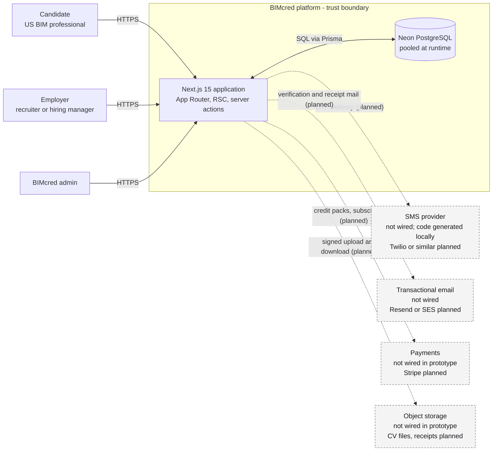
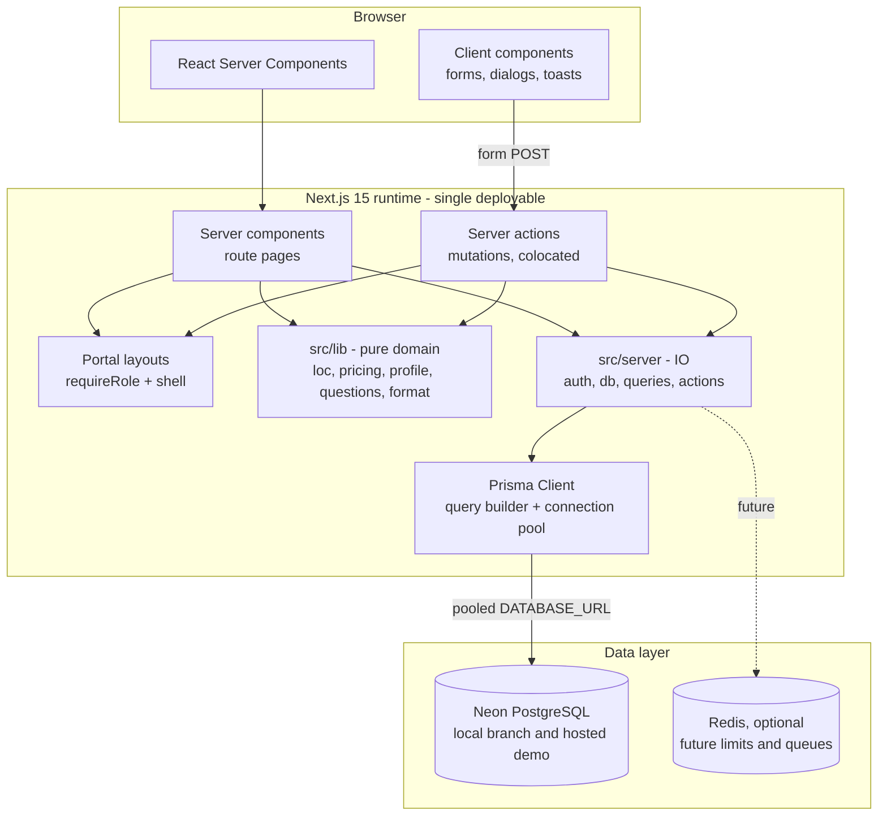
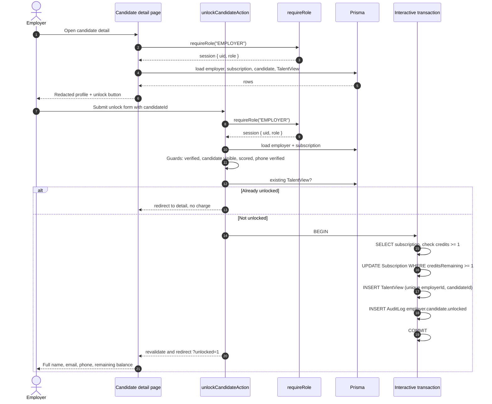
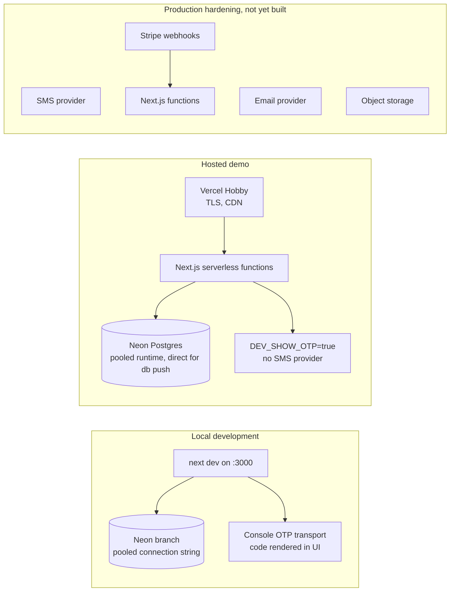
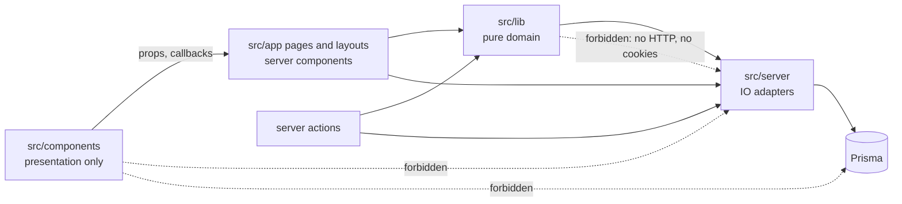
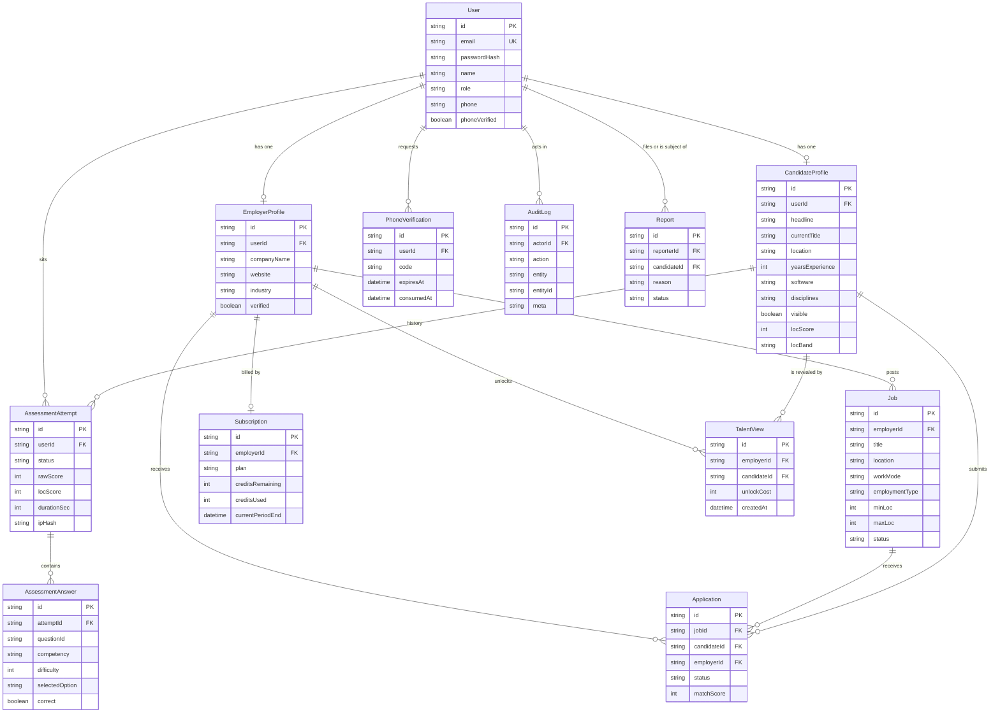
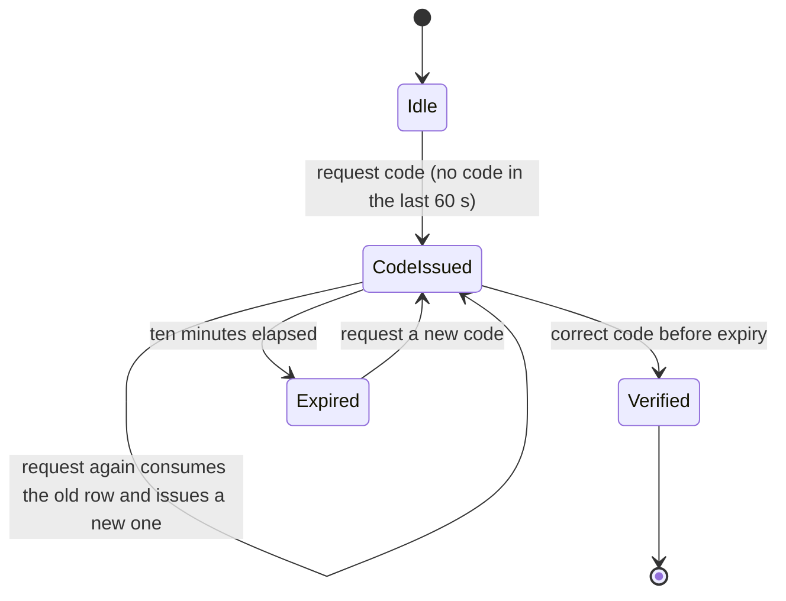
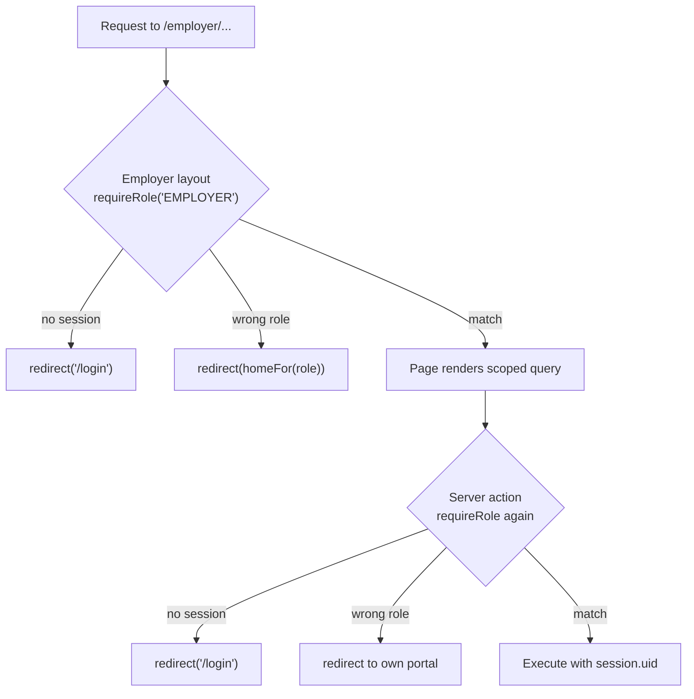
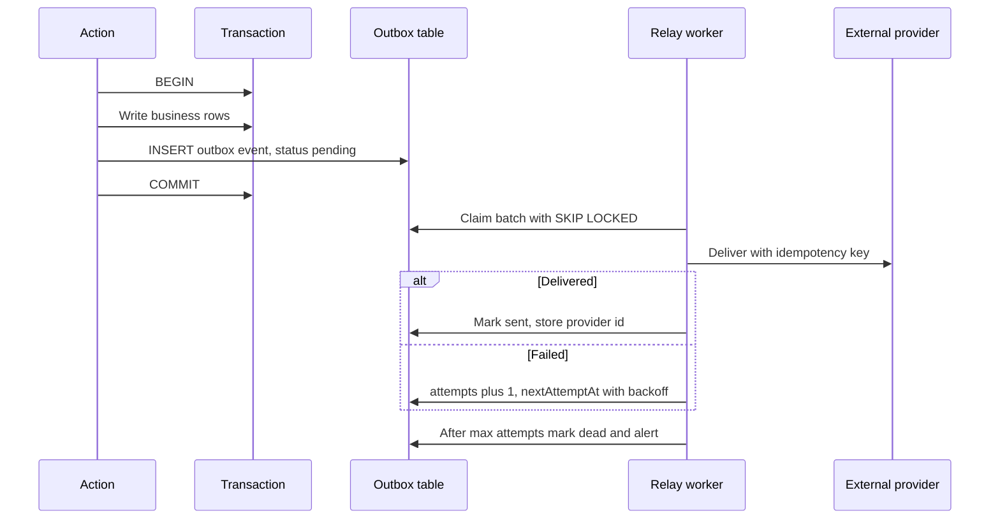

# BIMcred — System Architecture

Status: living document, matches the frozen prototype in this repository.
Audience: engineers joining the project, reviewers, and whoever has to run this in production.
Scope: the Next.js 15 application in `src/`, its data model, its runtime topology, and the
operational envelope around it. Product policy, security controls, and deployment steps live in
`04b-security-and-compliance.md` and `04c-deployment-runbook.md`.

Terminology used throughout:

| Term | Meaning |
| --- | --- |
| LOC | Level of Competence. An integer 100–500, "LOD for people". |
| Band | The labelled range a LOC falls into (Emerging … Expert). |
| Unlock | The billable action that reveals a candidate's identity to one employer. |
| Attempt | One completed sitting of the 15-question assessment. |
| Portal | One of the three authenticated surfaces: candidate, employer, admin. |

---

## 1. Architecture overview

### 1.1 What the system does

BIMcred is a talent marketplace with a verification gate. Candidates join free, prove possession
of a US mobile number, complete a 15-question BIM assessment, and receive a LOC score. Employers
pay for credits and spend one credit to reveal a candidate's identity. Admins moderate the
marketplace, inspect employer accounts, and read the audit trail.

The whole product is one deployable: a Next.js 15 App Router application with server actions,
Prisma, and a relational database. There is no separate API service, no message broker, and no
background worker in the prototype. That is a deliberate choice, documented in section 2, and the
boundaries in section 7 describe exactly where the first worker will be inserted.

Three properties drive most of the design:

1. **Scarcity is the business model.** A credit is spent once per (employer, candidate) pair. The
   unlock path must be exactly-once under concurrency, because a double spend is a refund and a
   support ticket.
2. **The score is a claim we have to defend.** LOC must be reproducible from stored answers, and
   the assessment must be resistant to trivial farming. See section 13.
3. **Candidate data is personal data.** Before unlock, an employer sees a redacted projection.
   After unlock, they see contact details. That boundary is enforced server-side, not by hiding
   fields in the UI.

### 1.2 System context



All four dashed integrations are unimplemented. They are drawn to show where the seams will be, not
to imply a current dependency.

Actors and their trust level:

| Actor | Authenticated | Trust assumption |
| --- | --- | --- |
| Candidate | Yes, cookie session, role `CANDIDATE` | Owns the phone number on the profile. May be adversarial about the assessment. |
| Employer | Yes, cookie session, role `EMPLOYER` | Authorised to act for one employer organisation. May try to enumerate candidates without paying. |
| Admin | Yes, cookie session, role `ADMIN` | Trusted operator. Mutations are audited; reads are not. |
| SMS provider | No | Planned. Not a current dependency. |
| Email provider | No | Planned. Not a current dependency. |
| Payments | No | Planned. Credits are currently seeded, topped up, or admin-granted without money. |
| Object storage | No | Planned. No uploads exist. |

### 1.3 Container view



Reading the diagram: there is no `middleware.ts` in the prototype. The portal layout runs
`requireRole` on every server render, and each action calls it again. `src/lib` is pure: it has no
cookies, no Prisma, and no network. `src/server` owns the database client, the session helpers, the
read models, and the actions. Client components never import Prisma; server components may query
through `src/server/queries.ts` or, on a detail page, through `db` directly.

The browser never receives a database row. Every page is rendered on the server; the client bundle
contains form scaffolding and presentation only. The employer talent list query does not select
candidate email or phone. The detail page selects them but renders them only inside the unlocked
branch, and applies `redactName` to the display name before unlock. Section 6 records the exact
fields and the manual review rule; the prototype has no automated response-shape test.

### 1.4 Primary flow: employer unlocks a candidate

This is the flow the whole business rests on. It is a single server action, one interactive
transaction, one unique constraint, one audit row.



Failure branches:

| Condition | Result |
| --- | --- |
| Employer is not `verified` | Redirect back to the detail page with "company must be verified"; no read of contact fields, no charge. |
| Candidate is hidden, has no LOC score, or has no verified phone | Redirect to `/employer/talent` with "no longer available"; no charge. |
| Subscription is missing or `creditsRemaining < 1` | Inside the transaction the conditional `updateMany` matches 0 rows, `NO_CREDITS` is thrown, the transaction rolls back, and the action redirects with the top-up message. |
| Another request unlocks the same pair at the same time | The pre-check saw no row, but the unique `(employerId, candidateId)` constraint rejects the second insert. The whole transaction rolls back, so the credit is not spent; the action shows its generic retry message on the next attempt. |
| Audit insert fails | The transaction aborts. A credit is never spent without a corresponding audit row. |
| Database or connection error | The catch block turns it into "That unlock could not be completed. Try again."; the transaction has rolled back. |

The action has the shape `Promise<void>` and communicates through `redirect()`. Expected outcomes are
query-string flags (`?unlocked=1`, `?error=…`); there is no typed result object and no retry loop in
the prototype. A production build should add bounded retries for serialisation or PgBouncer errors and
return a discriminated result instead of a redirect-only interface.

### 1.5 Deployment topologies



The prototype is the local and hosted boxes. Both use the same PostgreSQL provider and the same
schema; only the connection strings differ. There are no route handlers: no `/api/health`, no
webhook receiver, and no public API. Everything in sections 7 to 11 about queues, caching, and
observability describes how the right box grows without a rewrite: the domain modules stay, the
transport and the store change.

---

## 2. Why this stack — decision log

Each decision is recorded with the alternatives that were actually considered. "Revisit when"
gives the trigger for reopening it, which prevents architecture debates from recurring on vibes.

### ADR-001 — Custom HMAC cookie session instead of NextAuth or Clerk

**Decision.** A single `httpOnly` cookie named `bimcred_session` holds
`base64url(JSON payload) + "." + base64url(HMAC-SHA256(payload))`. Seven-day expiry, role claim
inside the payload. Server helpers `getSession` and `requireRole` are the only readers.

**Alternatives rejected.**
- *NextAuth (Auth.js).* Brings an adapter model, a session table, OAuth flows, and a configuration
  surface we do not need for email + password. The custom format is roughly 120 lines and is fully
  auditable in one file, which matters because session verification is the security perimeter.
- *Clerk or Auth0.* Vendor dependency, per-MAU pricing, and candidate PII leaving our boundary in
  the prototype. Not compatible with "100% local, no paid services".
- *Server-side session table.* Better revocation, but adds a database round trip to every request
  and a table to operate. The prototype accepts the trade-off: a seven-day expiry, no per-user
  revocation, and rotating `SESSION_SECRET` signs everyone out at once (section 5.3).

**Consequences.** We own CSRF, rotation, and revocation semantics. No third-party login. No MFA
in the prototype. This is written down as a real limitation, not a feature.

**Revisit when.** We need SSO/SAML for enterprise employers, or a compliance customer demands
centralised session revocation and device management.

### ADR-002 — Prisma over Drizzle or raw SQL

**Decision.** Prisma with a single `schema.prisma`, generated client, and `prisma migrate` for
production.

**Alternatives rejected.**
- *Drizzle.* Excellent SQL ergonomics and smaller runtime, but migrations and relational querying
  are more manual, and the team optimises for predictable schema review over query micro-tuning.
- *Raw SQL with a thin mapper.* Best control, worst onboarding, and every join becomes hand-written
  type plumbing.
- *TypeORM.* Weaker type inference at the edges and a history of migration sharp edges.

**Consequences.** Prisma's interactive transactions are the backbone of the unlock invariant. We
accept a heavier engine binary, a generate step in CI, and the well-known serverless connection
problem, which is solved with a pooled connection string (section 11.3). The prototype does not use
`prisma migrate` yet: the local database is created with `db push`, and production must baseline a
migration history before the first managed deploy.

**Revisit when.** A hot query cannot be expressed efficiently, or cold-start engine size becomes
the dominant latency term. Both are localised: Prisma allows `$queryRaw` escape hatches.

### ADR-003 — PostgreSQL everywhere (Neon free tier)

**Decision.** `prisma/schema.prisma` declares `provider = "postgresql"` with `url = env("DATABASE_URL")`
(pooled, used at runtime) and `directUrl = env("DIRECT_URL")` (unpooled, used by `db push` and the
seed). The public demo and local development use the same provider, because Prisma fixes the provider
per schema and both builds share one generated client. A local Neon branch keeps development isolated
from demo data; Docker Compose is available for an offline local database.

**Why Postgres over SQLite.** Concurrent writers, real row-level transactions, `SELECT … FOR UPDATE`
if needed, point-in-time recovery, and managed hosting. SQLite serialises writers and is not viable
for a multi-instance deployment. The original prototype used SQLite for zero-install local review;
that convenience was traded for a single dialect once the app had to be hosted.

**Consequences.** The schema stays deliberately portable at the data-shape level: `String` statuses,
comma-separated sets, JSON-string payloads, cuid ids, and application-side lowercased email
uniqueness. There is no `prisma/migrations` directory yet; the demo uses `prisma db push`, and a paid
production deployment must baseline a reviewed migration history and apply it with
`prisma migrate deploy`. The unlock transaction's correctness does not depend on `SELECT FOR UPDATE`:
it uses a conditional `UPDATE … WHERE creditsRemaining >= 1` plus a unique index.

**Revisit when.** Never for the demo. Add read replicas, migrations, and a pooler sizing review when
the product moves beyond free tiers.

### ADR-004 — Modular monolith over microservices

**Decision.** One repository, one deployable, three portal areas and a shared domain layer with
boundaries held by convention.

**Alternatives rejected.**
- *Services per bounded context (identity, assessment, billing, search).* Four deploy pipelines and
  a distributed transaction between credits and unlocks, for a product with no traffic yet.
- *Serverless functions per endpoint.* Same distribution cost, plus cold starts on the unlock path.
- *A separate scoring service.* LOC scoring is pure arithmetic over 15 rows; it does not deserve a
  network hop.

**Consequences.** Module boundaries are enforced by convention and code review (section 3), not by
the network. The first extraction candidate is SMS delivery, because it is the only dependency with
retries, provider failover, and per-message cost.

**Revisit when.** One module needs an independent scaling profile or a different runtime, or team
size makes a single deploy queue a bottleneck.

### ADR-005 — Server actions over REST or tRPC

**Decision.** Mutations are colocated server actions in `src/server/actions`. Reads are server
components querying through `src/server/queries` or, on a detail page, through `db`. There are no
route handlers in the prototype: no health endpoint, no webhook, and no public API.

**Alternatives rejected.**
- *REST API plus a client data layer.* Duplicate types, hand-written fetch wrappers, and a public
  attack surface we would have to authenticate separately.
- *tRPC.* Good ergonomics, but it is a second schema to maintain next to Prisma and it encourages
  client-side data fetching where a server component is simpler and leaks less.
- *GraphQL.* Overkill; the query shapes are fixed by the pages.

**Consequences.** Actions are POST-only, run on the server, and are reachable by anyone who can
forge a request, so each one validates input and re-checks the role. Progressive enhancement works
without JavaScript. The prototype ships no automated test suite; verification is the type check, the
production build, and the manual smoke checklist in `04c-deployment-runbook.md`.

**Revisit when.** A native mobile client or a partner integration needs a stable public contract.

### ADR-006 — Vercel for the production target, containers as the escape hatch

**Decision.** Document Vercel + managed Postgres as the production path. Ship a `docker-compose.yml`
that runs the same app against Postgres for reviewers who want a self-contained stack.

**Alternatives rejected.**
- *Kubernetes.* Operational overhead with no payoff at this scale.
- *A single VM with Docker Compose.* Cheapest and simplest, but no zero-downtime deploys, no managed
  TLS, and we would own patching.
- *AWS Lambda + API Gateway by hand.* More moving parts than Vercel for the same runtime.

**Consequences.** The hosted demo is a Vercel Hobby build that runs `prisma generate && next build`
against Neon, with the schema and demo data pushed from the developer's machine via `db push` and the
seed. Local development needs no Docker if it uses a free Neon branch; the compose file uses a `full`
profile so a local Postgres can run alone. A paid production deployment would add a baseline migration
history and run `prisma migrate deploy` as a separate step.

**Revisit when.** We need long-running workers, WebSockets, or data residency in a specific region.
At that point the app moves to containers and the compose file becomes the seed of the real manifest.

### ADR-007 — Tailwind CSS v3, not v4

**Decision.** Tailwind 3 with a checked-in config and design tokens as CSS variables.

**Reason.** v4's CSS-first configuration was still settling when the prototype was frozen, and the
plugin ecosystem (forms, typography) is mature on v3. Upgrading later is a config migration, not a
component rewrite.

### ADR-008 — bcryptjs cost 10, not argon2

**Decision.** `bcryptjs` with cost factor 10, 12-byte random salt per hash, 72-byte input clamp.

**Alternatives rejected.**
- *argon2id.* Better memory hardness, but a native dependency that complicates serverless builds.
- *Node `crypto.scrypt`.* No native dep and strong, but hand-rolled parameter and encoding choices
  are a footgun; bcryptjs is boring and correct.
- *Cost 12.* Roughly 4× the CPU per login. At prototype scale, 10 is the right latency/security
  trade-off; production should move to 12 with a rehash-on-login path.

**Consequences.** bcrypt reads only the first 72 bytes of the input. The signup validator checks only
a minimum of 8 characters and sets no maximum, so a longer passphrase is silently truncated rather
than rejected. Production must enforce the 72-byte ceiling explicitly (and ideally raise the minimum
to 12) before the truncation becomes a user-visible surprise.

**Revisit when.** Production hardening: raise to 12 and store a `passwordAlgo` marker to allow
gradual rehash.

### ADR-009 — Plaintext OTP in the prototype, hashed OTP in production

**Decision.** The six-digit code is stored in `PhoneVerification.code` as plaintext, with a
ten-minute expiry and a `consumedAt` timestamp. `DEV_SHOW_OTP=true` makes the candidate verification
page render the active code; the flag is read directly and is not gated by `NODE_ENV`.

**Reason.** The demo must run with no SMS account, so the code has to be visible somewhere. Storing
it in plaintext keeps the console flow simple and lets a reviewer inspect the row. The cost is
explicit: anyone who can read the database during the ten-minute window can complete verification.

**Consequences.** Support can read a code back to a user, which is convenient and is not the desired
production behaviour. Production must hash the code before insert, compare in constant time, add an
attempt counter, and remove the UI reveal entirely. The prototype has no attempt counter, no
constant-time comparison, and no SMS transport; the schedule of those changes is in
`04b-security-and-compliance.md` section 14. The free public demo keeps `DEV_SHOW_OTP=true` because
no SMS is sent; it must never be used for real candidates, and the flag must be turned off as soon as
a real SMS provider is connected.

### ADR-010 — No ORM-level soft delete and no `deletedAt` column

**Decision.** Every row hard-deletes through its relation, and no model has a `deletedAt` column. There
is also no account-deletion action in the prototype. Candidate erasure is a manual DSAR procedure
documented in `04b-security-and-compliance.md`, not a product feature.

**Reason.** A blanket soft-delete flag quietly breaks unique constraints (`email`), leaks PII into
"deleted" rows, and complicates every query. Explicit handling per entity is more code but auditable;
admitting that the prototype has no deletion workflow is more honest than shipping a flag nobody
tests.

**Consequences.** `onDelete: Cascade` removes dependent rows when a user or job is deleted directly in
the database. Audit logs have no delete path in the application, but a database operator can still
remove them. Production needs an explicit erasure/anonymisation job plus an append-only audit role,
and it must decide how financial rows survive an erasure request.

---

## 3. Directory and layering conventions

### 3.1 Shape of the tree

```text
src/
  app/
    layout.tsx                  root shell, fonts, global styles
    page.tsx                    -> /
    login/page.tsx              -> /login
    signup/page.tsx             -> /signup
    candidate/
      layout.tsx                requireRole("CANDIDATE")
      page.tsx                  -> /candidate
      verify-phone/page.tsx
      assessment/page.tsx
      profile/page.tsx
      jobs/page.tsx
      applications/page.tsx
    employer/
      layout.tsx                requireRole("EMPLOYER")
      page.tsx                  -> /employer
      talent/page.tsx           -> /employer/talent
      talent/[id]/page.tsx      -> /employer/talent/[id]
      jobs/page.tsx
      jobs/new/page.tsx
      pipeline/page.tsx
      billing/page.tsx
    admin/
      layout.tsx                requireRole("ADMIN")
      page.tsx
      users/page.tsx
      employers/page.tsx
      assessments/page.tsx
      audit/page.tsx
  components/
    assessment-form.tsx         client form for the timed assessment
    auth-shell.tsx              shared login/signup shell
    loc-result.tsx              LOC result card and competency breakdown
    logo.tsx, nav-link.tsx
    portal-shell.tsx            shared portal chrome
    ui.tsx                      primitives: button, input, badge, meter, empty state
  lib/
    loc.ts                      scoring, bands, LOC formula
    questions.ts                fixed 15-question bank and competency catalogue
    pricing.ts                  plan catalogue, UNLOCK_COST
    format.ts                   dates, currency, jobMatchScore
    profile.ts                  profile completeness helpers, CSV helpers
    journeys.ts                 public marketing copy and journey content
  server/
    db.ts                       Prisma singleton
    auth.ts                     getSession, requireRole, hashing, OTP, phone normalisation
    queries.ts                  read models and projections, including talent search
    actions/
      auth.ts                   signup, login, logout
      candidate.ts              profile, phone, assessment, application
      employer.ts               job create, unlock, stage move, report, billing
      admin.ts                  employer verification, credits, visibility, reports
prisma/
  schema.prisma
  seed.ts
```

There is no `prisma/migrations` directory yet: the demo database, hosted or local, is created with
`prisma db push`. A paid production deploy needs a baseline migration (see the runbook), and every
later change lands as a reviewed, forward-only migration.

Portal folders are real URL segments: `/candidate` is a folder with its own layout, not a route-group
alias. There is no indirection between the file tree and the authorisation map, which is deliberate:
the first segment after the origin names the portal and the layout in that folder enforces the role.

### 3.2 Layering rules



Rules, in priority order:

1. **`src/lib` is pure.** Given the same inputs it returns the same outputs. No `cookies()`, no
   `headers()`, no `fetch`, no Prisma, no `Date.now()` read inside scoring (the caller passes a
   timestamp or a stored date).
2. **`src/server` owns all IO.** The Prisma client (`db.ts`), session and crypto helpers (`auth.ts`),
   read models (`queries.ts`), and the server actions (`actions/*.ts`) live here. Actions may import
   `src/lib`; `src/lib` never imports `src/server`.
3. **`src/components` render props.** No data fetching, no business branching beyond presentation.
   A component may format a LOC for display by calling `src/lib/format`; it may not compute one.
4. **Pages compose.** A server component reads the session, calls one or two query helpers, and
   passes plain objects down. Pages do not contain scoring or ledger logic.
5. **Actions validate, authorise, delegate.** Every action calls `requireRole`, resolves the caller's
   portal profile from the session id, parses `FormData` through small typed helpers, executes the
   domain work, audits it, revalidates, and redirects.
6. **No cross-portal imports.** A page under `app/candidate` does not import from `app/employer`;
   shared presentation lives in `components/ui.tsx` and `components/portal-shell.tsx`.

### 3.3 Validation at the boundary

Every server action parses `FormData` field by field before it touches the database. The prototype
uses a handful of small helpers (`field`, email and phone normalisers, integer parsers) rather than a
schema library; the important property is that untrusted input is narrowed at the edge, not inside a
query. Swapping in zod later is mechanical because the checks already live in one place per action.

```ts
// Reference shape, condensed from src/server/actions/employer.ts.
export async function unlockCandidateAction(form: FormData): Promise<void> {
  const session = await requireRole("EMPLOYER");
  const candidateId = field(form, "candidateId");

  const employer = await db.employerProfile.findUnique({
    where: { userId: session.uid },
    include: { subscription: true },
  });
  if (!employer) fail("/employer", "Employer profile not found.");
  if (!employer.verified) fail(`/employer/talent/${candidateId}`, "Verify your company first.");

  await db.$transaction(async (tx) => {
    // Conditional credit update, TalentView insert, and audit row, all or nothing.
  });

  revalidatePath("/employer/talent");
  redirect(`/employer/talent/${candidateId}?unlocked=1`);
}
```

Boundary rules:

| Input | Validation |
| --- | --- |
| Email | Trim, lowercase, regex shape check (`name@domain.tld`). Operator precedence is safe because the regex is evaluated as a whole. Uniqueness is enforced by the `User.email` unique index, with a pre-check for a friendly message. |
| Password | Minimum 8 characters, enforced in `signupAction`; bcrypt truncates at 72 bytes. The prototype does not enforce a maximum, a denylist, composition rules, or a confirmation field. Production should raise the minimum to 12 and follow NIST guidance. |
| Phone | `normalizeUsPhone` converts a 10-digit NANP number to `+1XXXXXXXXXX`; non-US country codes are rejected. The column is not unique at the database level. |
| OTP | Exactly six digits; exact match against `PhoneVerification.code` (plaintext in the demo). |
| LOC query filters | Band is mapped to one of five labels; numeric filters are parsed with `parseInt`, not clamped; the result limit is fixed at 60. |
| Job post | Title at least 4 characters and company verified; LOC window constrained to 100–500 with `minLoc <= maxLoc`; salary order validated; enums checked against the form values. |
| IDs | No shape check before the query. A malformed id reaches Prisma and, for a detail page, ends in `notFound()`. |

Validation failures never reveal whether a referenced row exists on the candidate detail page:
"does not exist" and "not visible to you" both render `notFound()`.

### 3.4 Server action conventions

- All mutations are form actions and therefore `POST`. No action mutates on `GET`.
- Actions return `Promise<void>`. Success ends in `redirect()`; an expected failure redirects back to
  the page with a human-readable message and the submitted values, so the form keeps its state.
  Unexpected errors are logged with a request id and mapped to a generic message.
- Actions never accept a `role`, `employerId`, `candidateId` identity, or `userId` from the form.
  Identity comes from the session; a `candidateId` in the form is a subject to authorise against, not
  proof of identity.
- After a mutation, revalidate the narrowest paths that changed (`/employer/talent`,
  `/employer/billing`, `/admin/audit`). Bulk `revalidatePath("/")` is forbidden because it defeats the
  static marketing page.
- Any action that spends money or reveals PII writes an audit row. The unlock and the assessment
  submit write inside the transaction; the admin credit grant writes its audit row immediately after
  the `upsert`.

---

## 4. Domain model in code terms

### 4.1 Persistence model

Twelve models, all with string `cuid` primary keys, `createdAt` defaults, and `updatedAt` where
mutation is expected. No composite natural keys except the unique pair on `TalentView`, which is a
load-bearing constraint rather than a convenience.



Notes that matter for implementation:

- **`TalentView` carries `@@unique([employerId, candidateId])`.** This is the double-spend guard of
  last resort. Even if application logic were wrong, the database refuses a second paid reveal.
- **`CandidateProfile.locScore` and `locBand` are a denormalised cache** of the latest completed
  `AssessmentAttempt`, together with `locVerifiedAt`. The band is always derived from the score by
  `bandFor()`, so the two can never disagree; anything reading the profile for search uses the cache,
  anything explaining a score reads the attempt.
- **`AssessmentAnswer` stores `difficulty`, `competency`, and `selectedOption` per row**, and the pair
  `(attemptId, questionId)` is unique, so a form resubmission cannot duplicate an answer. The weight
  used at scoring time is the item's difficulty (1, 2, or 3), frozen into the attempt's result.
- **`Subscription` is one row per employer** (`employerId` unique), with
  `creditsRemaining + creditsUsed = credits granted to date` as the ledger identity. There is no
  `creditsGranted` column: grants are events recorded in `AuditLog`, which is the prototype's
  append-only record (see 4.4 for the production replacement).
- **`AuditLog.meta` is a JSON string, `action` is a dotted verb** such as
  `employer.candidate.unlocked`, and `actorId` is nullable with `onDelete: SetNull`, so deleting an
  account never erases the audit trail. Never put a phone number, email, password hash, or OTP in
  `meta`.
- **`Application.employerId` is denormalised from `Job.employerId`** so the pipeline board is a
  single-table scoped read. `Application` also has `@@unique([jobId, candidateId])`, so a candidate
  cannot apply twice to one job.
- **Phone data lives on `User`** (`phone`, `phoneVerified`), and `PhoneVerification` links to `User`
  rather than to the candidate profile. One login owns one number.
- **Enum-like columns are strings.** Statuses are validated at the boundary and sets (software,
  disciplines, competencies) are comma-separated strings. This keeps the schema easy to extend
  without a migration; Postgres-native enums, `text[]`, and `jsonb` are deferred production work.

### 4.2 LOC scoring module (`src/lib/loc`)

**Responsibility.** Turn a submitted attempt into an integer score and a band. Pure. No IO, no clock.

**Inputs.** `answers: Array<{ questionId, optionId }>` plus the question bank in `src/lib/questions`.
**Outputs.** `{ locScore, rawScore, correct, total, band, byCompetency, breakdown, strengths, gaps }`.

**Formula.**

```text
earnedWeight  = sum(difficulty_i where answer_i is correct)
totalWeight   = sum(difficulty_i for all 15 items in the bank)
accuracy      = earnedWeight / totalWeight
locScore      = clamp(100, 500, round(100 + accuracy * 400))
band          = bandFor(locScore)
```

Difficulty weights are 1 (recall), 2 (applied), 3 (analysis). The bank is fixed at 15 items for a
given bank version, so `totalWeight` is identical for every candidate sitting it, which is what makes
scores comparable across sittings. In bank version 1 the mix is 5 × 1, 7 × 2, 3 × 3, for a total
weight of 28. Unanswered items count as incorrect but still contribute their weight to `totalWeight`,
so skipping is never better than guessing. Duplicate answers keep the last submission for an item;
unknown question ids are ignored and cannot inflate the denominator.

**Bands.**

| Band | Range | Interpretation |
| --- | --- | --- |
| Emerging | 100–199 | Recognises BIM concepts, limited applied project experience. |
| Developing | 200–299 | Routine modeling and documentation with support on coordination. |
| Competent | 300–399 | Independent across common BIM workflows; owns a defined workstream. |
| Proficient | 400–449 | Leads coordination and information-management decisions. |
| Expert | 450–500 | Cross-discipline command of delivery, standards and automation. |

**Invariants.**

1. Output is always an integer in `[100, 500]`; the transform is linear and monotonic, so more
   weighted-correct answers can never lower the score.
2. A bank with zero total weight is treated as zero accuracy, never as a division error.
3. Identical answers plus identical bank version always produce an identical score.
4. `band` is derived from `locScore` by `bandFor()`, never stored independently, so the two cannot
   disagree. Bounds are inclusive and cover 100–500 without gaps.
5. The attempt that produced a score is immutable after submission: answers, per-item difficulty and
   the resulting score are frozen. A later retake writes a new attempt and refreshes the profile cache;
   it does not rewrite history.

Worked example, bank version 1 (28 total weight): the candidate gets all 5 easy items, 4 of 7 medium,
and 1 of 3 hard — `earnedWeight = 5 + 8 + 3 = 16`, `accuracy = 0.5714`,
`locScore = 100 + round(228.6) = 329`, band **Competent**.

**Where it is called.** `submitAssessment` action (write path, stores attempt + answers + profile
cache in one transaction), the candidate result view (competency radar, strengths, gaps), the employer
candidate card (band and item-level explanation for unlocked profiles), admin assessment detail, and
the future recompute job (section 7.2).

**Deliberately not in this module.** Question selection, timing enforcement, anti-cheat checks, and
persistence. Those belong to the assessment action, which is allowed to be impure.

### 4.3 Matching and fit scoring (`src/lib/format.ts`)

**Responsibility.** Give a candidate a 0–100 heuristic for how well a posting fits them, so the job
feed can be triaged. This is the only scoring function in the product.

**Function.** `jobMatchScore(job, candidate)` combines three terms:

| Component | Points | Rule |
| --- | --- | --- |
| LOC window | 70 | Full points inside `[minLoc, maxLoc]`; linear decay of 1 point per 150 LOC outside the window. |
| Experience | 15 | `min(1, yearsExperience / 6)`. |
| Tool proxy | 15 | `min(1, softwareCount / 5)` when the job lists competencies, otherwise full points. |

```text
score = round(min(100, 70*locFit + 15*expFit + 15*toolProxy))
```

The result is stored on `Application.matchScore` when a candidate applies and rendered as "% fit".
A separate helper, `toolOverlap` in `src/server/queries.ts`, computes the percentage of a job's
competency keys present in a candidate's software list for display.

**What it is not.** It is not used to rank candidates against each other. Employer talent search
orders rows in SQL by `locScore DESC, updatedAt DESC`. It is not a learned model, it does not use
protected attributes, and it does not claim a candidate will succeed. The only tiebreak is the
database's `updatedAt`; there is no `candidateId` tiebreak and no pagination cursor in the prototype.

**Call sites.** `applyToJobAction` (writes `matchScore`), the candidate job list, and the pipeline
cards that show fit. The employer talent list uses LOC order, not this score.

### 4.4 Credit handling (`Subscription` plus the unlock action)

**Responsibility.** Keep the employer's unlock balance non-negative and make each first-time reveal
exactly once. There is no `src/lib/credits` module; the behaviour lives in
`src/server/actions/employer.ts`, with `UNLOCK_COST` and the plan catalogue in `src/lib/pricing.ts`.

**Implemented operations.**

| Operation | Where | Effect |
| --- | --- | --- |
| Read balance | `loadEmployerContext` | Returns `subscription.creditsRemaining`, `creditsUsed`, and the plan for the portal shell and billing page. |
| Spend on unlock | `unlockCandidateAction` | Conditional decrement, `TalentView` insert, and `employer.candidate.unlocked` audit row in one transaction. |
| Change plan | `changePlanAction` | Upserts the plan and **resets** `creditsRemaining` to the catalogue allowance. It does not carry a balance across plans. |
| Top up | `topUpCreditsAction` | Adds 1–500 credits to the existing balance; no payment processor is involved. |
| Admin grant | `grantCreditsAction` | Adds 1–500 credits after `requireRole("ADMIN")`; the audit row is written after the upsert. |

**Invariants.**

1. `creditsRemaining >= 0`. Enforced by `updateMany({ where: { creditsRemaining: { gte: 1 } } })`
   inside the transaction, not by a database check constraint.
2. At most one `TalentView` per `(employerId, candidateId)`, enforced by a unique index. A repeat
   visit redirects without charging.
3. A successful spend increments `creditsUsed` by the same amount and writes exactly one audit row
   in the same transaction.
4. Deduction and reveal are atomic. A process failure rolls both back.
5. `creditsRemaining + creditsUsed` is not a lifetime granted total: plan changes reset the balance,
   and top-ups are not reconciled against a payment record.

**Unlock preconditions.** Before the transaction: employer verified, candidate exists and is
`visible`, `locScore` is non-null, candidate `User.phoneVerified` is true, and the pair is not already
unlocked. Inside the transaction the balance is re-read and the conditional update re-checks it.
A candidate who hides their profile or has no score cannot be purchased.

**Documented limitation.** The prototype stores a balance on `Subscription` plus an audit trail
instead of a double-entry ledger. Admin grants are positive-only, have no required reason, and do
not support negative adjustments or refunds. Before real money flows, add an append-only
`CreditLedgerEntry` table `(employerId, delta, reason, refId, createdAt)` and derive the balance.

### 4.5 Phone verification (`PhoneVerification` plus candidate actions)

**Responsibility.** Issue, validate, and consume a six-digit US mobile code; set
`User.phoneVerified`; make a verified phone a prerequisite for the talent pool and for unlocking.



**Rules.**

| Rule | Value | Enforcement |
| --- | --- | --- |
| Code length | 6 digits from `crypto.randomInt` | `randomOtp()` in `src/server/auth.ts` |
| TTL | 10 minutes | `expiresAt` compared in `confirmOtpAction` |
| Resend cooldown | 60 seconds per user | Newest `PhoneVerification.createdAt` |
| Storage | Plaintext in the demo | `PhoneVerification.code`; hash before production |
| Comparison | Exact string match | No constant-time comparison and no per-code attempt counter |
| Number format | E.164 `+1` only, NANP shape | `normalizeUsPhone` |
| Consumption | Single use | `consumedAt` set on success or when a new code is requested |
| Success effect | `phoneVerified = true` | Same transaction as code consumption |

**Invariants.**

1. A new request consumes every unconsumed code for that user, so only one code is active.
2. An expired code cannot be redeemed even if it is the newest row.
3. A verified user cannot request another code; `sendOtpAction` rejects with "already verified".
4. The plaintext code exists in the database and, when `DEV_SHOW_OTP="true"`, in the candidate UI.
   It is not written to the audit log.
5. Candidates cannot appear in employer search or be unlocked without `phoneVerified = true`.

**Call sites.** `/candidate/verify-phone`, `sendOtpAction`, `confirmOtpAction`, the assessment gate,
and the unlock guard. Signup does not send an OTP; the candidate is redirected to the verification
page after sign-up.

**Gaps.** No per-code attempt counter, no IP or per-phone hourly cap, no carrier/VoIP screening, and
no rate limiter outside the 60-second cooldown. Section 04b lists these as production requirements.

### 4.6 Audit trail (`AuditLog` and per-action helpers)

**Responsibility.** Append the business record of who did what to which subject.

**Shape.** `AuditLog { actorId?, action, entity, entityId?, meta, createdAt }`. `action` is a dotted
verb, `entity` is a model name, and `meta` is a JSON-encoded string of ids, amounts, and small enums.
`actorId` is nullable and `onDelete: SetNull`, so removing a login does not erase history.

**Implementation.** There is no `src/lib/audit` module. `candidate.ts`, `employer.ts`, and `admin.ts`
each define a local `audit(actorId, action, entity, entityId, meta)` helper that calls
`db.auditLog.create(...)`. The unlock and assessment-submit paths inline the create inside the
transaction; the other helpers swallow a failed write with `.catch(() => undefined)`.

**Action catalogue.**

| Action | When | Entity |
| --- | --- | --- |
| `auth.signup` | Account created | User |
| `auth.login` | Successful login | User |
| `candidate.profile.updated` | Profile edit committed | CandidateProfile |
| `candidate.phone.otp_sent` | Code issued | User |
| `candidate.phone.verified` | OTP consumed successfully | User |
| `candidate.assessment.started` | Attempt opened | AssessmentAttempt |
| `candidate.assessment.completed` | Attempt submitted and scored | AssessmentAttempt |
| `candidate.application.submitted` | Application created | Job |
| `candidate.application.withdrawn` | Candidate withdrew | Application |
| `employer.profile.updated` | Company profile edit | EmployerProfile |
| `employer.verification_requested` | Employer asks for verification | EmployerProfile |
| `employer.job.created` | Job saved | Job |
| `employer.job.status_changed` | Draft, open, or closed | Job |
| `employer.application.moved` | Pipeline stage change | Application |
| `employer.candidate.unlocked` | Credit spent and reveal created | CandidateProfile |
| `employer.candidate.reported` | Report filed | CandidateProfile |
| `billing.plan.changed` | Plan switch in the prototype | Subscription |
| `billing.credits.top_up` | Credit pack added | Subscription |
| `admin.credits.granted` | Manual balance change | EmployerProfile |
| `admin.employer.verified` / `.unverified` | Admin verification decision | EmployerProfile |
| `admin.candidate.visible` / `.hidden` | Search visibility decision | CandidateProfile |
| `admin.candidate.phone_verified` / `.phone_unverified` | Manual phone override | User |
| `admin.report.resolved` / `.dismissed` | Moderation decision | Report |

**Rules.** Append-only by convention: there is no update or delete path in application code, but no
database role prevents one. `/admin/audit` reads the newest 40 rows with an optional entity filter and
the actor join. Reading the audit log is not itself audited, and viewing a candidate's contact data in
the admin console does not write a separate PII-access row in the prototype.

---

## 5. Authentication and authorisation

### 5.1 Session token format

```text
Set-Cookie: bimcred_session=<payload>.<signature>; Path=/; HttpOnly; SameSite=Lax; Max-Age=604800
payload   = base64url(JSON.stringify(claims))
signature = base64url(HMAC-SHA256(SESSION_SECRET, payload))
```

Claims, as defined by `SessionUser` in `src/server/auth.ts`:

| Claim | Type | Purpose |
| --- | --- | --- |
| `uid` | string | `User.id`. Every query and action scopes by this. |
| `email` | string | Display only; refreshed at login, not on profile change. |
| `name` | string | Display only; rendered in the portal shell. |
| `role` | `CANDIDATE` \| `EMPLOYER` \| `ADMIN` | Coarse routing and role gate. |
| `exp` | number | Expiry in Unix seconds, set to `now + 604800` at sign-in. |

This is not a JWT. There is no header, no `alg` field, and therefore no algorithm-confusion attack:
verification always means HMAC-SHA256 with the one configured key. The signature is compared with
`crypto.timingSafeEqual` after a length check.

The cookie is `httpOnly`, `SameSite=Lax`, `Path=/`, and `Secure` only when `NODE_ENV=production`, so
local HTTP development works. There is no `Domain` attribute, no `__Host-` prefix, and no separate
CSRF cookie.

### 5.2 Verification path

1. Read the `bimcred_session` cookie. A missing cookie means anonymous; no error.
2. Split the value on `.` and require both a payload segment and a signature segment.
3. Recompute the HMAC over the payload and compare in constant time.
4. Base64url-decode and `JSON.parse` inside a `try/catch`. Reject on any throw.
5. Require `uid` to be a string, `role` to be in `["CANDIDATE", "EMPLOYER", "ADMIN"]`, and `exp` to be
   a number in the future. `email` and `name` are trusted for display but are not type-checked.
6. Return the claims. **No database lookup happens on any request.**
7. `requireRole(role)` compares the claim to the required role. If the visitor is unauthenticated it
   redirects to `/login`; if the role differs it redirects to that role's home
   (`/candidate`, `/employer`, `/admin`). It never returns a 403 and never reloads the user row.

Two consequences follow directly from step 6, and both are accepted prototype limits:

- A role change or account deletion is not reflected until the cookie expires or the signing secret
  is rotated. Portal pages that load a missing profile redirect to `/login`, but the token itself is
  still accepted.
- A stolen cookie is valid for up to seven days. There is no device list, session table, or per-user
  revocation.

The parser uses the first two dot-separated segments; a hardening change is to reject any token whose
split length is not exactly two.

### 5.3 Rotation and invalidation

- **Key rotation.** `SESSION_SECRET` signs and verifies with the same key. There is no
  `SESSION_SECRET_PREVIOUS` support in the code. Replacing the secret invalidates every existing
  session, which is the correct response to a leak but is a global logout. Rotate on a schedule and
  immediately on suspicion; plan a maintenance announcement for the scheduled case.
- **Per-user invalidation.** Not implemented. Changing a password, changing a role, hiding a profile,
  or marking a phone unverified does not invalidate an existing cookie.
- **Logout** calls `clearSessionCookie()` and redirects to `/`. The browser deletes the cookie; a copy
  taken before logout remains valid until `exp`.
- **Expiry.** Fixed seven days, no sliding renewal. There is no "remember me" and no refresh token.

Production needs a server-side session record or a revocation list before it can honestly offer
device management, admin suspension, or "sign out everywhere".

### 5.4 CSRF strategy

The prototype relies on two properties:

1. Every mutation is a Next.js server action invoked by a form `POST`. There is no mutation on `GET`.
2. The session cookie is `SameSite=Lax`, so a cross-site form POST does not carry the cookie in
   modern browsers.

That is the whole strategy. There is **no origin check**, no double-submit token, and no
synchroniser token in the code. `APP_URL` is documented in `.env.example` but is not read by any
module. Non-browser clients are irrelevant because they cannot obtain the victim's cookie.

Before production, add an `Origin`/`Sec-Fetch-Site` check on every mutating action, compare it with
`APP_URL`, and reject with a typed error. Add a synchroniser token if the product ever exposes a
public API or a cross-origin embed.

### 5.5 Role gates in the layout and the action



- **Layouts are the first gate.** `candidate/layout.tsx`, `employer/layout.tsx`, and
  `admin/layout.tsx` each call `requireRole`. This covers every page under the folder, including pages
  added later, and renders the portal shell only after the check.
- **Actions are the authoritative gate.** Every mutating action calls `requireRole` again, because an
  action endpoint can be invoked without rendering the layout that guards the page. UI hiding is never
  a control.
- **There is no middleware.** No edge check, no redirect layer, and no route matcher to keep in sync.
  The cost is a session verification on every server render, which is a local HMAC computation.
- **Ownership is re-asserted on the row.** `requireRole` establishes the role, not the tenant. Actions
  then load the employer by `userId = session.uid`, or load the job/application and compare its
  `employerId` to the loaded employer. A mismatch is a redirect with "not found", not a 403.

Admin pages use the same layout and action pattern with `requireRole("ADMIN")`. The prototype does not
write a separate audit row when an admin views candidate PII; it does audit the admin mutations listed
in section 6.4.

### 5.6 Password policy

| Rule | Value | Reality in the prototype |
| --- | --- | --- |
| Minimum length | 8 characters | Enforced in `signupAction` with "Use at least 8 characters". |
| Maximum length | 72 bytes | Not enforced; bcrypt silently truncates beyond 72 bytes. |
| Composition rules | None | No symbol, case, or digit requirement. |
| Denylist | None | No common-password or email-local-part check. |
| Hashing | bcryptjs, cost 10, per-password salt | `hashPassword` / `verifyPassword` in `src/server/auth.ts`. |
| Confirmation | Field may be present in the form | Not validated server-side; the action reads only `password`. |
| Reset | Not implemented | A locked-out user needs manual support. |

Login returns the same message for an unknown email and a wrong password: "That email and password
combination does not match our records." It does **not** compare against a dummy hash when the email is
unknown, so the unknown-email path is faster. Equalising that timing is a production hardening item.

Before production: raise the minimum to 12, enforce the 72-byte ceiling explicitly, add a breached
password check, and implement a signed single-use reset token with a 30-minute TTL.

### 5.7 Rate limits and abuse controls

Only the controls below exist in code. Everything in the second table is a production requirement.

| Implemented control | Behaviour | Location |
| --- | --- | --- |
| OTP resend cooldown | One request per user per 60 seconds; a new request consumes the previous code. | `sendOtpAction` |
| One active assessment | An `IN_PROGRESS` attempt is reused; an attempt older than 15 minutes plus 60 seconds is marked `EXPIRED`. | `startAssessmentAction` |
| One completed assessment | A second attempt is refused with "You have already completed the assessment." | `startAssessmentAction` |
| Assessment time box | 15 minutes server-enforced; submission is rejected after 15 minutes plus 120 seconds. | `submitAssessmentAction` |
| One application per job | Unique `(jobId, candidateId)` plus a pre-check. | `applyToJobAction` |
| One unlock per pair | Unique `(employerId, candidateId)`; repeat visits are free. | `unlockCandidateAction` |
| Credit floor | Conditional `updateMany` keeps the balance non-negative. | unlock transaction |

| Planned control | Intended key and limit |
| --- | --- |
| Login | 5 attempts / 15 min, then exponential backoff, keyed by `email + ipHash`. |
| Signup | 3 / hour per `ipHash`. |
| OTP verify | 5 attempts per code and 10 / hour per IP. |
| Unlock | 30 / min per employer. |
| Talent search | 120 / min per employer. |
| Admin export | 5 / hour per admin. |

There is no rate-limit module, no in-memory bucket, and no shared counter in the prototype. A
production deployment with more than one instance needs Redis or a Postgres table keyed by
`(key, windowStart, count)`; an in-process limiter would reset on deploy and would not coordinate
across functions.

### 5.8 Account enumeration

| Surface | Behaviour | Assessment |
| --- | --- | --- |
| Login | Uniform "email and password" message for both failure modes. | Good, except the timing difference noted in 5.6. |
| Signup | An existing email returns "That email is already registered. Sign in instead." | Deliberate enumeration trade-off for usability; production should use a neutral "check your email" page and send a notice to the existing owner. |
| OTP request | Requires an authenticated candidate session, so it cannot be used to test arbitrary numbers. Resend is limited by the 60-second cooldown. | Acceptable for the prototype. |
| Candidate detail by id | `notFound()` for both "missing" and "hidden from you". | Good. |
| Email verification | None. There is no double opt-in and no "is this address registered" endpoint. | Production gap. |

There is no public user search or autocomplete. Employer search covers `headline`, `currentTitle`,
and `bio` only; it does not search email, phone, or name.

---

## 6. Multi-tenancy and data access rules

### 6.1 Tenancy model

One database, shared schema, tenant column. The tenant is the employer organisation, represented by
`EmployerProfile.id` (referred to as `employerId`). Candidates are global subjects, not tenants:
their profile is visible to many employers only through the unlock mechanism. Admins are cross-tenant
by role, not by data.

Every employer-owned row carries `employerId`:

| Model | Column | Note |
| --- | --- | --- |
| `Job` | `employerId` | Foreign key to `EmployerProfile.id`. |
| `Subscription` | `employerId` | Unique: one subscription per employer. |
| `TalentView` | `employerId` | Unique pair with `candidateId`; the unlock record. |
| `Application` | `employerId` | Denormalised from `Job.employerId` at apply time so the pipeline board is one predicate, not a join. |

The `Application.employerId` copy is written by `applyToJobAction` from the loaded job. There is no
database constraint tying it back to `Job.employerId`; application code is the integrity boundary.
`Application.candidateId` and `TalentView.candidateId` point at `CandidateProfile.id`, not `User.id`.
The employer's own login is resolved through `EmployerProfile.userId = session.uid`.

### 6.2 The scoping helpers

Read-side scoping lives in `src/server/queries.ts`. The relevant functions are:

```ts
// src/server/queries.ts - reference shape
export function loadEmployerContext(userId: string) { /* employer + subscription + jobs + views */ }
export function searchTalent(filters: TalentFilters, limit = 60) { /* global visible pool */ }
export function isUnlocked(employerId: string, candidateId: string): Promise<boolean> { /* ... */ }
export function unlockedCandidateIds(employerId: string): Promise<Set<string>> { /* ... */ }
export function employerApplications(employerId: string) { /* where: { employerId } */ }
```

Rules:

1. **Pages never accept a tenant id from the URL or a form field.** They call
   `loadEmployerContext(session.uid)` and use the returned `employer.id`. No page has a hidden
   `employerId` input.
2. **Ids from the URL are subjects, not ownership proof.** An action that receives a `jobId` or
   `applicationId` loads the row and compares its `employerId` with the tenant derived from the
   session. A mismatch redirects with "not found"; it does not render a 403.
3. **The employer pipeline is scoped by a single predicate.** `employerApplications(employerId)` uses
   `where: { employerId }`; `moveApplicationAction` re-checks `application.employerId`.
4. **Job mutations re-assert through the relation.** `setJobStatusAction` loads the job with its
   employer and compares `job.employer.userId` to `session.uid`.
5. **The talent pool is global on purpose.** `searchTalent` is not tenant-scoped; it is filtered to
   `visible`, non-null `locScore`, and `user.phoneVerified`, and it does not select contact fields.
6. **Admin queries are the deliberate exception.** They live in the same query module and are called
   only from pages guarded by `requireRole("ADMIN")`.

There is no `redact.ts` module, no `employerJobWhere` helper, and no `assertEmployerOwns` function in
the codebase. The checks are inline and repeated per action; a production refactor should extract them
so a missing check becomes a type error rather than a review question.

### 6.3 Candidate PII redaction

Redaction is implemented in two places:

- `searchTalent` selects `user: { select: { name, phoneVerified } }`. Email and phone are never
  loaded for the list.
- The list page and the detail page call a local `redactName(name)` that returns "Maya C." for
  "Maya Chen". The detail page selects email and phone but renders them only inside the `unlocked`
  branch.

| Field | Before unlock | After unlock | Notes |
| --- | --- | --- | --- |
| Display name | First name + last initial ("Maya C.") | Full name | `redactName`; server-side. A single-token name is returned unchanged. |
| Headline, current title | Visible | Visible | Candidate-authored. |
| Bio | Visible | Visible | Rendered in full on the detail page. |
| Location | Visible | Visible | City/state text, not an address. |
| LOC score and band | Visible | Visible | The shop window; also a search filter. |
| Years of experience, availability, work mode, work authorization | Visible | Visible | All are profile fields in the search result. |
| Disciplines, software | Visible | Visible | Comma-separated keys rendered as labels. |
| Phone-verified badge | Visible | Visible | Part of the trust signal. |
| Email | Not selected in the list; hidden on the detail page | Rendered on the detail page | There is no candidate-controlled contact toggle. |
| Phone | Not selected in the list; hidden on the detail page | Rendered as `(512) 555-0142` | Same unlock condition as email. |
| Assessment detail | Score, band, and competency-level correct counts | Same | Selected options and the answer key are not rendered to employers. |
| Reports and moderation | Not exposed | Not exposed | Admin console only. |

The prototype has no field called `employerHistory`, no portfolio or CV fields, and no internal
fraud flags on the candidate model. The test that would assert a serialised redacted row contains no
forbidden keys does not exist; the manual rule is that any new PII field must be added to
`searchTalent`'s `select` deliberately and rendered behind the `unlocked` branch.

### 6.4 Admin override

Admins can read full user rows and change platform state. Every mutation is role-gated and audited:

| Capability | Surface | Audit action |
| --- | --- | --- |
| Verify or unverify an employer | `/admin/employers` | `admin.employer.verified` / `admin.employer.unverified` |
| Grant 1–500 unlock credits | `/admin/employers` | `admin.credits.granted` |
| Mark a candidate's phone verified or unverified | `/admin/users` | `admin.candidate.phone_verified` / `admin.candidate.phone_unverified` |
| Hide or restore a candidate in search | `/admin/users` | `admin.candidate.visible` / `admin.candidate.hidden` |
| Resolve or dismiss a report | `/admin` | `admin.report.resolved` / `admin.report.dismissed` |

Boundaries:

- There is no separate "view candidate PII" action and therefore no `ADMIN_PII_VIEWED` row. Reading
  `/admin/users` is not audited; only the mutations above are.
- Credit grants are positive-only. There is no refund, no negative adjustment, and no required
  reason. The amount is clamped to 1–500 in the action.
- Report resolution accepts an optional free-text resolution, capped at 400 characters.
- Admins cannot impersonate a candidate or employer. There is no "view as" token swap.
- Admin list queries are global and role-gated. They return full `User` rows, including
  `passwordHash`; the pages render only contact fields, but the query projection is broader than it
  needs to be and should be narrowed before production.

### 6.5 Data access summary

| Surface | Scope predicate | PII level |
| --- | --- | --- |
| `/candidate/*` | `CandidateProfile.userId = session.uid` via `loadCandidateContext` | Own data, full |
| `/employer/talent` | Global, `visible = true`, `locScore != null`, `user.phoneVerified = true`; list selects name and badge only | Redacted preview |
| `/employer/talent/[id]` | Any candidate by id; hidden or unscored candidates 404 unless already unlocked; contact fields rendered only if a `TalentView` exists for this employer | Redacted or full |
| `/employer/jobs`, `/employer/pipeline` | `Job.employerId = tenant` / `Application.employerId = tenant` | Candidate name and application data; contact only for unlocked pairs |
| `/employer/billing` | `Subscription.employerId = tenant` | No candidate PII |
| `/admin/*` | Global, role-gated; mutations audited | Full, with the gaps noted in 6.4 |

An employer keeps access to a candidate's contact details after the candidate sets `visible = false`,
because the unlock is permanent. That is a product decision recorded here: the candidate can hide
from new searches but cannot revoke an existing introduction.

---

## 7. Asynchronous work and reliability

### 7.1 What is synchronous in the prototype

| Work | Why synchronous | Failure behaviour |
| --- | --- | --- |
| Audit writes | They should be atomic with the business effect. | Unlock and assessment audit rows are inside the transaction, so a failure aborts the whole write. The per-action helpers in other paths swallow a failed insert with `.catch(() => undefined)`. |
| LOC scoring | Pure arithmetic over 15 rows; a queue would add latency and a consistency gap. | Submit fails and nothing is stored. |
| Credit spend | Exactly-once requirement; a queue would make the UX "maybe unlocked". | See 7.4. |
| OTP generation and storage | The candidate is waiting for the code. | Request fails with an error flag; no code is stored. |
| OTP delivery | There is no delivery step. | The code is stored and, in the demo, rendered when `DEV_SHOW_OTP="true"`. |
| Transactional email | Signup notification only. | New Candidate/Employer signups POST to FormSubmit's free AJAX endpoint; the recipient defaults to `ramesh@jobs2india.com` and is configurable with `SIGNUP_NOTIFY_EMAIL`. Delivery failures are logged and never block signup. |

The asymmetry is deliberate: block on things that change money or records, never block on a
notification. The prototype simply has no notification path to block on.

### 7.2 What moves to a queue

The prototype has no queue, no `JobQueue` port, no cron route, and no worker process. The table is the
production target.

| Job | Trigger | Why it must not be inline later |
| --- | --- | --- |
| SMS delivery and retries | OTP request | Provider latency and failover; a 3 s p99 provider would otherwise be our p99. |
| Email delivery | Signup, unlock, receipts | Batching, bounce handling, suppression lists. |
| PDF receipts | Credit purchase | CPU-heavy, minutes-later is fine. |
| Search index sync | Profile or job change | Keeps the write path small; enables a dedicated index. |
| LOC recompute | Question-bank change | Bulk, slow, must be resumable and idempotent. |
| Analytics export | Nightly | Batch, not request-scoped. |
| Payment reconciliation | Hourly | Compares provider state to the balance and audit trail. |

### 7.3 Outbox pattern

When a transaction must both commit state and cause an external effect (send an SMS, grant credits
from a payment webhook), write an outbox row in the same transaction and let a relay deliver it:



Prototype reality: there is no outbox table and no relay. The only external effect that would need one
is SMS delivery, and that is not wired. The outbox is the first infrastructure piece to add when a
real provider is connected (checklist in the runbook).

### 7.4 Avoiding double spend

Three guards exist, in order of how early they act:

1. **Application check.** `talentView.findUnique` before the transaction. Fast path for the common
   "already unlocked" case, and it saves a write transaction. Not sufficient alone.
2. **Conditional update.** `updateMany` sets `creditsRemaining = creditsRemaining - UNLOCK_COST` and
   increments `creditsUsed`, with `where: { employerId, creditsRemaining: { gte: UNLOCK_COST } }`.
   The row count tells the action whether it won. This is atomic on Postgres without an explicit
   lock.
3. **Unique constraint.** `@@unique([employerId, candidateId])` on `TalentView`. If two requests both
   pass step 2 for the same pair, the second insert fails and the transaction rolls back, returning
   the credit.

There is no request idempotency key on the action and no retry loop. A retried form submission after a
successful commit hits guard 1 and redirects without a charge; a retry after a database error is left
to the user.

Production should add bounded retries for `SQLITE_BUSY`, `P2034` (write conflict/deadlock), or
serialisation failure, with 20/50/120 ms jittered backoff, and must never retry a validation error or
an insufficient-credit result.

### 7.5 Retries, backoff, and dead letters

No retry or dead-letter machinery exists in the prototype. The production policy below applies to the
queue and outbox described in 7.2 and 7.3.

| Concern | Policy |
| --- | --- |
| Base delay | 1 s, doubling per attempt. |
| Max delay | 5 minutes. |
| Jitter | Full jitter (`random(0, delay)`) to avoid thundering herds. |
| Max attempts | 5 for SMS, 8 for email, 10 for webhook processing. |
| Dead letter | `status = dead`, `lastError` stored, alert fires, admin can replay. |
| Poison message | Same payload failing five times is quarantined without blocking the queue head. |
| Ordering | Per-key FIFO where it matters (all events for one employer); global ordering is not guaranteed. |

### 7.6 Failure isolation

The prototype makes no external calls, so there is nothing to time out. The credit transaction never
contains a network call, which is the property to preserve when notifications move out of band.

Production rule: wrap every external call with a timeout (2 s for SMS, 3 s for email, 5 s for payment)
and a circuit breaker after five consecutive failures in 60 s. Open circuit means a fast, typed error,
not a hung request. Notifications are emitted after commit from the outbox, never inside the credit
transaction.

---

## 8. Caching and performance

### 8.1 What is cached, and for how long

| Asset | Mechanism | Freshness | Invalidation |
| --- | --- | --- | --- |
| `/` marketing page | Static render at build | Immutable per deploy | Deploy, or `revalidatePath("/")` if copy becomes dynamic |
| Plan catalogue and credit pack prices | Module constant plus static render | Per deploy | Deploy |
| LOC band definitions and labels | Module constant (`src/lib/loc`) | Per deploy | Deploy, and only with a bank version bump |
| Question bank | Server-only module, not HTTP-cached | Per deploy | Deploy |
| Candidate and employer portal pages | Rendered per request; the layout reads the session cookie | Live | `revalidatePath` after mutations |
| Talent search results | Rendered per request from the search params | Live | `revalidatePath("/employer/talent")` after unlock/profile changes |

There is no `unstable_cache`, no `noStore()`, and no `React.cache` in the code. The rule is:
**public, identical for everyone, safe to be stale** may be cached. Anything keyed to a session, a
credit balance, a LOC score, or a person is rendered fresh. A stale credit balance is a support ticket;
a stale marketing headline is not.

### 8.2 Next.js primitives in use

- Async server components read `cookies()` through `getSession()`; the portal layouts therefore render
  dynamically without an explicit `force-dynamic` export.
- `revalidatePath` after mutations: `/employer/billing` after spend, grant, plan change, or top-up;
  `/employer/talent` and `/employer/talent/[id]` after unlock or profile edit; `/candidate` after
  assessment submit; `/admin/*` after moderation.
- `redirect()` carries success and error outcomes through query-string flags rather than return values.
- `notFound()` hides both missing and hidden candidates on the detail page.
- Prisma's client is a `globalThis` singleton in `src/server/db.ts` to survive development HMR and warm
  serverless instances. No query result is cached across requests.

### 8.3 Performance targets

These are targets for a production deployment, not measurements taken from the prototype.

| Interaction | p50 target | p95 target | p99 ceiling |
| --- | --- | --- | --- |
| Marketing page (cached) | 40 ms TTFB | 120 ms | 300 ms |
| Portal page render (one DB round trip) | 90 ms | 250 ms | 600 ms |
| Talent search, 2 000 candidates, 60 rows | 120 ms | 350 ms | 800 ms |
| Unlock action (transaction plus audit) | 80 ms | 300 ms | 700 ms |
| Assessment submit (15 answers, scoring) | 120 ms | 400 ms | 900 ms |
| Login (bcrypt cost 10) | 90 ms | 200 ms | 400 ms |

### 8.4 N+1 traps in talent search

| Trap | Symptom | Current state |
| --- | --- | --- |
| Loading candidates then querying skills per row | 60 extra queries per page | Skills are a comma-separated column on `CandidateProfile`; no extra query. |
| Checking unlock status per row | 60 `TalentView` lookups | Avoided: `unlockedCandidateIds` does one `findMany` and returns a `Set`. |
| Loading full profile including answers | Payload bloat and PII risk | The list includes the profile but selects only `user.name` and `user.phoneVerified`; answers are not loaded. |
| Counting applications per job in the pipeline | One count query per job | `loadEmployerContext` uses `_count` on the jobs relation. |
| Filtering by skill in JavaScript after fetching everything | Full table scan in app memory | Filters run in SQL with `contains` on the CSV column. This is a substring match, not a normalised skill join. |

Indexes that exist today: `CandidateProfile(visible, locScore)`, `CandidateProfile(visible, location)`,
`CandidateProfile(visible, yearsExperience)`, `CandidateProfile(visible, locBand)`,
`Job(employerId)`, `Job(status, createdAt)`, `Application(employerId, status)`,
`TalentView(employerId, candidateId)` unique, `AuditLog(createdAt)`, and
`PhoneVerification(userId, consumedAt)`. Search is capped at 60 rows by `searchTalent`; there is no
pagination or cursor in the prototype.

---

## 9. Observability

### 9.1 Structured log schema

The prototype has no structured logger. It uses `console.*` in the seed script and relies on Prisma's
query log in development (`["query", "warn", "error"]`) and error-only logging otherwise. There is no
`requestId`, no redaction wrapper, and no log shipping. The schema below is the production target:
one JSON object per line to stdout, no string concatenation, no multi-line messages.

| Field | Type | Notes |
| --- | --- | --- |
| `ts` | ISO-8601 string | UTC, millisecond precision. |
| `level` | `debug` `info` `warn` `error` | `debug` disabled in production. |
| `msg` | string | Short, stable, greppable. Not a sentence with interpolated PII. |
| `env` | string | `local` `preview` `staging` `production`. |
| `buildSha` | string | Injected at build; correlates a regression with a deploy. |
| `requestId` | string | Generated per request, propagated to actions and domain calls. |
| `route` | string | Route pattern, not the concrete URL (`/employer/talent/[id]`). |
| `action` | string | Server action name, when applicable. |
| `userId` | string | Internal id only. |
| `role` | enum | Claimed role at time of action. |
| `employerId` | string | Present for employer-scoped operations. |
| `latencyMs` | number | Server-side wall time. |
| `outcome` | `ok` `denied` `invalid` `error` | Coarse result. |
| `errCode` | string | Stable machine code (`CREDIT_RACE`, `SMS_TIMEOUT`). |
| `errStack` | string | Production: first frame only, or a trace id. |

Forbidden in logs at any level: email addresses, phone numbers, OTP codes, names, passwords or hashes,
session cookie values, full request bodies, raw IP addresses. `ipHash` is permitted. A production
redaction helper should wrap the logger and drop any key in a denylist, so a careless
`logger.info({ user })` cannot leak.

### 9.2 Metrics, SLOs, and alerts

| Metric | Definition | MVP SLO | Alert |
| --- | --- | --- | --- |
| Availability | Non-5xx responses on `/employer/*` and `/candidate/*` | 99.5% monthly | 5xx > 2% over 5 min |
| Unlock latency | p95 of the unlock action | < 300 ms | p95 > 800 ms for 10 min |
| Unlock success rate | `unlocked + already_unlocked` / attempts | > 99% | < 97% over 15 min |
| OTP delivery rate | Provider-accepted / requested | > 98% | < 95% over 15 min |
| OTP verification rate | Verified / issued (24 h cohort) | > 70% | < 50% for 24 h |
| Assessment completion | Submitted / started (7-day cohort) | > 60% | < 40% for 48 h |
| Signup to verified | Verified profiles / signups | > 55% | Drop > 15 points week over week |
| Credit transaction errors | Failed commits / unlock attempts | < 0.5% | > 2% over 10 min |
| DB pool saturation | Waiting acquisitions / pool size | < 60% | > 90% for 5 min |
| Audit write failures | Any | 0 | Any occurrence pages on-call |

Breakdowns that matter: LOC band distribution (guards against a scoring bug that pushes everyone to
one band), unlock-to-application conversion per employer, and OTP failure reason (provider vs user
error vs expired).

### 9.3 Tracing

Phase 1 (prototype): none. There is no request id and no trace context. Phase 2: OpenTelemetry traces
with spans for `server_action`, `prisma_query` (sanitised statement name only), `sms_send`,
`mail_send`, and `unlock_transaction`. Propagation via `traceparent`. Sampling at 10% in production,
100% for requests that end in an error. Never attach query parameters to spans.

### 9.4 Audit log versus application log

| | Audit log | Application log |
| --- | --- | --- |
| Storage | `AuditLog` table, same database as the business data | stdout, shipped by the platform |
| Content | Business facts: who, what, subject, reason | Diagnostics: latency, errors, counts |
| Mutability | Append-only, never updated by the app | Rotated and discarded |
| Retention | 24 months | 30 days |
| Access | `/admin/audit`, plus export for a DSAR or investigation | Engineers, via log search |
| PII | None (ids, enums, amounts) | None (redacted by wrapper) |
| Failure impact | Blocks the transaction for unlock and assessment; best effort elsewhere | Never blocks the request |

Audit rows must survive a database restore and must be readable without the log platform. That is why
they live in the database and not in the log stream.

---

## 10. Environments and configuration

### 10.1 Environments

The local and hosted demo rows exist today. The other rows are the deployment profile to build
before taking real customers.

| Environment | Database | OTP | Payment | Purpose |
| --- | --- | --- | --- | --- |
| Local | Neon branch (or local Docker Postgres) | `DEV_SHOW_OTP=true`, code shown in UI | Disabled | Development. |
| Hosted demo | Neon free tier, pooled runtime URL | `DEV_SHOW_OTP=true`; no SMS sent | Disabled | Public prototype review only. |
| Preview (per PR) | Neon branch or a shared preview DB | Console | Disabled | Review a change without touching demo data. |
| Staging | Postgres, anonymised seed | Real provider, test numbers allowlisted | Provider test mode | Release rehearsal, migration dry run. |
| Production | Postgres with PITR | Real provider | Live | Customers. |

### 10.2 Environment variable matrix

| Variable | Read by the app? | Purpose | Secret |
| --- | --- | --- | --- |
| `DATABASE_URL` | Yes (Prisma) | Pooled Neon URL at runtime, locally and on Vercel. | Treat as secret (contains credentials). |
| `DIRECT_URL` | Prisma CLI | Unpooled Neon URL for `db push` and the seed. | Yes |
| `SESSION_SECRET` | Yes (`src/server/auth.ts`) | HMAC key for the session cookie. Required and at least 32 chars in production; dev falls back to a public string. | Yes |
| `NODE_ENV` | Yes | `production` adds `Secure` to the cookie and enforces the secret check; Vercel sets it. | No |
| `DEV_SHOW_OTP` | Yes (`verify-phone/page.tsx`) | Renders the current OTP in the candidate UI. **Not** gated by `NODE_ENV`; required for the no-SMS demo, turn off when SMS is connected. | No |
| `APP_URL` | No | Documented canonical origin. No module reads it; there is no origin check or email link builder. | No |
| `SMS_PROVIDER`, `SMS_API_KEY`, `SMS_API_SECRET`, `SMS_SENDER_ID`, `SMS_WEBHOOK_SECRET` | No | Reserved for a real SMS adapter. The demo generates the code without a transport. | Keys: yes |
| `SIGNUP_NOTIFY_EMAIL` | No | Signup notification recipient; defaults to `ramesh@jobs2india.com`. | Not secret |
| `EMAIL_PROVIDER`, `EMAIL_API_KEY`, `EMAIL_FROM` | No | Reserved for transactional email. | Keys: yes |
| `STRIPE_SECRET_KEY`, `STRIPE_WEBHOOK_SECRET` | No | Reserved for billing. The billing page is simulated. | Yes |
| `BLOB_READ_WRITE_TOKEN` | No | Reserved for object storage. No uploads exist. | Yes |
| `FEATURE_*` | No | Reserved kill switches; no code reads them. | No |
| `LOG_LEVEL` | No | Reserved for a structured logger; the app uses `console`. | No |
| `POSTGRES_USER`, `POSTGRES_PASSWORD`, `POSTGRES_DB`, `POSTGRES_PORT`, `APP_PORT` | No (Compose only) | Interpolated by `docker-compose.yml`. | Password: yes |

`.env` is gitignored; `.env.example` documents every key with a safe placeholder. No secret is
committed, embedded in a client bundle, or prefixed `NEXT_PUBLIC_`. Production values belong in the
platform's encrypted environment store, scoped per environment. A startup assertion that rejects the
placeholder `SESSION_SECRET` is a production requirement, not current behaviour.

### 10.3 Feature flags

The prototype defines three feature flags in `.env.example` and reads none of them. They document the
intended release seams; they are not a working flag system.

| Flag | Default | Intended effect | Current behaviour |
| --- | --- | --- | --- |
| `FEATURE_SMS_LIVE` | `false` | Swap the console code for a provider adapter. | No adapter and no flag read; the code is generated locally. |
| `FEATURE_BILLING` | `false` | Gate real checkout. | Billing is simulated; plan changes and top-ups are always available. |
| `FEATURE_OBJECT_STORAGE` | `false` | Gate CV uploads. | No upload surface exists. |
| `FEATURE_AI_MATCH` | `false` | Gate a learned ranking model. | No such model; only `jobMatchScore` exists. |

---

## 11. Cost model

### 11.1 Assumptions

- One SMS per verification attempt, plus 15% for resends and failures: 1.15 messages per verified
  candidate. US long-code messaging at $0.008 per segment (range $0.0075–$0.012 with carrier fees).
- 60% of signups reach phone verification; 70% of those complete the assessment.
- Employers: 8% of the user base, average 1.6 seats. 30% of employers buy a credit pack in a month,
  averaging 20 credits, priced at $2.50 per credit.
- Hosting is Vercel Pro ($20 per seat) plus managed Postgres ($19–$69 depending on scale).
- Email at $0–$20 per month; object storage at $0.023 per GB with negligible volume before 50k users.
- Figures are USD per month, infrastructure only. They exclude support, engineering, and marketing.

### 11.2 Monthly range by scale

| Line item | 0–500 users | 5 000 users | 50 000 users |
| --- | --- | --- | --- |
| App hosting | $0–20 (Hobby or one Pro seat) | $40–80 (2 seats) | $120–200 (4–6 seats, more invocations) |
| Postgres | $0 (Neon free) – $19 | $19–39 | $69–190 (larger compute, PITR, read replica) |
| SMS verification | $0 (console) – $5 | $25–45 (≈3 000 verified) | $250–450 (≈30 000 verified) |
| Email | $0 | $0–20 | $20–50 |
| Object storage and egress | $0 | $1–5 | $10–40 |
| Error tracking and logs | $0 | $0–26 | $26–80 |
| CDN and bandwidth | included | included | $20–60 |
| Payment processing | 2.9% + $0.30 per pack | same, ~$4 800 GMV → $150 | same, ~$48 000 GMV → $1 500 |
| **Infrastructure subtotal** | **$0–50** | **$85–250** | **$500–1 100** |
| **Including payment fees** | **$0–50** | **$235–400** | **$2 000–2 600** |

### 11.3 Where the cost cliffs are

1. **SMS is the dominant variable cost.** At $0.008 per message, 50 000 verified candidates is about
   $460 in messages alone — more than hosting. Three levers, in order of preference: verify only once
   per number and never re-verify on login; block known VoIP and disposable ranges before sending;
   negotiate volume pricing or move to a provider with cheaper US termination. Do not "fix" this by
   dropping verification: it is the product.
2. **Serverless connections.** Each function instance opens a Prisma pool. Without a pooled
   connection string, Postgres connection limits are hit long before CPU is. Use the provider's
   pooler (`?pgbouncer=true&connection_limit=5`) and keep transactions short.
3. **Payment fees scale linearly with GMV** and are the largest line at 50k users. That is a good
   problem: they are a percentage of revenue, not a fixed cost.
4. **Compute is not the cliff.** A talent search over 50 000 profiles with the indexes in section 8.4
   is a few hundred milliseconds on the smallest paid Postgres tier.

---

## 12. Failure modes

| Failure | Symptom | Detection | Mitigation | User-visible behaviour |
| --- | --- | --- | --- | --- |
| Database down | Every portal 5xx; actions throw | Uptime check on `/`; platform error logs | Managed Postgres failover; maintenance page; retry | Generic error page; no partial write. |
| No OTP delivery path | With `DEV_SHOW_OTP` off, the code is stored but never shown or sent | Support reports; no provider metric exists | Set `DEV_SHOW_OTP` for the demo; connect a provider before launch | The candidate sees "code generated" but cannot complete verification. |
| Duplicate signup | Second signup with the same email | `User.email` unique index plus a pre-check | The action redirects to `/login` with "That email is already registered." | The page reveals that the address exists; this is a known enumeration trade-off. |
| Expired session mid-assessment | Submit redirects to `/login`; typed answers are lost | Support reports; no session metric | None in the prototype. Production: autosave answers and restore after re-authentication. | Redirect to sign-in; the attempt stays `IN_PROGRESS` until it expires. |
| Credit race (two tabs unlock the same pair) | One succeeds; the second hits the unique pair constraint and rolls back | Application logs / support reports | Conditional update plus unique constraint; the second request is not charged | "That unlock could not be completed. Try again." A reload shows the unlocked profile. |
| Double-click unlock | Same as the credit race: one charge, one generic error | Support reports | No idempotency key and no disabled button in the prototype | One reveal; the second response is an error even though the first succeeded. |
| Two accounts share a phone | Both can verify the same number | Manual review | None: `User.phone` is not unique | No error; the pool contains a duplicate identity signal. |
| Job deleted with applications | Pipeline rows disappear | Admin/support report | `onDelete: Cascade` removes applications; no soft delete | "This job is no longer available." |
| Audit write failure on unlock or assessment | Transaction aborts | Error log; the action redirects with an error | Rollback releases the credit and stores nothing | "That unlock could not be completed. Try again." |
| Audit write failure on other actions | The business write succeeds without an audit row | Missing rows in `/admin/audit` | Helpers swallow the error; production should make the write required | No user-visible effect. |
| Clock skew between app and database | Session expiry or OTP TTL drifts | Expiry anomalies in logs | Timestamps are UTC; comparison uses application time | Rare; a skewed clock can expire a valid OTP early. |
| Migration drift | A production schema does not match the client | Deploy check | No migrations exist yet; local work uses `db push`. Production must baseline and review forward-only migrations. | Deploy blocked; the previous version keeps serving. |
| Role changed in the database | The old cookie still carries the old role until it expires | Manual review | Rotate `SESSION_SECRET` to force a global sign-out; no per-user revocation exists | The user keeps the old portal access for up to seven days. |

---

## 13. Anti-abuse and trust architecture

### 13.1 Threat-to-control map

| Abuse | Why it matters | Controls present | Residual risk |
| --- | --- | --- | --- |
| Bot signups | Inflates the talent pool, wastes SMS spend | Email normalisation and shape check, a candidate profile that starts `visible = false`, phone verification required before search or assessment, a `Report` queue, and the OTP 60-second cooldown. No signup rate limit and no CAPTCHA. | High in the prototype; a bot with real numbers can still create profiles. |
| Disposable or VoIP numbers | Fake "verified" candidates | One phone per account by application convention (the column is not unique), `+1` NANP shape check, admin unverify. No carrier lookup or VoIP blocklist. | High until carrier signals are added. |
| Test farming (retakes to fish for the score) | Erodes score credibility | One completed assessment per user, one `IN_PROGRESS` attempt at a time, 15-minute server-enforced window, answer key server-only. No retake path and no randomised order. | Low for retakes; a candidate can still use a second account with another verified number. |
| Employer scraping | Extracts the paid dataset for free | Talent list omits email and phone; detail contact requires a `TalentView`; names redacted pre-unlock; terms prohibit automated collection. No search or unlock rate limit and no honeypot rows. | Medium: a verified employer can read the visible profile fields at machine speed. |
| PII enumeration | Discovering who is on the platform | `cuid` ids, `notFound()` for missing and hidden candidates, no employer search over email/phone/name, no user autocomplete. No rate limits and no admin-read audit. | Low for candidates; admin reads are a policy gap. |
| Credit fraud and refund abuse | Direct revenue loss | Server-authoritative balance, conditional decrement, unique unlock pair, audit row in the transaction. Billing is simulated; there is no payment webhook, refund path, or reconciliation job. | Low while no real money moves; unacceptable for production as written. |
| Account takeover | Full profile control, reputation damage | bcrypt cost 10, uniform login failure message, `httpOnly` `SameSite=Lax` cookie, HMAC verification, audit of successful logins. No login rate limit, no MFA, no per-user revocation, no origin check. | High until rate limiting and MFA exist. |

### 13.2 Assessment integrity

The LOC score is only useful if a high score means something. The prototype's controls:

1. **Server-side scoring.** The correct answer never ships to the browser. The client posts question
   ids and option ids; `scoreAssessment` holds the key on the server.
2. **Fixed paper, not a draw.** The bank is 15 stable questions with a published difficulty mix. The
   order is fixed (`q01`–`q15`), options are not shuffled, and there is no larger bank to draw from.
   Copying an answer sheet would work if the sheet were public; the bank is server-only, which is the
   actual control.
3. **One attempt.** A completed attempt blocks another for the same user. An `IN_PROGRESS` attempt is
   reused, and one older than 15 minutes plus 60 seconds is marked `EXPIRED` so a new attempt can
   start. There is no cooldown beyond that window.
4. **Time box.** The assessment is 900 seconds. Submission after 900 seconds plus 120 seconds of grace
   is refused and the attempt is marked `EXPIRED`. There is no per-question timing floor and no
   anomaly flag.
5. **No retake and no best-of.** The first completed score is published to the profile and stays
   there. The page says so before the candidate starts. This is a prototype limitation, not a
   psychometric policy.
6. **Admin visibility only.** `/admin/assessments` aggregates answer correctness and difficulty. No
   employer sees selected options. There is no "invalidate attempt with a reason" action; a bad
   attempt would require database intervention.

### 13.3 Why "verified" is a defensible claim

We claim three narrow things and no more:

- **Phone possession.** A six-digit code was stored against the user, shown or sent, and entered
  within ten minutes. The demo does not send a real SMS and stores the code in plaintext, so the claim
  is only as strong as the environment running it.
- **Assessment completion.** The candidate completed the fixed 15-question paper inside the
  server-enforced time box and was scored by the deterministic scorer. There is no proctoring, no
  identity check, and no recorded rubric version field.
- **Employer verification.** An admin flipped `EmployerProfile.verified` to true. There is no domain
  check, no `PENDING` state, and no automated evidence collection; the admin is the control.

We do **not** claim identity verification, right-to-work status, employment history accuracy,
criminal background, or a guarantee of competence. The prototype's UI says the LOC is a screening
signal and not a certification.

### 13.4 Score disputes

There is no dispute workflow in the prototype. The assessment page tells the candidate that the
attempt is retained for audit and dispute resolution, and the admin assessment page exposes aggregate
correctness. If a candidate disputes a score, support would inspect `AssessmentAttempt`,
`AssessmentAnswer`, and the fixed bank directly.

The correct production fix for a bad question is a bank version bump and a recompute under a new
version, never an ad-hoc edit to `locScore`. The schema has no `bankVersion` column yet, so that
invariant is a design requirement rather than an implemented one.

### 13.5 Fairness guardrails

LOC is a job-related skills signal, not a selection decision. Employers see the score alongside
skills, experience, and the rest of the profile; there is no automatic reject, and no ranking
component uses a protected attribute. The product does not collect race, sex, age, disability, or
national origin. Section 9 of `04b-security-and-compliance.md` documents the EEOC and adverse-impact
policy, including the monitoring of unlock-to-interview conversion by band. This is product policy,
not legal advice.

---

## Appendix A. Known gaps in the prototype

| Gap | Impact | Production requirement |
| --- | --- | --- |
| No password reset | A user who forgets a password is locked out | Signed single-use reset token, 30-minute TTL, rate limited |
| No MFA | Admin accounts are single-factor | TOTP for `ADMIN` at minimum, then all employers |
| Stateless sessions, no server session table | A stolen cookie is valid until expiry; role changes do not revoke it | Server-side session records or a revocation list, plus device management |
| No login, signup, search, or unlock rate limiting | Credential stuffing and scraping are cheap; only the OTP 60-second cooldown exists | Shared Redis or Postgres counters on every sensitive surface |
| Admin PII reads are not audited | An operator can browse candidate contact data without a trace | Dedicated, reason-bearing PII-access audit events and alerting |
| No billing integration | Credits are seeded or admin-granted | Stripe Checkout plus signed webhook plus reconciliation |
| No file uploads | CVs are links | Signed uploads, virus scanning, private bucket, short-lived download URLs |
| Audit immutability by convention | A database superuser can edit rows | Append-only role, hash chain or WORM export |
| Single-region | Latency for distant users | Multi-region reads, regional data residency if required |

## Appendix B. Diagram index

| Diagram | Section | Purpose |
| --- | --- | --- |
| System context | 1.2 | Actors and external dependencies |
| Container view | 1.3 | Processes and layering inside the deployable |
| Unlock sequence | 1.4 | Credit transaction and audit write |
| Deployment topologies | 1.5 | Local demo versus production target |
| Layer import rules | 3.2 | What may depend on what |
| Entity relationships | 4.1 | The twelve Prisma models |
| Phone verification states | 4.5 | OTP lifecycle |
| Role gates | 5.5 | Layout and action gates, no middleware |
| Outbox relay | 7.3 | Durable external effects |

