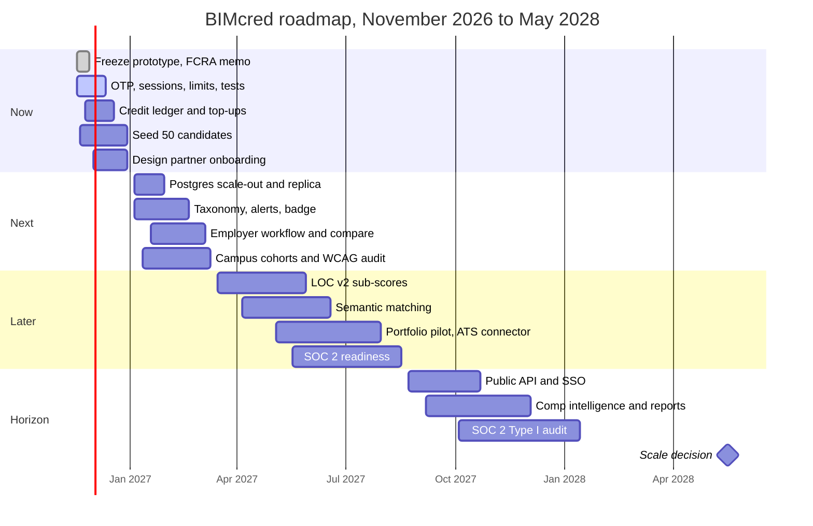

# BIMcred Roadmap

Status: first version, written 2026-11-17, reviewed every four weeks. Companion: `docs/05-future-improvements.md` holds the backlog; item IDs (`FI-xx`, `TD-xx`) refer to that file.

## 0. Operating assumptions

| Assumption | Value | Consequence if wrong |
| --- | --- | --- |
| Team | 2 full-stack engineers, 1 designer, 1 part-time BIM SME (2 days/week), founder on sales and supply | Each missing engineer removes one Later workstream, not one week |
| Budget | Hosting, domain, email, error tracking, one legal memo, a small campus incentive budget. No paid ads | Campus and referrals must carry acquisition; ads cannot compensate for a weak channel |
| Prototype | Three portals, 15-question LOC test, PostgreSQL on Neon free tier, cookie sessions, no tests, no queue, dev OTP | Phase 1 is partly hardening, not purely features |
| Market focus | US BIM practitioners, two metro areas where the founder and BIM SME have networks | Ten metros before ten employers makes supply impossible |
| Pricing | Trial $0 (10 credits), Starter $149, Growth $399, Enterprise $1,200 monthly; annual $119/$319/$960; 1 credit per first-time unlock | If credit burn is far below allowance, the ladder is overpriced; top-up data decides |
| Legal | The FCRA memo gates all employer-facing claims; no automated rejection before it lands | If the memo makes us a consumer reporting agency, scope for 18 months changes |

Realism note: the base case is 10 paying employers by week 16 and roughly $50,000 MRR by month 18. That is a small, defensible business, not a venture outlier. If employer conversion lands at 5 percent instead of 15 to 20 percent of qualified conversations, section 7.5 triggers a channel pivot rather than a quiet failure.

## 1. Phases at a glance

| Phase | Dates | Weeks | Goal | Exit gate |
| --- | --- | --- | --- | --- |
| Now | 2026-11-17 to 2026-12-29 | 0-6 | Private beta: 50 verified candidates, 3 design partners, money paths exercised | 50 verified, 3 activated employers, 1 paid invoice, legal memo received |
| Next | 2026-12-29 to 2027-03-09 | 6-16 | First revenue: 10 paying employers, 200 verified candidates, retention loop | 8 paying, $3,000 MRR, 150 verified, trial-to-paid above 15 percent |
| Later | 2027-03-09 to 2027-08-17 | 16-39 | Repeatability: LOC v2 sub-scores, employer workflow depth, semantic matching, first ATS | $12,000 MRR, net revenue retention at or above 100 percent, 2 ATS-connected accounts |
| Horizon | 2027-08-17 to 2028-05-17 | 39-78 | Enterprise readiness and data products, then a scale decision | $50,000 MRR, 120 accounts, SOC 2 Type I, raise or bootstrap decision |

## 2. Now: weeks 0-6, private beta

**Goal.** A beta that can take money without embarrassing us: 50 verified candidates in two metros, three design-partner employers using the product weekly, every revenue path exercised at least once.

**Scope.**

- Hardening: real OTP delivery with expiry and attempt limits (TD-03), edge and per-account rate limiting (FI-56, TD-04), session secret rotation (TD-09), CI with type checks and the first tests on the credit ledger and scoring (TD-06, TD-11).
- Revenue: idempotent credit ledger, top-up packs (FI-39), annual price surfaced at checkout (FI-40), plan-limit enforcement so Starter and Growth differ in product, not only on the pricing page.
- Trust: score receipt (FI-11), item exposure control (FI-03), proctoring-lite signals (FI-04), plain-language LOC explainer (FI-62), FCRA memo (FI-59), DPA template (FI-64).
- Supply: 50 verified candidates seeded through three partnerships (two campus programmes plus one AEC meetup), work-authorisation and relocation fields (FI-23), responsive assessment on a phone (FI-21 partial), integrity review queue.
- Demand: saved searches and digests (FI-25), salary band required on job posts (FI-15), clear upgrade moment at the filter wall.
- Operations: error tracking and traces (FI-54), backup and restore rehearsal (TD-08), seed data separated from real candidates (TD-12).

**Non-goals.** No public launch, SEO directory, portfolio review, API, ATS, semantic search, native app, multi-region, public sub-scores or sponsored placement.

**Resourcing.**

| Role | Weeks 0-2 | Weeks 3-4 | Weeks 5-6 |
| --- | --- | --- | --- |
| Engineer A | OTP, sessions, rate limits, CI | Credit ledger, top-ups, receipt | Backup drill, admin tooling, fixes |
| Engineer B | Plan enforcement, trial wall, salary bands | Saved searches, digests, mobile layout | Employer onboarding, analytics events |
| Designer | Pricing page, LOC explainer, receipt | Digest email, onboarding screens | Accessibility pass on candidate flow |
| BIM SME | Legal brief, 20 new items | Item review, calibration shadow run | Review first 50 disputes and flags |
| Founder | 3 design partners, 60-account list | Three campus conversations | Invoices, pricing interviews, beta review |

**Success metrics.**

| Metric | Threshold at week 6 |
| --- | --- |
| Verified candidates | 50 or more, at least 20 per metro |
| Assessment completion | 55 percent of started attempts |
| Design partners activated | 3 accounts with at least one unlock each |
| Paid invoices | 1 or more at any plan |
| Time to first unlock | Median under 45 minutes for design partners |
| Credit accounting errors | Zero duplicate or lost credits |
| Candidate complaint rate | Below 1 per 100 verified candidates |
| OTP abuse | No scripted send above 20 per hour per prefix |

**Risks.** OTP deliverability and cost (two providers, per-prefix budgets, manual review after two failures). Score disputes at low volume are a leading indicator of ambiguous items (review every dispute in week 5). Design partners asking for an ATS before we can build one (written "not before month 6" commitment, concierge push as a manual service). Legal memo late (beta proceeds, employer-facing predictive claims do not).

**Go/no-go at 2026-12-29.** Go if 50 verified candidates, 3 activated employers, at least 1 paid invoice, and a legal memo with a clear decision. Below 30 candidates: extend beta four weeks and narrow to one metro. Below 2 activated employers: the problem is the filter wall or the inventory, so the next phase starts with experiments E-01 and E-03 before new features.

## 3. Next: weeks 6-16, first revenue

**Goal.** Ten paying employers, 200 verified candidates, and employers returning in week four without being chased.

**Scope.**

- Data: move off the Neon free tier and add a read replica (FI-48) before the first campus cohort creates a write spike; baseline a migration history; taxonomy v1 (FI-36); salary band suggestions from real postings (FI-15).
- Candidate: public opt-in profile and SEO pages (FI-12), badge and LinkedIn share (FI-20), job alerts (FI-14), gap-driven roadmap for four roles (FI-17), two campus cohorts (FI-45, experiment E-02).
- Employer: team seats and notes (FI-27), compare view (FI-26), scheduling (FI-29), scorecards (FI-30), seat usage analytics (FI-32), hire-outcome capture (FI-37, collection only).
- Reliability: durable queue and outbox (FI-50), audit log (FI-57), portfolio image pipeline prepared but not launched (FI-55), WCAG 2.2 AA audit and critical fixes (FI-61).
- Commercial: annual contracts and procurement pack (FI-40), top-up price test, pricing page showing the annual saving computed from the catalogue.
- Experiments E-01, E-02 and E-03 with the decision rules already written in the backlog.

**Non-goals.** No ATS connectors, white-label, enterprise SSO, sponsored slots, agency accounts, semantic ranking in production, public sub-score claims, or a third metro.

**Resourcing.** Same team. About 30 percent of engineer A on the migration and 20 percent of engineer B on reliability. Designer owns accessibility and public profile templates. BIM SME owns taxonomy, item review and scorecard anchors. Founder runs E-01 and E-03, campus partnerships, and every employer conversation.

**Success metrics.**

| Metric | Threshold at week 16 |
| --- | --- |
| Verified candidates | 200, at least 60 from campus |
| Paying employers | 8 or more (base case 10) |
| Monthly recurring revenue | $3,000 or more |
| Trial-to-paid conversion | 15 percent or more of trials started after week 8 |
| Employer activation | 60 percent reach first unlock within 7 days |
| Week-4 paid retention | 80 percent of accounts active |
| Credits burned | 55 to 75 percent of allowance (outside this band the ladder is wrong) |
| Hire confirmations | 5 or more, even if informal |
| Zero-result searches | Below 30 percent of search sessions |
| Accessibility | No critical WCAG failures on candidate flows |

**Risks.** Migration during active use (weekend cutover, dual-write shadow, 14-day read-only snapshot). Campus supply arriving in a burst then stopping (two cohorts per programme per year, referrals held until week 12 so a weak channel is not masked). Workflow features built before employers ask (each item tied to a named design-partner request, anything else slips). Top-ups cannibalising upgrades (price at roughly 1.4x the Growth effective rate, review burn weekly). Founder becoming the onboarding bottleneck (E-03 exists to encode the script into the product by week 14).

**Go/no-go at 2027-03-09.** Go if 8 paying employers, $3,000 MRR, 150 verified candidates, trial-to-paid at or above 15 percent, and no more than one paying account lost. Below 5 paying employers: stop feature work for four weeks, run 30 employer interviews and a pricing test. Do not build LOC v2 on a product nobody buys.

## 4. Later: months 4-9, repeatability

**Goal.** The machine works without the founder in every conversation. Sub-scores make LOC useful for specialist hiring, semantic search closes the vocabulary gap, and the first ATS connector makes BIMcred part of the employer's process.

**Scope.**

- Assessment: adaptive selection in shadow mode (FI-01), continuous calibration (FI-02), LOC v2 with four discipline sub-scores as bands (FI-07). v1 scores are frozen and labelled; version handling is in scope, not an afterthought.
- Candidate: referral programme (FI-13), interview prep for four roles (FI-16), portfolio review pilot capped at 40 reviews (FI-08), compensation range on profiles where sample sizes allow (FI-38, labelled estimate).
- Employer: funnel and offer analytics (FI-31), talent pools with re-engagement (FI-33), one ATS connector chosen by demand (FI-28), semantic matching in a 50/50 test against filter-only search (FI-24, FI-49).
- Data: event pipeline (FI-51), outcome collection at scale (FI-37), first internal quarterly insight memo (FI-44, internal only).
- Trust: demographic collection with consent and an internal adverse-impact review (FI-58), state privacy matrix (FI-60), SOC 2 Type I readiness (FI-63, readiness only, audit in Horizon).
- Platform: feature flags in routine use (FI-52), outbox and scheduler hardened (FI-50), audit log exercised in a real security questionnaire (FI-57).

**Non-goals.** No multi-region, white-label, owned ATS or video, per-hire fee, course marketplace, native apps, a second engineer on SOC 2, or public sub-score percentile claims before cohorts exceed 30.

**Resourcing.** BIM SME rises to three days a week for portfolio review and sub-score authoring, funded by revenue. A contract privacy and accessibility review replaces the one-off audit. Engineer A owns search and data; engineer B owns workflow and ATS. Designer owns the sub-score report and compensation pages. Founder moves from onboarding calls to partner management and enterprise conversations.

**Success metrics.**

| Metric | Threshold at month 9 |
| --- | --- |
| Monthly recurring revenue | $12,000 |
| Paying accounts | 45 |
| Verified candidates | 500 |
| Net revenue retention | 100 percent or more |
| Trial-to-paid conversion | 22 percent |
| Searches using a sub-score | 25 percent or more |
| Semantic recall at 50 | 0.80 on the evaluation set |
| ATS-connected accounts | 2, with 15 percent of unlocks pushed within 24 hours |
| Portfolio reviews | 25 per month with reviewer hours under 20 per week |
| Candidate complaint rate | Below 1 per 100 verified candidates |
| Adverse-impact review | Completed with a named remediation owner |

**Risks.** Two score versions confuse employers (v2 additive and banded, v1 visible with an issue date, filters state the version). Semantic matching reproducing majority patterns (recall by discipline before launch, filter-only path retained, no pay-to-rank). Portfolio review becoming unpaid consulting (fixed rubric, 20-minute cap, weekly batch, waitlist instead of overtime). An ATS connector nobody uses (build only after three named employers commit to connecting within 30 days). SOC 2 with two engineers (readiness only, no audit until controls have run a quarter).

**Go/no-go at 2027-08-17.** Go to Horizon if $12,000 MRR, NRR at or above 100 percent, 2 live ATS connections, and sub-score adoption at 20 percent or more. Below $8,000 MRR: narrow to MEP subcontractors and VDC consultancies, drop portfolio review, postpone SOC 2. Below 90 percent NRR: retention is the problem, so Horizon enterprise work is cancelled until it is fixed.

## 5. Horizon: months 9-18, enterprise and a scale decision

**Goal.** Become buyable by a 1,000-person AEC firm, prove the data products are real, then decide whether to raise or run a profitable small company.

**Scope.**

- Enterprise surface: public API, webhooks and Slack or Teams alerts (FI-34), SSO and SCIM (FI-46), audit export (FI-57), SOC 2 Type I with the observation window actually run (FI-63).
- Data products: compensation intelligence published with sample sizes (FI-38), first external quarterly report (FI-44), hire-outcome benchmark for Growth and Enterprise.
- Monetisation tests: per-hire hybrid pilot capped at three accounts (FI-41), sponsored job slots tested for eight weeks (FI-42), white-label evaluated against one named licensee (FI-47), Enterprise pricing validated in three procurement cycles.
- Assessment depth: practical task sandbox co-funded by one design partner, three tasks only (FI-10); CPD ledger with a curated issuer whitelist (FI-09).
- Multi-region (FI-53) only if a signed deal requires EU residency; otherwise explicitly deferred.

**Non-goals.** No owned ATS, video interviewing, candidate fees, scraping, white-label at scale, native mobile app unless mobile-only candidates exceed 25 percent of verified supply, multi-region without a contract, or buying an audience.

**Resourcing.** A third engineer only after $30,000 MRR and only for platform or enterprise work. Founder on enterprise sales and partnerships. BIM SME becomes reviewer lead with a second contract reviewer. Design contractor for enterprise UI. Legal counsel on retainer for DPAs and the FCRA follow-up.

**Success metrics.**

| Metric | Threshold at month 18 |
| --- | --- |
| Monthly recurring revenue | $50,000 |
| Paying accounts | 120, at least 6 Enterprise |
| Verified candidates | 800 |
| Net revenue retention | 110 percent |
| Logo churn | Below 2 percent per month |
| Gross credit margin | Above 80 percent after infrastructure and review costs |
| Hire confirmations | 25 per month, 200 cumulative since launch |
| SOC 2 Type I | Report issued, no exceptions on access control |
| Enterprise pipeline | 5 qualified opportunities, 2 in procurement |
| API adoption | 8 accounts with active tokens |

**Risks.** Enterprise cycles dragging cash (annual prepayment required, no custom work without a signed order). SOC 2 cost and scope creep (fixed control set, one auditor, no ISO 27001 commitment without a deal requiring it). Hybrid pricing confusing the brand (three-account cap, never self-serve, publish terms). Sandbox becoming a maintenance trap (three tasks, partner-funded, kill at month 16 if usage is below 20 percent). Hiring ahead of revenue (hire only against a named trigger).

**Go/no-go at 2028-05-17.** Decision, not a launch. Raise a seed extension if MRR is at or above $50,000, growth is 8 percent or more month over month, and NRR is at or above 110 percent. Bootstrap if MRR is $35,000 to $50,000 with churn below 2 percent. Restructure below $25,000 MRR: reduce to the highest-retaining segment, cut enterprise scope, rebuild around the one workflow that retains.

## 6. Milestones and acceptance criteria

| ID | Date | Milestone | Acceptance criteria | Owner |
| --- | --- | --- | --- | --- |
| M1 | 2026-12-01 | Beta live with design partners | Three accounts log in with real OTP, search with filters, unlock with credits; no dev OTP in production; error tracking live | Engineer A |
| M2 | 2026-12-29 | Private beta exit | 50 verified candidates; 3 activated employers; 1 paid invoice; legal memo on file; restore drill passed | Founder |
| M3 | 2027-02-09 | Data foundation | Paid Postgres tier with replica and reviewed migrations; p95 writes under 200 ms; zero ledger discrepancies over 14 days | Engineer A |
| M4 | 2027-03-09 | First revenue gate | 8 paying employers (base case 10); $3,000 MRR; 200 verified; trial-to-paid 15 percent; WCAG critical issues closed | Founder |
| M5 | 2027-05-28 | LOC v2 GA | Sub-scores live for 4 disciplines with bands; no mixed-version filters; 25 percent of searches use a sub-score | BIM SME |
| M6 | 2027-08-17 | Repeatability gate | $12,000 MRR; 45 accounts; NRR 100 percent; 2 ATS connections; adverse-impact review completed | Founder |
| M7 | 2027-12-03 | Data products and enterprise | First external compensation report; 1 enterprise pilot in procurement; API live; SOC 2 controls running | Engineer B |
| M8 | 2028-05-17 | Scale decision | $50,000 MRR; 120 accounts; SOC 2 Type I issued; 8 API accounts; decision documented | Founder |

## 7. First 10 employers: acquisition plan

### 7.1 Target profile and list build

Ten paying employers by week 16 comes from 60 qualified accounts, built by hand in week 1 and refreshed weekly.

| Segment | Accounts | Profile | Why they buy |
| --- | --- | --- | --- |
| General contractors and construction managers | 20 | 500 to 5,000 employees, in-house VDC, 3 to 15 BIM hires a year | Continuous hiring; a bad coordinator is expensive to unwind |
| MEP subcontractors | 15 | 100 to 800 employees, coordination-heavy, 2 to 8 hires a year | Compete for the same coordinators with less brand reach |
| BIM and VDC consultancies | 15 | 20 to 150 employees, project staffing, 3 to 10 hires a year | Need a shortlist this week |
| Owner-operators and campus facilities | 10 | Hospitals, universities, transit agencies with BIM standards teams | Few hires but high standards and good case studies |

Qualification before an account enters the list: a person titled BIM manager or VDC lead, at least one BIM-related role posted in the last 12 months, US-based, and no exclusive staffing agreement covering all BIM roles. Sources: public trade rankings, association member directories, local BIM and Revit user group lists, the BIM SME network, and manual research on public postings. No scraping, no purchased lists, no mass email.

### 7.2 Offer ladder

1. 15-minute discovery call, no slides: which BIM roles are open, what a bad hire cost last time, who else screens candidates.
2. 30-minute working demo on one of their own open roles. We run the search live, hit the filter wall, and unlock one candidate on us.
3. 14-day Growth trial with 10 bonus credits and a concierge first search (E-03). Written success criteria: first unlock within 24 hours, one interview request within 14 days.
4. Design-partner terms for the first three: three months at the Starter price, a monthly 20-minute feedback call, permission for an anonymised case study, no auto-renew.
5. Standard plan afterwards, with the annual option at the catalogue discount for anyone mentioning procurement.

### 7.3 Outreach sequence

Three touches over ten days, then a 30-day pause. Every message references something specific and public about the account, which is why the daily volume is 25 accounts rather than 250.

**Email 1, subject "BIM coordinator hiring in [metro]".**

> Hi [name], I saw [company] is hiring a [role] in [city]. We run a verified skills assessment for BIM professionals and score them 100 to 500, so you can filter by coordination ability instead of keyword-matching CVs. There are [n] verified [discipline] candidates in [metro] this week. Worth a 15-minute call to see whether the pool is deep enough for your role? If not, I will not follow up. - [founder]

The count is pulled from the product the morning of sending. If it is under five, the email says so and asks whether they want to be told when the pool grows, which is a useful demand signal.

**Call opener, 20 seconds.**

> Hi [name], this is [founder] from BIMcred. I am not selling a job board. We score BIM candidates on a verified assessment and let you filter by discipline and competence band. I saw your [role] posting and wanted to check whether finding coordinators is actually hard right now, or under control.

**Follow-up email, one insight, no attachment.**

> One thing from our data this month: most [discipline] candidates in [metro] sit in the 300 to 360 band, and the ones above 400 are not looking. If your role needs above 400, the honest answer is that the pool is thin and you may need to grow someone. Happy to show the distribution for your role in 15 minutes.

Label any figure as "our data, small sample" unless it clears the reporting thresholds in the backlog. Do not send this follow-up until the distribution actually exists in the dashboard; an invented range is worse than no follow-up.

### 7.4 Objection handling

| Objection | Response |
| --- | --- |
| We already use LinkedIn | LinkedIn shows where someone worked, not whether they can run a coordination cycle. The trial is free with 10 unlocks; compare both shortlists on the same role. |
| The candidates will be juniors | Every profile shows years, discipline and sub-score bands. Filter to five or more years and show me a role where the shortlist is weak; that is the useful test. |
| $149 is too much for a small team | Starter is 25 first conversations a month. If you hire two BIM roles a year, the question is whether that saves one screening cycle. If not, do not buy it. |
| Send me some information | I will send a two-minute recording of your own role searched live, plus the matching candidate count. If the count is low, I will say so. |
| Not now, mid-project | Fair. I will check back in 60 days. Do you want the quarterly BIM salary summary when it exists? |

No discounting below list in the first two quarters. Discounts train the market and hide whether value is real.

### 7.5 Pipeline maths and the pivot rule

Base case for the first 60 accounts: 25 conversations, 12 demos, 8 trials, 3 paid. Two cohorts by week 16 gives 6 to 10 paying employers, which is why the gate asks for 8. These are planning assumptions, not measured history; the first 20 conversations replace them with real numbers. Weekly targets: 25 new contacts, 10 follow-ups, 4 conversations, 2 demos, 1 trial start. If after 30 qualified conversations demo-to-paid is below 15 percent, stop outreach and run ten structured interviews. If the answer is "we only hire through agencies", the pivot is to sell to those agencies under FI-35, not to discount direct employers.

## 8. First 200 verified candidates: supply plan

### 8.1 Channel mix

| Channel | Target verified | Effort | Why it works |
| --- | --- | --- | --- |
| Three university or AEC programme partnerships | 90 | High, needs a faculty champion | Students want a portable credential before graduation |
| Four local BIM and Revit meetups | 40 | Medium, evenings | A room of exactly the right people; a live demo converts |
| Referrals from the first 40 verified candidates | 30 | Low | Practitioners refer people like themselves |
| BIM SME network and targeted LinkedIn content | 25 | Medium | Credibility travels through a known practitioner |
| Community posts in BIM forums and Slack groups | 15 | Low | Value-first content, no spam |

Total 200 with a 10 percent buffer (planning assumption), because roughly one in ten completions fails phone verification or integrity review.

### 8.2 Channel playbooks

**University partnerships.** Approach the BIM or digital construction course lead with a specific offer: a free cohort report, no institutional ranking published, and a 25-minute assessment that fits one lecture slot. Students get a verified badge and a benchmark against early-career practitioners in their metro. Completion earns a fixed-value gift card from the marketing budget plus a portfolio review for the top ten. Recruit in September or January, run within four weeks, follow up with a cohort summary.

Student email, 110 words:

> Hi [name], I am [founder] from BIMcred. We built a verified skills assessment for BIM roles in the US, the kind of thing an employer can check instead of guessing from a CV. [programme] students can take it free this month and get a badge plus a comparison with early-career coordinators in [metro]. It takes 25 minutes and there is nothing to install. Your course lead [name] has the details. If you want the assessment without the badge, that is fine too; we never charge candidates.

**Meetups.** Ask the organiser for five minutes at the start. Put one assessment question on screen, take a show of hands, then reveal the answer and the reasoning. Offer a QR code for the full assessment and a printed one-page score report. The host gets an anonymised cohort summary.

Thirty-second pitch:

> One question, ten seconds. [question]. Most people hesitate on it, which is exactly why employers cannot tell from a CV who actually knows coordination. We score it, verify it, and let candidates keep the badge. Scan the code if you want to know where you land; 25 minutes, free.

**Referrals.** Only after a candidate is verified. Offer a fixed-value reward or a portfolio review, cap five rewards per person per quarter, and pay only after the referred candidate has been active for 14 days. No leaderboard, no gamification.

**BIM SME network.** Twenty personal invitations, each asking for two introductions rather than a broadcast: "we are calibrating the test against people who actually coordinate models, and I would value your read on whether the questions are fair".

**Communities.** Post the plain-language LOC explainer and the salary band methodology, answer questions for a week, keep the link in the profile. Ask moderators first. Never drop the same message into five groups.

### 8.3 Quality gates and anti-fraud

Every candidate passes US mobile verification with expiry and attempt limits, duplicate detection by phone and device signals, integrity review for flagged attempts (FI-04), and a consent screen covering outcome follow-up and public profile opt-in. Flagged attempts go to a human queue with a 48-hour service level; the candidate can retake after 30 days rather than being silently rejected. Target flag or rejection rate: under 8 percent of completions.

### 8.4 Weekly supply targets

Weeks 1-2: two meetups and three campus conversations, 15 completions. Weeks 3-6: first campus cohort and referral invites, 45 completions, 52 cumulative verified. Weeks 7-10: second cohort and community posts, 45 completions, 92 cumulative. Weeks 11-16: two more meetups, referrals compounding, third cohort, 120 completions, 200 cumulative. The plan is front-loaded with events because they are scheduled and predictable, and back-loaded with referrals because they only work once there is something to refer into.

## 9. Operating cadence

| When | Session | Output |
| --- | --- | --- |
| Monday 09:00 | Metrics review, 30 minutes | One decision per metric outside threshold, written in the log |
| Tuesday | Employer outreach block, two hours | 25 new contacts, 10 follow-ups logged |
| Wednesday | Campus office hours and candidate support | Completion blockers resolved, disputes answered |
| Thursday | Employer demos and design-partner calls | Two demos, one feedback note per call |
| Friday 15:00 | Ship and retro, 45 minutes | Release notes, one process change, debt item chosen |
| Monthly | Pricing and credit burn review | Ladder or top-up change only with data |
| Quarterly | Roadmap gate against phase metrics | Go, pivot or narrow, recorded with the date |

Dashboard, in order of attention: verified candidates this week, employer activations, credits burned versus allowance, trial-to-paid, week-4 retention, candidate complaints, error rate on unlock and payment paths. Everything else is a build-time detail.

## 10. Cross-phase risks

| Risk | Likelihood | Impact | Mitigation | Trigger to act |
| --- | --- | --- | --- | --- |
| Founder is the only salesperson and support person | High | High | Scripts, saved replies, one support block per day | Above 10 tickets a week |
| BIM SME time disappears | Medium | High | Two contract reviewers trained before month 6 | Review backlog above two weeks |
| Legal memo changes the product category | Low | High | No automated rejection or predictive claims until resolved | Any employer asks to auto-screen |
| Supply concentrated in two metros | High | Medium | Add a metro only with an employer sponsor and a meetup host | 60 percent of unlocks fail the location filter |
| Scoring credibility incident | Low | Very high | Receipt, dispute path, item retirement, published methodology | Any public accusation of bias or randomness |
| Pricing too cheap to fund the work | Medium | High | Top-up data, annual contracts, Enterprise tier | Gross margin below 70 percent for two months |
| Two engineers become a services team | Medium | High | Standard packages, integration cap, no custom builds | Any request above 40 engineering hours |

## 11. What would change this plan

Three events force a rewrite rather than a rescore. First, the FCRA memo concluding that a verified skills score used in hiring makes us a consumer reporting agency: that adds disclosure, dispute and accuracy obligations and reorders the Next phase. Second, an employer segment proving it will pay three times list for a workflow we have not built, which justifies narrowing the product rather than widening it. Third, a supply channel delivering 50 verified candidates a month without founder involvement, which would move the whole Later phase from acquisition to retention.

Until one of those happens the plan stays narrow: two metros, one assessment, one credit model, and a small number of employers who hire BIM roles often enough to care whether the score is real. The dates are explicit so a miss is visible, and the gates are numeric so a bad quarter is a conversation about evidence rather than optimism.
